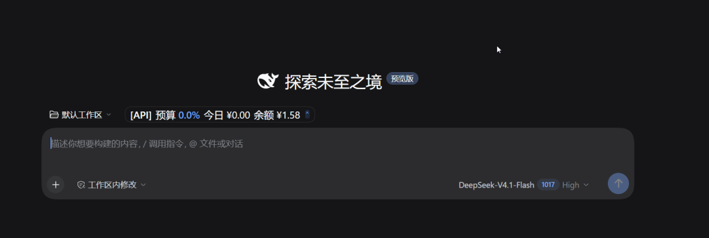
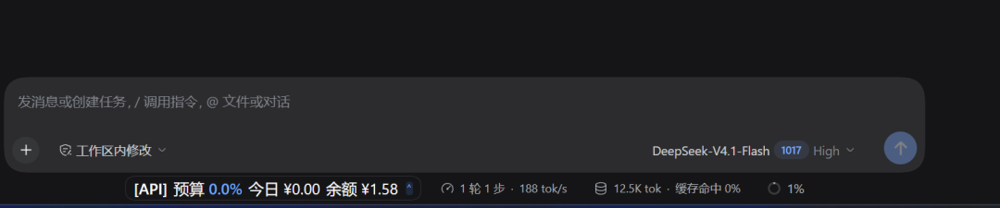
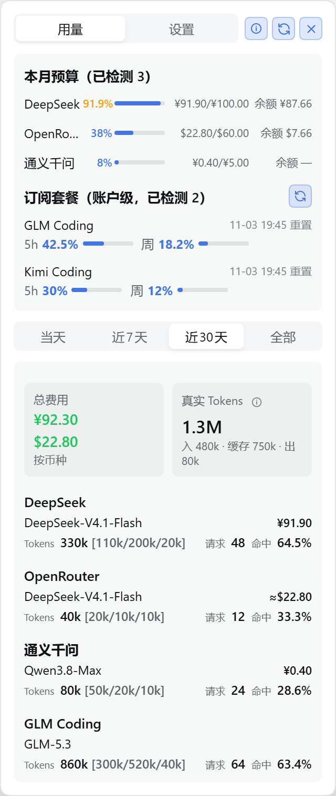
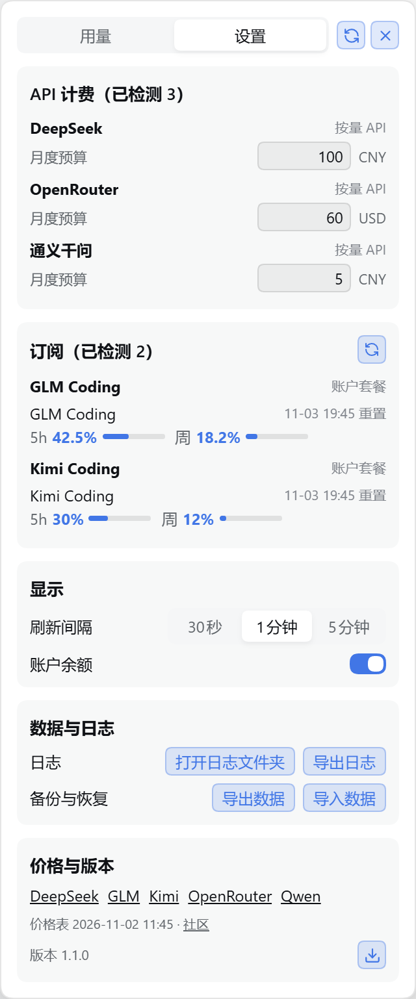

<h1 align="center">dsh-token-dash</h1>

<p align="center">
  <a href="./README.md">简体中文</a> | English
</p>

<p align="center">
  Track daily/monthly model spend and budget headroom right next to the DSH input box:<br />
  paste an API Key and the plan is auto-detected (subscription or pay-as-you-go), set a monthly budget, and consumption is estimated locally in real time;<br />
  export the current month as a backup and import it back after switching machines or reinstalling.
</p>

<p align="center">
  <a href="https://github.com/spartawhy117/dsh-token-dash/releases">Latest release</a> ·
  <a href="./CHANGELOG.md">Changelog</a> ·
  <a href="https://github.com/spartawhy117/dsh-token-dash/issues">Feedback</a>
</p>

<p align="center">
  
  
  
  
  
</p>

- **Providers**: DeepSeek (DS account / API key), GLM Coding (subscription), Kimi Coding (subscription), Kimi / OpenRouter / Qwen (pay-as-you-go; OpenRouter in USD, Qwen CNY domestic / USD international) — paste a key and the billing mode is detected automatically
- **Pages**: bottom bar Pill → floating dashboard (usage / settings tabs); click the pill to expand, click outside to collapse
- **Dashboard data**: time range (today / last 7 days / last 30 days / all), per-provider monthly budget progress (used / total / percent), today's spend, account balance, subscription 5h / weekly windows with reset times; two tiles for **total cost by currency** and **real Tokens (including cache read/write)**; per provider/model cost, requests and hit rate below
- **Settings**: per-provider monthly budget (with currency, defaults to 100 when empty), three refresh intervals, balance toggle, logs, data export / import, check for updates
- **Data**: daily / monthly usage estimated locally (built-in price catalog + community price table), three-layer model attribution, read-only local sessions; subscription models count toward Tokens but not cost, and the billing mode is pinned per key instead of following quota flakiness

---

## Install

Requires DSH `0.2.1` or newer. Three options:

```bash
# Option 1: install from npm (recommended)
dsh plugin --profile desktop add dsh-token-dash

# Option 2: install straight from the GitHub repo (plain JS, no build step)
dsh plugin --profile desktop add github:spartawhy117/dsh-token-dash

# Option 3: download dsh-token-dash-x.y.z.tgz from Releases and install locally (offline)
dsh plugin --profile desktop add /path/to/dsh-token-dash-1.1.0.tgz
```

Update: run `update` with the same name, or use the `⤓` button on the right of “Pricing & version” in settings. Remove: run `remove` with the same name; data stays in `$DSH_HOME/dsh-token-dash/`.

---

## Interface

Screenshots below use mock data so the full layout is visible at once:

**P1 · Bottom bar pill** (home workspace row / activity row under the chat input; click to open the panel, click outside or `×` to close)

<p align="center">
  
</p>

<p align="center">
  
</p>

**P2 · Floating dashboard (usage tab)**: monthly budgets and subscriptions, time range, two summary tiles, per-model breakdown

<p align="center">
  
</p>

**P3 · Settings tab**: API billing, subscriptions, display, data & logs, pricing & version

<p align="center">
  
</p>

---

## Logs & privacy

When filing a bug, attach `$DSH_HOME/logs/dsh-token-dash/` (already redacted). Error log entries carry `errorKind` (http/timeout/network/parse) and `httpStatus`, which usually pinpoints the cause:

```bash
npm run logs -- --tail 50                # tail recent logs
npm run logs -- --module slot,adapter.*  # filter by module
```

Reads only local session `usage` (title-generation overhead excluded); balances come from official endpoints only, with credentials resolved by the host and never written to disk; costs are local estimates — no billing requests are ever made.

Backups happen entirely on disk: `Export data` writes one JSON file (settings + current-month usage, without subscription quotas or balances), `Import data` only parses that file, and the existing files are backed up before the current month is overwritten. No network involved.

---

## Development

```bash
npm test      # unit tests
npm run e2e   # end-to-end (temp DSH_HOME + web profile + Playwright)
npm run shots # regenerate the P2/P3 screenshots in docs/pic from mock data (tools/mock)
npm run pack  # build the release tarball into build/
```

Releases: pushing a `v*` tag triggers the GitHub Release (tarball) and a direct npm publish automatically (Trusted Publishing via OIDC, with provenance — no manual approval step); see [docs/release.md](./docs/release.md) for the full checklist.

## Acknowledgements

Attribution and billing semantics learned from these community plugins:

- [dsh-cost-dashboard](https://github.com/mike-lee0120/dsh-cost-dashboard)
- [dsh-token-usage-lao](https://github.com/LaoYueHanNi/dsh-token-usage)
- [dsh-ui-usage-billing](https://github.com/kenz1117/dsh-ui-usage-billing)
- [dsh-spend](https://github.com/nonewind/dsh-spend)
- [dsh-stats-panel](https://github.com/zhang-jiazhi/dsh-stats-panel)
- [DshCockpit](https://github.com/Lxiayu/DshCockpit)
