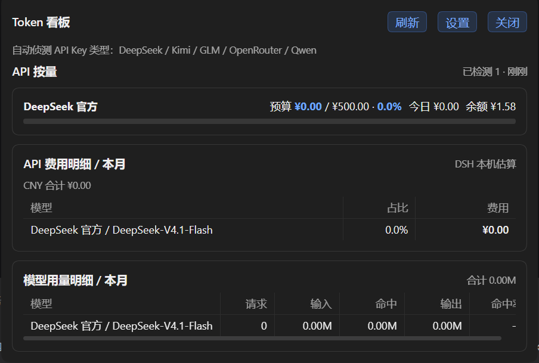
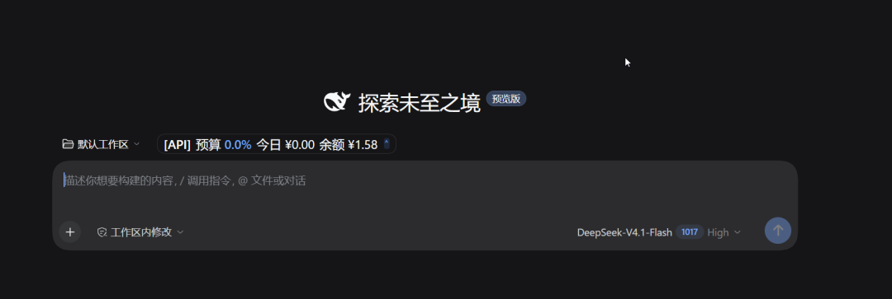
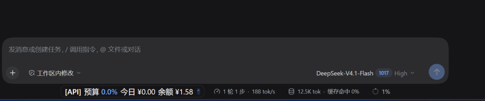
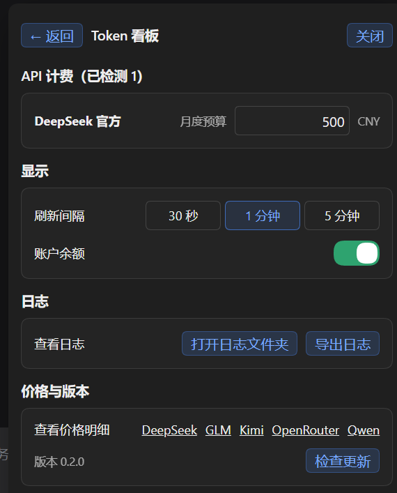

# dsh-token-dash

[](https://github.com/spartawhy117/dsh-token-dash/releases)
[](./LICENSE)


DSH 底栏 Token 看板：月度预算、订阅配额、账户余额、模型费用/用量明细与诊断日志，全程本地估算、只读本地数据。



## 功能特性

- **底栏 Pill**：预算%（状态色 <80% 主色 / 80~100% 橙 / ≥100% 红）、今日消费、账户余额；订阅显示 5h/周窗口与重置时间
- **浮层看板**：API 卡（独立预算 + 已用/总额 + 进度条）、订阅卡（套餐窗口/重置时间）、按币种分组费用明细（/ 本月）、模型用量明细（/ 本月）
- **设置视图**：月度预算（币种单位）、刷新间隔（30 秒/1 分钟/5 分钟）、账户余额开关、日志查看/导出、检查更新（确认 → 自动执行 → 完成提示）
- **自动侦测**：DeepSeek / Kimi / GLM / OpenRouter / Qwen——填了 Key 或登录 DS 账号即出现在看板
- **三层模型归属**：`message.source` → `request/header` → 模型名前缀，老数据也能正确归属
- **费用**：内置 catalog + 社区价格表，本地估算，不发起计费请求

## 界面预览

**P1 · 底栏 Pill**（首页工作区行 / 会话输入框下方活动行）




**P2 · 浮层看板**（费用与用量明细）


**P3 · 设置**



## 界面结构

```text
P1 · 底栏 Pill（点击展开看板）
┌──────────────────────────────────────────────────────────┐
│ [API] 预算 91.9% · 今日 ¥0.04 · 余额 ¥87.66 ⌃            │
└──────────────────────────────────────────────────────────┘

P2 · 浮层看板（pill 正上方弹出）
┌────────────────────────────────────────────────────────┐
│ Token 看板                          刷新  设置  关闭   │
│ API 按量                            已检测 2 · 刚刚    │
│ ┌──────────────────────────────────────────────────┐  │
│ │ DeepSeek 官方                                    │  │
│ │   预算 ¥79.13 / ¥95.80 · 91.9%                   │  │
│ │   [=====================================----]    │  │
│ └──────────────────────────────────────────────────┘  │
│ API 费用明细 / 本月                      DSH 本机估算 │
│ 模型用量明细 / 本月                        合计 1.28M │
└────────────────────────────────────────────────────────┘

P3 · 设置
┌──────────────────────────────────────────────────────────┐
│ ← 返回  Token 看板                                关闭   │
│ API 计费（已检测 2）                                     │
│   DeepSeek 官方     月度预算  [ 500.00 ]  CNY            │
│ 显示                                                     │
│   刷新间隔  [30 秒] [1 分钟] [5 分钟]                    │
│   账户余额                                          [开] │
│ 日志 · 查看日志（打开日志文件夹 / 导出日志）             │
│ 价格与版本 · 版本 1.0.0                     [检查更新]   │
└──────────────────────────────────────────────────────────┘
```

## 安装

Requires DSH `0.2.1` or newer. 两种方式任选：

**方式一：GitHub 仓库直装**（推荐，本插件纯 JavaScript 无构建，源码即产物）

```bash
dsh plugin --profile desktop add github:spartawhy117/dsh-token-dash
```

**方式二：Release 产物安装**（离线 / 网络受限场景）——从 [Releases](https://github.com/spartawhy117/dsh-token-dash/releases) 下载 `dsh-token-dash-x.y.z.tgz` 后：

```bash
dsh plugin --profile desktop add /path/to/dsh-token-dash-1.0.0.tgz
```

> 包声明了 `dsh.bundle`，`add` 会自动把插件接入 profile——安装即用，首次启动会自动回填安装前的历史会话数据。

## 更新

```bash
dsh plugin --profile desktop update github:spartawhy117/dsh-token-dash
```

也可以在插件设置页（P3 → 检查更新）内完成：发现新版本 → 确认 → 自动执行更新 → 重启生效。用方式二（tgz）安装的，重新下载新版 tgz 后 `add` 覆盖安装。

## 卸载

```bash
dsh plugin --profile desktop remove github:spartawhy117/dsh-token-dash
```

数据文件保留在 `$DSH_HOME/dsh-token-dash/`（消耗记录、预算与模式偏好），不再需要时手动删除。

> [!NOTE]
> npm 源安装将在后续版本提供。届时若从 `github:` 安装切换到 npm 包名，需要先 `remove` 旧名再 `add` 新名（不同安装名无法原地 `update`），数据不受影响。

## 使用说明

### 底栏 Pill

 Pill 常驻显示**当前对话供应商**的预算余量与账户余额，点击展开浮层看板，再次点击或点击浮层外任意位置收起。

### 浮层看板

- **API 按量**：每张卡显示预算进度（已用/总额 + 百分比着色）、今日消耗、账户余额；超过 3 个 provider 时区域内滚动
- **订阅套餐**：显示 5h/周窗口占用与重置时间，多订阅两列排布
- **费用/用量明细**：按币种分组的模型费用与 token 用量（含缓存命中），本月口径
- **重新检测**：只重查订阅配额（GLM / Kimi Coding），绕过缓存立即生效

### 设置

- **月度预算**：按 provider 独立设置，输入即保存（Enter / 失焦均生效）
- **刷新间隔**：30 秒 / 1 分钟 / 5 分钟三档，保存即生效
- **账户余额开关**：关闭后 Pill 不显示余额（看板明细仍显示）
- **检查更新**：发现新版本 → 确认 → 自动执行更新 → 提示重启

## 日志与排查

```bash
npm run logs -- --tail 50                    # 最近 50 条
npm run logs -- --module slot,adapter.*      # 按模块过滤（* 通配）
npm run logs -- --event mount                # 按事件名过滤
```

模块速查：`boot`（启动/配置）、`slot`（P1 挂载）、`adapter.*`（各 provider 请求与错误分类）、`pricing`（价格表）、`collect`（会话数据回填）、`vm`（看板聚合）、`update`（检查/安装）、`diag`（日志导出）、`route`（请求异常）。

提交 issue 时建议附上 `~/.dsh/logs/dsh-token-dash/` 目录（已脱敏：不含 Key、不含对话内容）——错误日志带 `errorKind`（http/timeout/network/parse）与 `httpStatus`，可直接定位原因。

## 数据与隐私

- 只读本地会话 `usage`，不统计标题生成开销
- 余额仅访问官方接口（DeepSeek / Kimi / OpenRouter），凭据经宿主解析，插件不落盘
- 费用为本地估算，不发起计费请求；不做系统级悬浮窗，只在 DSH 窗口内渲染
- 日志脱敏：不含 API Key、不含对话内容

## 开发

```bash
npm test          # 单元测试
npm run e2e       # 端到端（临时 DSH_HOME + web profile + Playwright）
npm run pack      # 生成发布 tarball 到 build/（不入库，.gitignore 已忽略）
dsh plugin --profile desktop add link:D:/MyProjects/dsh-tokenDash   # 本地开发安装
```

**版本发布**：更新 `package.json` 版本 → 提交 → `git tag v1.0.x` → push tag。`build/` 目录存放生成物（`npm pack` 的 tarball、未来的 release 资产），不纳入 git 管理；npm publish 流程后续接入。

## 致谢

归属与计费语义参考了社区同类插件的实践：

- [dsh-cost-dashboard](https://github.com/mike-lee0120/dsh-cost-dashboard)
- [dsh-token-usage-lao](https://github.com/LaoYueHanNi/dsh-token-usage)
- [dsh-ui-usage-billing](https://github.com/kenz1117/dsh-ui-usage-billing)
- [dsh-spend](https://github.com/nonewind/dsh-spend)
- [dsh-stats-panel](https://github.com/zhang-jiazhi/dsh-stats-panel)
- [DshCockpit](https://github.com/Lxiayu/DshCockpit)
