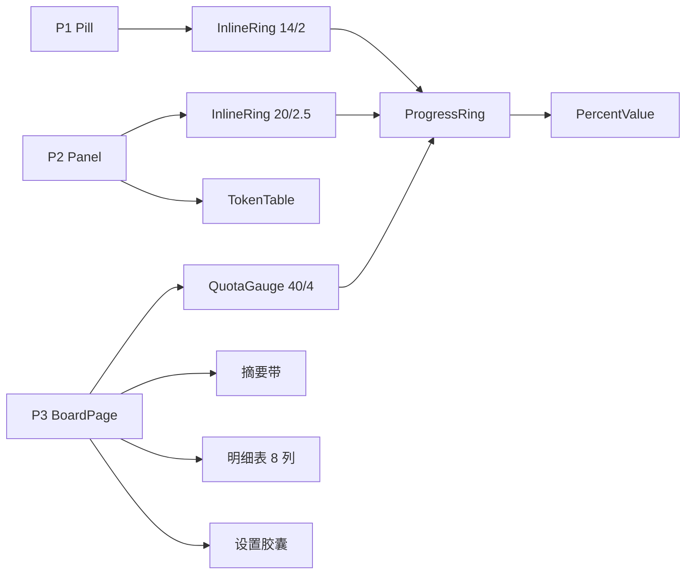

# Token 看板卡片化与三色环（前端重构）

> 状态：待验收（S0–S4 已完成，自动测试通过） 
> 创建时间：2026-11-04 
> 更新时间：2026-11-04（施工完成 + 截图重出） 
> 关联逻辑根：`dsh-token-dash`（`client.js`） 
> 关联资料：[`ui-design.md`](../../../ui-design.md)（v3.2）、走查清单 [`board-visual-review-checklist.md`](../../../checklist/active/board-visual-review-checklist.md)、施工稿 [`board-redesign-build-checklist.md`](../../../checklist/active/board-redesign-build-checklist.md)、原型 [`tools/preview/templates/`](../../../tools/preview/templates/)、历史方案 [`feature_fullpage_board.md`](../../archived/dsh/feature_fullpage_board.md)（已实施 `1.2.0-local.2`）

## 〇、前置事实

**现状**

- `client.js` 已有 `ProgressRing`（纯几何）、P1 `Pill`、P2 `Panel`、P3 `BoardPage`；环只画前景色，P3 两区仍是表格。
- 现有 e2e 断言基于表格结构（`token-dash-budget-row-*` / `token-dash-quota-*`），重构时需同批更新。
- `docs/pic/*.png` 是旧实现截图，重构完成后由 `npm run shots` 重出。

**不变的部分**

- 数据契约不变：`/summary`、`/usage`、`/prefs`、`/providers/refresh`、`/logs/meta`、`/open-in-app/open`。
- 路由与入口不变：`main` + `sidebar.panellist`，`key = token-dash`。
- 预算持久化不变：`PUT /prefs`，空值 = 未设置。

**设计与预览**

- 组件契约见 ui-design §2.5.1 / §2.5.4–2.5.6；页面原型见 `page-p1/p2/p3.html`。
- 预览只出 HTML（`.tmp/preview/*.html`），IDE 直接看；PNG 仅在需要静态图时加 `--png`。

## 一、需求

| ID | 优先级 | 需求 / 边界 / 风险 | 成功信号 |
|---|---|---|---|
| REQ-01 | P0 | 组件拆分：`ProgressRing`（几何）/ `PercentValue`（文本+颜色）/ `InlineRing`（P1/P2）/ `QuotaGauge`（P3） | 环不再持有数字；三处复用同一 `stateOf` / `percentText` |
| REQ-02 | P0 | 三色语义：normal 低饱和绿、warn 黄、critical 红；环与数字同色 | 三态与 `ring.html` 一致 |
| REQ-03 | P0 | 金额去绿：费用与金额改前景色 + 600，负数 / 超支红 | 全页无「绿金额」 |
| REQ-04 | P1 | P1：`InlineRing` 14/2，最多 3 窗，箭头改 SVG，空态 `--` | 与 `page-p1.html` 一致 |
| REQ-05 | P1 | P2：`fit-content` 280–480；按量四列主区；订阅三窗两行；表格补表头线与行分隔 + aria | 实测宽 ~365 / ~349，320px 不横滚 |
| REQ-06 | P0 | P3 按量区：每 provider 一卡，卡宽 ≤260、末行居中；卡内竖排 `QuotaGauge` → 预算输入 → 三行 | 3 家一行 3 张、520 两行 2+1 |
| REQ-07 | P0 | P3 订阅区：`auto-fit` 卡片；窗口一排；缺窗不出列；辅助 68% | 1000/760/520 = 4/3/2 列 |
| REQ-08 | P0 | P3 范围与明细：底框内「范围 + 摘要带 + 8 列明细」；摘要带两半居中、多币种同字号；窄屏内部滚动 | 与 `page-p3.html` 一致 |
| REQ-09 | P1 | P3 设置胶囊：三行 40px 标签；主按钮仅「立即刷新」；版本行收敛 | 三行左对齐成列 |
| REQ-10 | P1 | 响应式：页宽 `max-width 952`；订阅 4/3/2；整页无横向滚动 | 三档 `scrollWidth === clientWidth` |
| REQ-11 | P1 | E2E 同步：环色 = 数字色、内联结构、P2 宽度、单币种居中、胶囊三行 | `npm run e2e` 全绿 |
| REQ-12 | P2 | 文档与截图：README / README.en 文案与图片、CHANGELOG、`npm run shots` | 截图与实现一致 |
| BND-01 | 边界 | 不改数据接口、不新增 provider、不改预算持久化格式 | 前端只消费现有 VM |
| BND-02 | 边界 | 不改宿主槽位与入口机制（`main` / `sidebar.panellist`） | `key = token-dash` 不变 |
| BND-03 | 边界 | 不引入组件库或 CSS 框架，继续内联样式 + token | 依赖不新增 |
| BND-04 | 边界 | 不做主题切换、不做自定义配色 | 只消费宿主 token |
| RSK-01 | 风险 | 环色断言在亮 / 暗主题下取色不同 | e2e 只断言「环与数字同色」，不断言具体 hex |
| RSK-02 | 风险 | P2 `fit-content` 在长 provider 名下变宽 | 模型列 190px 截断 + `max-width 480` 兜底 |
| RSK-03 | 风险 | 卡片化改动面大，e2e 旧断言大量失效 | S0→S3 串行提交，每阶段可独立回滚 |
| RSK-04 | 风险 | 窄屏摘要带堆叠后过高 | ≤560 单列；明细内部滚动，不撑高页面 |

## 二、设计方案

### 2.1 结构

| 节点 | 所在端 | 职责 |
|---|---|---|
| `Pill` | P1 | `InlineRing` + 标签/金额；最多 3 窗 |
| `Panel` | P2 | 按量四列主区 / 订阅三窗两行；范围 + 用量表 + 底部 |
| `BoardPage` | P3 | 两区卡片网格；摘要带 + 明细底框；设置胶囊 |
| `ProgressRing` | 共用 | 只画弧：`{ percent, state, size, stroke }` |
| `PercentValue` | 共用 | 文本与状态色：`{ percent, state }` |
| `InlineRing` / `QuotaGauge` | 组合层 | 分别承担 P1/P2 内联、P3 堆叠排版 |

### 2.2 关键签名 / 字段

| 层 | 名称 | 备注 |
|---|---|---|
| 几何 | `ProgressRing({ percent, state, size, stroke })` | `state ∈ normal / warn / critical / empty`；`percent = 0` 与 `empty` 不画弧 |
| 文本 | `PercentValue({ percent, state })` | `42.5%` / `—`，与环同色 |
| 组合 | `InlineRing({ percent, state, size = 14, stroke = 2, text? })` | P1 14/2、P2 20/2.5；`text` 省略时用 `PercentValue` |
| 组合 | `QuotaGauge({ label, percent, state, remaining, relative, absolute, size = 40, stroke = 4 })` | P3 按量环心「已用」，订阅环心周期 |
| 公共 | `stateOf(percent, critical)` / `percentText(percent)` | 阈值 warn 80 / API 100 / 订阅 90 |

### 2.4 关键陷阱

| 项 | 约束 |
|---|---|
| 环与数字同色 | 不能只染数字；warn 时环也要变黄 |
| `percent = 0` | 不画弧，否则 round linecap 在起点留一个点 |
| 缺窗 | 按实际窗口数出列，不渲染 `月 —` 空列 |
| P2 宽度 | 由摘要 / 窗口行驱动；模型名 190px 截断，不撑宽面板 |
| 摘要带 | 两半居中；单币种居中；顶部行左对齐（不要混用居中） |

## 三、实现要点（待实施）

### 3.0 开发改动总览（计划）

| ID | 类型 | 文件 | 开发改动说明 |
|---|---|---|---|
| CHG-01 | 修改 | `client.js` · `ProgressRing` | 收窄为几何，去掉内部文字；新增 `stateOf` / `percentText` |
| CHG-02 | 新增 | `client.js` · `PercentValue` | 格式化 + 状态色 |
| CHG-03 | 新增 | `client.js` · `InlineRing` | 环 + 右侧数字，14/2 与 20/2.5 |
| CHG-04 | 新增 | `client.js` · `QuotaGauge` | 环 40/4 + 环心 + 百分比 + 三行辅助 |
| CHG-05 | 修改 | `client.js` · `Pill` | 改用 `InlineRing`；最多 3 窗；箭头 SVG；空态 `--` |
| CHG-06 | 修改 | `client.js` · `P2Summary` | 四列改用 `InlineRing(20/2.5)` + 标签 |
| CHG-07 | 修改 | `client.js` · `P2Windows` / `WindowRow` | 三窗两行：环行 + `剩余 · 倒计时` |
| CHG-08 | 修改 | `client.js` · `TokenTable` | 表头线 / 行高 28 / 6% 分隔 / aria；模型名 190px |
| CHG-09 | 修改 | `client.js` · `Panel` | 宽度 `fit-content` 280–480（320 可降到 260）；重定位保留 |
| CHG-10 | 修改 | `client.js` · `BudgetTable` | 改卡片网格（flex、上限 260、末行居中）；卡内竖排 |
| CHG-11 | 修改 | `client.js` · `QuotaTable` / `QuotaCell` | 改 `auto-fit` 卡片；窗口一排；缺窗不出列 |
| CHG-12 | 修改 | `client.js` · `RangeCards` / `DetailTable` | 范围 + 摘要带 + 明细合并底框；8 列 + 内部滚动 |
| CHG-13 | 修改 | `client.js` · `SettingsRows` | 三行标签 + 主/ghost 按钮 + 版本行收敛 |
| CHG-14 | 修改 | `client.js` · `BoardPage` | 整页 `max-width 952`；卡片 4/3/2 自适应 |
| CHG-15 | 修改 | `scripts/e2e.mjs` | 断言改卡片结构；新增环同色 / 单币种 / 胶囊 / 三档宽度 |
| CHG-16 | 修改 | `tools/mock/shots.mjs` | 截图适配新布局（P3 整页、P2 两形态） |
| CHG-17 | 修改 | `README.md` / `README.en.md` | 功能说明与截图替换 |
| CHG-18 | 修改 | `CHANGELOG.md` | 新增本地构建版本块 |

### 3.1 阶段与改动清单（待实施）

> 施工前按 CHG 逐条补 diff / 落点；当前为设计定稿阶段，未进入实施。

| 阶段 | CHG | 完成判据 |
|---|---|---|
| S0 组件层 | CHG-01 ~ 04 | 四组件可用；旧页面行为不变；`npm test` 绿 |
| S1 P1 | CHG-05 | 14/2、三色、最多 3 窗、SVG 箭头、空态 `--` |
| S2 P2 | CHG-06 ~ 09 | 四列 / 三窗两行；表格样式；`fit-content`；320 不横滚 |
| S3 P3 | CHG-10 ~ 14 | 两区卡片；摘要带 + 明细底框；三行胶囊；4/3/2 列 |
| S4 脚本与文档 | CHG-15 ~ 18 | e2e 全绿；`shots` 重出图；README / CHANGELOG 同步 |

## 四、不改动 / 边界

- `BND-01`：不改数据接口、provider 清单与预算持久化格式。
- `BND-02`：不改宿主槽位与入口（`main` / `sidebar.panellist`，`key = token-dash`）。
- `BND-03`：不引入组件库或 CSS 框架。
- `BND-04`：不做主题切换与自定义配色，只消费宿主 token。

## 五、验收要点

| 项 | 来源 | 验证方式 | 结果 |
|---|---|---|---|
| 三色环且环与数字同色 | REQ-02 / RSK-01 | 截图 + e2e 断言颜色相等 | 通过（e2e / 截图） |
| 四组件拆分、环不持有数字 | REQ-01 | 代码走查 + `InlineRing` DOM 结构 | 通过（e2e / 截图） |
| 金额无绿色、负数红 | REQ-03 | 截图 + 代码走查 | 通过（e2e / 截图） |
| P1 14/2、三窗、空态 | REQ-04 | 截图 + e2e | 通过（e2e / 截图） |
| P2 两形态、宽度 280–480、320 不横滚 | REQ-05 / RSK-02 | 截图 + 量宽 | 通过（e2e / 截图） |
| P3 按量 3 家一行、520 两行；竖排预算 | REQ-06 | 两档截图 + 改值重算 | 通过（e2e / 截图） |
| P3 订阅 4/3/2、缺窗不出列 | REQ-07 | 三档截图 | 通过（e2e / 截图） |
| 摘要带居中、单币种居中、顶部行左对齐 | REQ-08 | 两态截图 | 通过（e2e / 截图） |
| 胶囊三行标签对齐 | REQ-09 | 截图 | 通过（e2e / 截图） |
| 整页无横向滚动 | REQ-10 | `scrollWidth === clientWidth` | 通过（e2e / 截图） |
| e2e 全绿 | REQ-11 | `npm run e2e` | 通过（e2e / 截图） |
| README / CHANGELOG 同步 | REQ-12 | 目检 + `npm run shots` | 通过（e2e / 截图） |

## 六、文档回写

- 实施完成后：`ui-design.md` 状态由「待实施」改「已实现」；本 plan 移入 `docs/plan/archived/`。
- `board-redesign-build-checklist.md` 记录阶段进度与偏差。
- README / CHANGELOG 按 S4 落地。

## 九、自测反馈台

### Issue #1 · P2 浮层排版定稿（[已修复]）

> 范围：只改 P2；P3 保持现状。规则以 `tools/preview/templates/page-p2.html` 为唯一形态参考。

**定稿规则**

1. **宽度固定 380**：`width: 380px; max-width: calc(100vw - 16px)`，不再用 `fit-content`，避免切 provider / 金额变化时面板跳宽。
2. **头部**：标题左、三个图标右（`ⓘ ⟳ ×`）；图标按钮 22×22、圆角 6、accent 文字 + 16% 底 + 32% 边，gap 4。
3. **摘要单行四列**：`环(20/2.5) | 已用/预算 | 真实余额 | 本月已花`，`flex + space-between` 铺满；前三组左对齐，最后一组右对齐；标签 11px `label-secondary`，值 12px/600。
4. **时间范围条**：撑满内容宽（380 − 24 = 356），四段等分居中。
5. **订阅窗口三槽位**：`grid-template-columns: repeat(3, 1fr)`；第 1 窗左对齐、第 2 窗居中、第 3 窗右对齐；只有两窗时占用**前两个槽位**（左 / 中），不补空列、不把「周」推到右边；只有一窗时占左槽位；每窗两行：`周期 + 环 + %` / `剩余 N% · X 后`。
6. **用量表**：模型列 `max-width: 150px` + 省略号；列距 6；Tokens 括号 11px；表头右对齐；行高 28。
7. **底部**：「更新于 HH:mm」左；「全量看板」右，蓝色按钮（`styles.button`）。

> 风险：380 下若 Tokens 括号与模型名冲突，优先把括号降到 10.5px 或继续截断模型名，**不得为此加宽面板**。

**设计文档**

| 章节 | 改动 |
|---|---|
| `ui-design.md` §2 面板宽 | 由 `fit-content 280–480` 改为 `380 / max-width calc(100vw-16)` |
| `ui-design.md` §4.1 | 结构图改为「固定 380 + 单行摘要」，补订阅三槽位说明 |
| `ui-design.md` §4.2 | 宽度由 `fit-content 280–480` 改为 `380 / max-width calc(100vw-16)` |
| `ui-design.md` §4.3 | 四列改单行 `space-between`，最后一组右对齐 |
| `ui-design.md` §4.4 | 三窗左/中/右，两窗占前两槽位 |
| `ui-design.md` §4.5 | 模型列 150、列距 6、括号 11px |
| `ui-design.md` §8 | 窄屏按 `100vw - 16` 收缩，不再写 280–480 |

**代码落点**

| 文件 · 落点 | 改动 |
|---|---|
| `client.js` · `styles.panel` | 固定 380 + `max-width` |
| `client.js` · `styles.summaryRow` / `summaryCell` | 单行 `space-between`；最后一组右对齐 |
| `client.js` · `P2Summary` | 保持四组，环与三组同排 |
| `client.js` · `Panel` 范围容器 | 去掉 220 限宽，改 `width: 100%` |
| `client.js` · `P2Windows` / `WindowRow` | 三槽位 grid + 左/中/右；两窗用前两槽位 |
| `client.js` · `TokenTable` | 模型列 150、列距 6、括号 11px、表头右对齐 |
| `client.js` · `Panel` footer | 保持 `styles.button`，确认右侧贴边 |

**测试**

- e2e：
  - 头部存在三个图标按钮（`ⓘ / ⟳ / ×`），且都带 accent 色；
  - 面板宽度 = 380（360 视口下 ≤344）；
  - 摘要四组 `space-between`，最后一组右边缘与面板内容右边缘差 ≤1px；
  - 范围条宽度 ≥ 面板内容宽 − 2；
  - 三窗 provider：第 1/2/3 窗的 x 分别贴左、居中、贴右；
  - 两窗 provider：只有两个窗口，第二个居中，第三个槽位不存在；
  - 模型列 `scrollWidth > clientWidth` 时长名省略、`title` 为全名；
  - 底部「全量看板」为蓝色（`color` 含 accent token）。
- 模板：`npm run preview page-p2` 目检三块（按量 / 订阅三窗 / 订阅两窗）。

**实施顺序**

1. `styles.panel` 固定 380；`summaryRow` 单行不换行；范围容器撑满；
2. `P2Summary` 最后一组右对齐；
3. `P2Windows` 固定三槽位，`WindowRow` 按索引左/中/右；
4. `TokenTable` 模型列 150、列距 6、括号 11px；
5. 回写 `ui-design.md` §2 / §4 / §8；
6. e2e 补断言 → `npm test` / `npm run e2e` → 截图 → 打包。

**验证结果（2026-11-05）**

- `npm test`：75 通过 / 1 跳过；
- `npm run e2e`：通过，新增 380 宽度、范围条满宽、本月已花右对齐断言；
- 截图：单行摘要、满宽范围条、蓝色头部/底部按钮、长模型名截断；
- `ui-design.md` §2 / §4.1–4.5 / §8 已回写。

> 保留理由：该 Issue 同时承载设计回写、代码落点与测试用例，压缩为 6 行会丢失实施依据；按软目标保留。

**完成判据**

- 上述 e2e 断言全绿；
- `page-p2.html` 与实现截图逐项一致；
- `ui-design.md` §4 已按表回写；
- 版本记录进 `CHANGELOG.md` 后打包。
