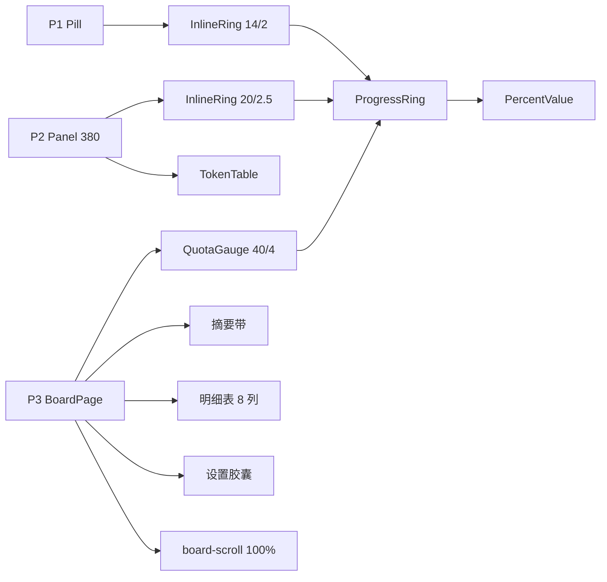

# Token 看板卡片化与三色环（前端重构）

> 状态：待验收<br>
> 完成时间：2026-11-05（2.0.0 候选；基线 `1.3.0`，未正式发布）<br>
> 关联逻辑根：`dsh-token-dash`（`client.js`）<br>
> 关联资料：[`ui-design.md`](../../../ui-design.md)（v3.4）、施工稿（已归档）[`board-redesign-build-checklist.md`](../../../checklist/archived/board-redesign-build-checklist.md)、设计决策（已归档）[`board-visual-review-checklist.md`](../../../checklist/archived/board-visual-review-checklist.md)、原型 [`tools/preview/templates/`](../../../../tools/preview/templates/)、历史方案 [`feature_fullpage_board.md`](../archived/dsh/feature_fullpage_board.md)

## 一、最终需求与范围

| ID | 最终处置 | 需求 / 边界 / 风险 | 最终结论或迁移去向 |
|---|---|---|---|
| REQ-01 | 完成 | 组件拆分：`ProgressRing` / `PercentValue` / `InlineRing` / `QuotaGauge` | 环只画几何，数字与文案归组合层，三处共用 `stateOf` / `percentText` |
| REQ-02 | 完成 | 三色语义：normal 绿、warn 黄、critical 红；环与数字同色 | 低饱和绿 `--td-state-ok`；warn 80、API 100、订阅 90 |
| REQ-03 | 完成 | 金额去绿，负数 / 超支红 | 金额改前景色 + 600，不再用 success 色 |
| REQ-04 | 完成 | P1：`InlineRing` 14/2，最多 3 窗，箭头 SVG，空态 `--` | 与 `page-p1.html` 一致 |
| REQ-05 | 完成 | P2：固定 380；摘要单行；范围条满宽；订阅三槽位；表格数值右对齐 | 后期反馈覆盖了原 `fit-content 280–480` 方案 |
| REQ-06 | 完成 | P3 按量区：每 provider 一卡，卡宽 ≤260、末行居中；竖排 Gauge → 预算 → 三行 | 3 家一行 3 张、520 两行 2+1 |
| REQ-07 | 完成 | P3 订阅区：`auto-fit` 卡片；窗口一排；缺窗不出列 | 1000/760/520 = 4/3/2 列 |
| REQ-08 | 完成 | 范围 + 摘要带 + 8 列明细合并底框；窄屏内部滚动 | 模型列 240、数值列 1fr、字号 13 |
| REQ-09 | 完成 | 设置胶囊三行标签；第一行刷新间隔 / 账户余额 | 后期去掉「立即刷新」，按钮统一蓝色 |
| REQ-10 | 完成 | 响应式：内容宽 1000 / 内容 952；整页无横向滚动；P3 自持纵向滚动 | `board-scroll` 100% + `overflow-y:auto` |
| REQ-11 | 完成 | E2E 同步：环同色、内联结构、P2 固定宽、右对齐、滚动、胶囊两组 | `npm run e2e` 全绿 |
| REQ-12 | 完成 | 文档与截图：README / README.en、CHANGELOG、`npm run shots` | 截图与实现一致 |
| BND-01 | 保持 | 不改数据接口、provider 清单与预算持久化格式 | 前端只消费现有 VM |
| BND-02 | 保持 | 不改宿主槽位与入口机制（`main` / `sidebar.panellist`） | `key = token-dash` 不变 |
| BND-03 | 保持 | 不引入组件库或 CSS 框架 | 内联样式 + token |
| BND-04 | 保持 | 不做主题切换与自定义配色 | 只消费宿主 token |
| RSK-01 | 已验证 | 环色断言在亮 / 暗主题下取色不同 | e2e 只断言「环与数字同色」，不断言 hex |
| RSK-02 | 已验证 | P2 长 provider 名撑宽 | 固定 380；模型列 150 + 省略号 |
| RSK-03 | 已验证 | 卡片化改动面大，旧 e2e 大量失效 | 按 S0→S4 串行，逐阶段回滚 |
| RSK-04 | 已验证 | 窄屏摘要带堆叠过高 | ≤560 单列；明细内部滚动 |

## 二、最终实现

### 3.0 最终改动总览

| ID | 类型 | 文件 | 开发改动说明 |
|---|---|---|---|
| CHG-01 | 修改 | `client.js` · `ProgressRing` / `stateOf` / `percentText` | 收窄为几何；统一三态与格式化 |
| CHG-02 | 新增 | `client.js` · `PercentValue` / `InlineRing` / `QuotaGauge` | 文本色、P1/P2 内联、P3 堆叠三种组合 |
| CHG-03 | 修改 | `client.js` · `Pill` | 改 `InlineRing`；最多 3 窗；SVG 箭头；空态 `--` |
| CHG-04 | 修改 | `client.js` · `Panel` / `PanelHeader` | 固定 380；头部 space-between；四列主区 + 满宽范围条 |
| CHG-05 | 修改 | `client.js` · `P2Summary` / `P2Windows` / `WindowRow` | 单行四列；订阅固定三槽位（左/中/右），两窗占前两槽 |
| CHG-06 | 修改 | `client.js` · `TokenTable` / `DetailTable` | 表头线、行高 28、6% 分隔、aria；数值列全部右对齐，列距 8 |
| CHG-07 | 修改 | `client.js` · `BudgetTable` | 卡片网格；竖排 Gauge + 常显预算 + 三行；Enter / 失焦 / Esc 规则 |
| CHG-08 | 修改 | `client.js` · `QuotaTable` / `QuotaCell` | `auto-fit` 卡片；窗口一排；缺窗不出列 |
| CHG-09 | 修改 | `client.js` · `RangeCards` / `DetailTable` | 摘要带 + 明细底框；总费用多币种 26px；模型列 240、数值 1fr/13px |
| CHG-10 | 修改 | `client.js` · `SettingsRows` | 三行标签；第一行只剩刷新间隔 / 账户余额；按钮蓝色 |
| CHG-11 | 修改 | `client.js` · `BoardPage` / `styles.boardScroll` | 外层自持滚动（100% + `overflow-y:auto`）；内层 1000 宽；页头两按钮 44×26 |
| CHG-12 | 修改 | `client.js` · `styles` / `EN` / `ZH` | 4px 间距六档、蓝色按钮、状态 caption、新词条 |
| CHG-13 | 修改 | `scripts/e2e.mjs` | 卡片结构、环同色、P2 固定 380、表头/数值右缘、胶囊两组、滚动、列宽/字号 |
| CHG-14 | 修改 | `tools/mock/fixtures.mjs` / `shots.mjs` | 七家 provider；新布局截图；胶囊静态化 |
| CHG-15 | 修改 | `README.md` / `README.en.md` / `docs/ui-design.md` / `docs/design.md` | 卡片、摘要带、三色环、间距、滚动说明同步 |
| CHG-16 | 修改 | `CHANGELOG.md` | 1.3.0-local.1 ~ local.7 变更块 |

### 2.1 最终结构



| 节点 | 职责 |
|---|---|
| `Pill` / `Panel` / `BoardPage` | 三页布局、取数、交互 |
| `ProgressRing` | 只画弧：`{ percent, state, size, stroke }` |
| `PercentValue` | `42.5%` / `—` 与状态色 |
| `InlineRing` / `QuotaGauge` | P1/P2 内联、P3 堆叠排版 |
| `stateOf` / `percentText` | 阈值与格式化唯一实现 |

### 2.2 关键决策与陷阱

| 项 | 最终结论 |
|---|---|
| P2 宽度 | **固定 380**（`max-width: calc(100vw - 16px)`）；不再 fit-content，避免切 provider 跳宽 |
| P2 摘要 | 单行四组 `space-between`；最后一组右对齐 |
| P2 订阅 | 固定三槽位：第 1 窗左、第 2 窗中、第 3 窗右；两窗占前两槽，一窗占左 |
| P2 表格 | 模型 150 + 省略号；Tokens 括号 11px；列距 8 |
| P3 明细 | 模型列 ≤240；7 个数值列 `minmax(56px,1fr)`；数值 13 / 表头 11；全右对齐 |
| P3 滚动 | `BoardPage` 外层 `board-scroll` 自持滚动，滚动条贴窗口右缘；不改宿主 `main` |
| 胶囊 | 三行 40px 标签；第一行只留刷新间隔（左）/ 账户余额（右）；按钮蓝色；底部 32 |
| 间距 | 4px 六档：4 / 8 / 12 / 16 / 24 / 32；1px 只给描边与分隔线 |
| 环 | `percent = 0` 与 `empty` 不画弧；warn 时环与数字同黄 |
| 缺窗 | 按实际窗口数出列，不渲染 `月 —` |

### 2.3 反馈收口（原 §九，已压缩）

| Issue | 结论 |
|---|---|
| #1 4px 间距 | 六档落地 `client.js`；表格列距归 #2、胶囊底部归 #3 |
| #2 表格右对齐 | P3 列距 12→8；P2 6→8 且 Tokens 补 `textAlign: right` |
| #3 P3 页头/胶囊 | 页头两按钮 44×26、标题与说明同行；胶囊三行、按钮蓝、底部 32 |
| #4 P3 滚动/列宽 | 去掉立即刷新；`board-scroll` 自持滚动；模型 240 + 数值 1fr/13px |

## 三、不改动 / 边界

- 不改数据接口、provider 清单与预算持久化格式。
- 不改宿主槽位与入口（`main` / `sidebar.panellist`，`key = token-dash`）。
- 不引入组件库 / CSS 框架；不引入构建链，`client.js` 仍是唯一产物。
- 不做主题切换与自定义配色，只消费宿主 token。

## 四、最终验收

| 项 | 方式 | 结果 |
|---|---|---|
| 组件拆分与环同色 | 代码走查 + e2e | 通过 |
| P1 14/2、三窗、空态 | e2e + 截图 | 通过 |
| P2 固定 380、单行摘要、满宽范围条 | e2e 量宽 + 截图 | 通过 |
| P3 卡片 4/3/2、缺窗不出列 | 三档截图 | 通过 |
| 摘要带 / 明细右对齐 | e2e 右缘断言 | 通过 |
| 胶囊两组、蓝色按钮、底部 32 | e2e 坐标 + 截图 | 通过 |
| P3 自持滚动 | `scrollHeight > clientHeight` | 通过 |
| 单测 / e2e | `npm test` / `npm run e2e` | 75 通过 / 1 跳过；e2e 通过 |
| 安装验证 | desktop profile | `1.3.0-local.7` 已安装 |

## 五、计划—实际偏差

```text
计划 P2 fit-content 280–480 → 实际固定 380（原因：宿主中栏窄，内容自适应导致右侧留白/跳宽）
计划 胶囊三组含「立即刷新」 → 实际两组（原因：刷新按钮冗余，间隔直接左对齐）
计划 明细模型列 1.6fr → 实际 ≤240 + 数值列 1fr（原因：模型名挤压数字，13px 仍显小）
计划 P3 由宿主中栏滚动 → 实际 BoardPage 自持滚动（原因：宿主 main 无可见滚动条）
```

## 六、关联资料

- 设计契约：[`ui-design.md`](../../../ui-design.md) v3.4
- 视觉决策：[`board-visual-review-checklist.md`](../../../checklist/archived/board-visual-review-checklist.md)
- 施工记录：[`board-redesign-build-checklist.md`](../../../checklist/archived/board-redesign-build-checklist.md)
- 原型：[`tools/preview/templates/`](../../../../tools/preview/templates/)
- 历史方案：[`feature_fullpage_board.md`](../archived/dsh/feature_fullpage_board.md)

## 九、自测反馈台

### Issue #5 · P2 按量摘要移除「本月已花」（[已修复]）

> 只改 P2 按量形态；订阅 P2、P3、预算与 VM 数据口径不动。

**现象**

- P2 按量摘要当前四组：环 + 已用/预算 + 真实余额 + 本月已花。
- 用户要求删除最后的「本月已花」，前面的槽位不变动。

**规则**

- P2 摘要保留前三组：`环+百分比 / 已用·预算 / 真实余额`；第四组不再渲染。
- 前三个槽位保持原顺序与列位置，尾部留空；不能把「真实余额」推到面板最右。
- 实现用 4 列网格 `auto 1fr 1fr 1fr`：前三列放三组，第四列空；列距 12、标签 11 / 值 12。
- 订阅 P2 不渲染摘要，不受影响；P3 卡片的「本月已花」保留。
- 删除 `token-dash-summary-month` 测试 id 与对应文案；`本月已花` 词条仍供 P3 使用，不能删。

**VM / 数据**

- **VM 不改**：P2 读 `provider.usage.monthCost`，但该字段同时供预算 `budget.used` 与 P3 卡片；删字段会破坏预算与 P3。
- `SummaryVM` 结构、`/summary`、`/usage` 均不变；本轮只删 P2 的一个渲染节点。

**设计文档**

| 章节 | 改动 |
|---|---|
| `ui-design.md` §4.1 | 结构图从四组改为三组，尾部留空 |
| `ui-design.md` §4.3 | 标题改「主区三列（尾部空槽）」；删除本月已花与右对齐规则 |
| `ui-design.md` §8 | 不改，仍为固定 380 |

**Preview**

- `tools/preview/templates/page-p2.html`：删除 `.summary` 第四组；`.summary` 改四列网格；`npm run preview page-p2` 重渲染并目检。

**代码**

| 落点 | 改动 |
|---|---|
| `client.js` · `P2Summary` | 删除 `token-dash-summary-month` 整个 span |
| `client.js` · `styles.summaryRow` | `flex space-between` → `grid-template-columns: auto 1fr 1fr 1fr`，列距 12 |
| `client.js` · 文案 | `本月已花` 词条保留（P3 仍在用） |
| `e2e` | 删除 month 断言；断言摘要仅 3 组、无「本月已花」、真实余额未贴右 |

**测试**

- e2e：`summaryRow` 不含「本月已花」；`token-dash-summary-month` 数量 0；前三个 `summaryCell` 存在；真实余额右边缘 < 面板右边缘 − 80；删除原来的 `monthBox` 右缘断言。
- `npm test`：VM / budget 断言不变，79 通过。
- `npm run e2e`：全绿。
- 截图：P2 按量面板与 `page-p2.html` 三组一致；P3 截图不受影响。

**验证结果（2026-11-05）**

- `npm test`：79 通过 / 0 失败；`npm run e2e`：UI assertions passed；
- P2 预览 `page-p2` 三组 + 尾部空槽；实际面板截图已重出；
- `docs/ui-design.md` v3.5、软件设计 v3.5；版本 2.0.0，未 tag / 未发布。

**版本与发布（用户 2026-11-05 追加约束）**

- 目标版本 **2.0.0**；CHANGELOG 以 1.3.0 正式块为基线，保持同样条目，追加本次 P2 摘要调整；不使用 1.3.1。
- **不正式发布**：不改 tag、不触发 `release` / `publish`、不 npm publish；只做提交、推送与 `npm run pack` 生成的 2.0.0 候选包。
- 完成后 `npm test` + `npm run e2e` + `npm run pack`，版本记录停在 2.0.0 待发布。
