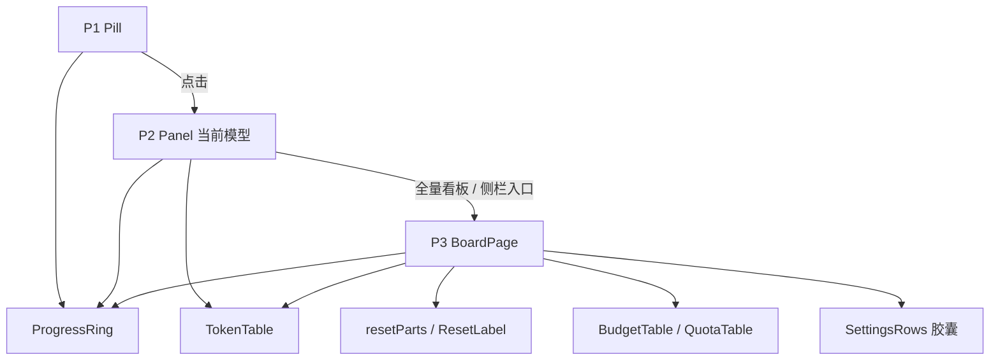

# Token 看板整页化与浮层收敛（前端）

> 状态：待验收（自动测试通过，人工走查项见 §五） 
> 创建时间：2026-11-04 
> 更新时间：2026-11-04（施工完成 + 精简；star chip 改纯跳转） 
> 关联逻辑根：`dsh-token-dash`（`client.js`） 
> 关联资料：[`ui-design.md`](../../../ui-design.md)（v3.1）、归档清单 [`ui-reference-checklist.md`](../../../checklist/archived/ui-reference-checklist.md)、[`backend-capability-checklist.md`](../../../checklist/archived/backend-capability-checklist.md)、施工稿 [`fullpage-board-build-checklist.md`](../../../checklist/active/fullpage-board-build-checklist.md)、后续走查 [`board-visual-review-checklist.md`](../../../checklist/active/board-visual-review-checklist.md)

## 〇、关键事实

**宿主机制**

- 整页走官方全局面板：`slots.inject('main', …)` 注册 `key = token-dash` 的页面，`sidebar.panellist` 注册同 `id` 的侧栏行；必须先 `inject` 再 `register`。
- `ctx.get('layout')` 暴露 `hasMainPanel / selectPanel / panelInfo`；**`selectPanel` 对未注册 key 直接抛错**，入口必须判空。
- 中栏 1280 视口下 1000px；滚动容器 `overflow:hidden`，`sticky bottom:12px` 仍生效（实测 `bottom=888`）。

**接口与数据**

- 现有：`GET /summary`、`GET /usage?range=`、`GET /prefs`、`PUT /prefs`、`POST /providers/refresh`、`GET /logs/meta`、`POST /open-in-app/open`。
- `currentProviderId = state.currentProvider ?? providers[0]`（账本值）；`/summary` 不读 `active`，投影链路依赖后端 B14。
- `budget.remaining` 后端已 `Math.max(0, …)`；计划余额必须前端自算才能显示负值。
- `/repo`（后端 B15）**不再需要**：star chip 只做 GitHub 跳转。

**测试与脚本**

- `scripts/e2e.mjs` 用真实宿主 + Playwright；headless 窗口无系统焦点，输入类断言走原生 setter + `KeyboardEvent`。
- `tools/mock/shots.mjs` 生成 README 截图；删双 tab 后改为截整页。

## 一、需求

| ID | 优先级 | 需求 | 成功信号 |
|---|---|---|---|
| REQ-01 | P0 | `ProgressRing`：P1 预算/订阅、P2 订阅、P3 已用共用 | 三处环几何与配色一致 |
| REQ-02 | P0 | `resetParts`：P2/P3 共用「相对时间 + 绝对时间」 | 两段同源同值 |
| REQ-03 | P0 | `TokenTable`：列宽自适应、Tokens 按「单位 / `[` 交界」对齐 | 多行 `[` 同一竖线 |
| REQ-04 | P0 | 新增 P3 整页：`main` + `sidebar.panellist` 同 key | 侧栏有入口，点击切整页 |
| REQ-05 | P1 | P1 百分比改「环 + 数字」；订阅 ≥90、API ≥100 转红 | 空环 / 满环 / `--` 三态正确 |
| REQ-06 | P1 | P2 收敛为「当前模型」四列（环+% / 已用·预算 / 真实余额 / 本月已花）+ 范围胶囊 + 用量表 + 全量看板 | 无进度条、无双 tab、无开关 |
| REQ-07 | P1 | P3 按量表四列：月度预算 / 已用（环+%） / 计划余额 / 真实余额 | 无「计费」「今日」列 |
| REQ-08 | P1 | P3 订阅表每窗两行：`环+%+剩余` / `倒计时 · 绝对时间` | 与 P2 字段一致，缺窗占位 |
| REQ-09 | P1 | 两格卡用卡片容器并与明细表分行；总费用多币种同行 | 两卡 gap 12、与表 16 |
| REQ-10 | P1 | 底部「设置与数据管理」三行 + sticky + 96px 留白 | 滚到底不遮挡 |
| REQ-11 | P2 | 预算就地编辑（只改数字） | 保存后环 / 已用% / 计划余额即时更新 |
| REQ-12 | P2 | 三路关闭：`×` / 点外部 / `Esc` | 任一方式都能关，焦点回 P1 |
| REQ-13 | P2 | P3 头部 GitHub 入口，**只做跳转**（新标签打开） | 恒显示 `★`，不请求 `/repo` |
| REQ-14 | P1 | P1 取值三级兜底：投影 → 默认模型 → 账本 | 切模型不发消息，Pill 立即跟随 |
| REQ-15 | P1 | 不可见不轮询、恢复可见立即刷新；开浮层按陈旧度补一次 | 回前台 1s 内更新 |
| REQ-16 | P2 | 容纳七家：两表各归其类；订阅最多 4 行；P1 最多三窗 | 不重叠、不截断 |
| REQ-17 | P0 | P3 自取数：`/summary` + `/usage` + `/prefs`，轮询 + 可见性暂停 + `⟳` 刷新 | 刷新保留旧数据，失败有 strip |
| REQ-18 | P1 | 脚本与文档同批：`shots.mjs` / README / design / i18n 词条 | `npm run shots` 可跑，英文无中文漏出 |
| BND-01 | 边界 | 不改 `src/` 与 `/summary` 契约；七家扩展归后端 B8–B13 | 前端只消费 VM |
| BND-02 | 边界 | 计费模式仍自动侦测，不提供切换 | 无下拉、无写接口 |
| BND-03 | 边界 | P2 不提供任何设置开关 | 设置只在 P3 胶囊 |
| BND-04 | 边界 | `MiniBar` 组件保留，仅停止调用 | 全局只剩组件定义 |
| BND-05 | 边界 | B14 未上线时前端降级到账本值，不造数 | 无 `active` 也正常显示 |
| RSK-01 | 风险 | `fit-content` 在 flex 内退化 `max-content` | 触顶 480 截断模型名 |
| RSK-02 | 风险 | 浮层与整页共用组件后 `Esc` 冲突 | 浮层打开时只关浮层 |
| RSK-03 | 风险 | `selectPanel` 未注册即抛错 | 入口先 `hasMainPanel` 判空 |

## 二、设计方案

### 2.1 结构

| 节点 | 职责 |
|---|---|
| P1 Pill | 当前 provider 概览；三级取值兜底；环 + 数字 |
| P2 Panel | 四列主区 + 范围胶囊 + 四列用量表 + 全量看板入口 |
| P3 BoardPage | 自取数；两张表 + 两格卡 + 八列明细 + 设置胶囊 |
| 共用件 | `ProgressRing` / `resetParts` / `TokenTable` / `usePolling` |

**流转**

| 转移 | 触发 | 动作 |
|---|---|---|
| T1 开浮层 | 点击 / Enter / Space | 渲染 Panel，按陈旧度补刷新 |
| T2 关浮层 | `×` / 外部 / `Esc` | 120ms 淡出后卸载，焦点回 Pill |
| T3 进整页 | 「全量看板」且 `hasMainPanel` | `layout.selectPanel(PAGE_ID)` |
| T4 进整页 | 侧栏条目 | 宿主切中栏 |
| T5 切 provider | 投影 / 默认模型 / 账本变化 | 重取 summary |
| T6 切范围 | 胶囊 | 保留旧数据至新数据到达 |
| T7 存预算 | Enter / 失焦；`Esc` 取消 | 本地即时回写环 / 已用% / 计划余额 |

### 2.2 关键签名

| 名称 | 说明 |
|---|---|
| `ProgressRing({ percent, state, size, stroke })` | `state ∈ normal / critical / empty`；P1 14/2、P2 20/2.5、P3 14/2 |
| `resetParts(ts, now?)` → `{ relative, absolute }` | 非法 `ts` 双 `null`；60min / 1440min 分界 |
| `ResetLabel({ ts, suffix })` | P2 带「重置」；P3 `suffix=''` |
| `TokenTable({ rows, maxRows, empty })` | 4 列；Tokens 两段对齐 |
| `BudgetTable({ providers, prefs, onSave })` | 四列；行内编辑；`prefs` 由 BoardPage 持有 |
| `usePolling(task, { refreshMs, enabled })` | 轮询 + `visibilitychange` 暂停 |
| `PAGE_ID = 'token-dash'` | `main.key` 与 `sidebar.panellist.id` 同值 |

### 2.3 数据约束

- `providers[].windows` 0–3 个，`key ∈ 5h/week/month`；缺窗不补占位对象（由 UI 占位）。
- `kind` 决定进哪张表；`billingModes = hide` 的 provider 两张表都不出现。
- 计划余额 = `budget.amount − budget.used`（前端算，可为负）；真实余额 = `balance`。

### 2.4 关键陷阱

| 项 | 约束 |
|---|---|
| `main` / `sidebar` 同 key | 不一致时宿主 `hasMainPanel` 校验失败 |
| `selectPanel` | 未注册 key 抛错；入口先判 `hasMainPanel` |
| `fit-content` 定位 | `measurePanel` 必须用面板实测宽度，不能用常量 360 |
| 环与数字 | 保留缺口 + `gap:6px`，99% 仍可分辨 |
| `Esc` 分层 | tooltip → 预算编辑 → 浮层，逐层消费；整页不接管 |
| 预算编辑保存 | 以输入框当前值为准（受控 state 可能滞后一帧） |
| 两格卡 | 两卡 gap 12，与明细表 16 |
| 家数 | 不写死，遍历 `providers[]` |

## 三、实现结果

### 3.0 阶段与改动总览

| 阶段 | 内容 | 结果 |
|---|---|---|
| S0 | `ProgressRing` / `resetParts` / `TokenTable` / 字号常量 | 完成 |
| S1 | 整页注册、BoardPage 取数、入口守卫、i18n | 完成 |
| S2 | 设置迁 P3 三行、`prefs` 上提、删 P2 双 tab | 完成 |
| S3 | P2 四列主区、订阅四段行、自适应定位、Esc | 完成 |
| S4 | 两张表、预算编辑、两格卡与明细、空态、star chip | 完成 |
| S5 | P1 环 / 三窗 / 三级取值 / 轮询节律 | 完成（投影未联调） |
| S6 | fixtures、shots、README / design / CHANGELOG | 完成 |

### 3.1 落地清单

| 文件 · 落点 | 内容 |
|---|---|
| `client.js` · `ProgressRing` | 14/20 两档、`state` 驱动弧色、零 hex |
| `client.js` · `resetParts` / `ResetLabel` | 拆两段；`suffix` 控制「重置」后缀 |
| `client.js` · `TokenTable` / `DetailTable` | 单网格 + `display:contents` 行，保证跨行列对齐；明细 8 列含费用 |
| `client.js` · `Pill` | `[API]` / `[订阅]` + 环 + 数字；订阅三窗；删单窗重置 |
| `client.js` · `rawActiveProvider` / `summaryPath` | 投影 → 默认模型 → 账本；`?active=` 透传 |
| `client.js` · `Panel` / `PanelHeader` | 删双 tab；四列主区 + 胶囊 + 用量表 + 全量看板；document 级 Esc |
| `client.js` · `P2Summary` / `P2Windows` / `WindowRow` | P2 四列与订阅四段行 |
| `client.js` · `BoardPage` | `/summary` + `/usage` + `/prefs` 自取数；轮询 / 可见性 / 刷新 / 错误 strip |
| `client.js` · `BudgetTable` | 四列 + 行内编辑（view / editing / error）；计划余额可负 |
| `client.js` · `QuotaTable` / `QuotaCell` | 每窗两行；缺窗三段 `—` |
| `client.js` · `RangeCards` | 两格卡（gap 12）+ 多币种同行 |
| `client.js` · `SettingsRows` | 三行：刷新与开关 / 日志与数据 / 价格与版本 |
| `client.js` · `BoardEntry` / `openBoardPage` | 侧栏入口与 `hasMainPanel` 守卫 |
| `client.js` · `EN` 词典 | 补新文案；停用双 tab 与旧标题词条 |
| `scripts/e2e.mjs` | 全量重写：P1/P2/P3、编辑、空态、窄屏、暗色；输入走原生 setter |
| `tools/mock/fixtures.mjs` | 七家（OpenCode Go 三窗 / Command Code 两窗 + credits） |
| `tools/mock/shots.mjs` | 截图：P2 按量 / 订阅两窗 / 订阅三窗、P3 整页；胶囊静态化 + 缩放 |
| `README.md` / `README.en.md` / `docs/design.md` / `docs/ui-design.md` | 页面形态与截图说明同步 |

### 3.2 实现决策（非显而易见项）

- 表格用「单网格 + `display:contents` 行」，避免每行独立 grid 导致列宽不一致。
- 预算提交读 `event.currentTarget.value`，不读 state；`Esc` 用 ref 标记跳过随后的 blur。
- `P3` 的 `prefs` 上提到 `BoardPage`，保存后就地重算 `summary.providers[id].budget`，不等轮询。
- `usePolling` 三处共用；`document.hidden` 时清定时器，恢复可见立即触发并重排。
- 浮层宽度自适应后 `panelShift` / 限高按面板实测矩形重算。
- star chip 只渲染 `★` 链接，不请求 `/repo`（原计划 B15 依赖作废）。

## 四、边界

- 不改 `src/`、`/summary` 契约与计费侦测；后端七家扩展与 `active` 由后端清单承担。
- 不改 `MiniBar` 组件本体；不改 `test/unit/*`（现有单测均为 host 侧）。
- 冲突先改文档再改代码。

## 五、验收

**自动测试（2026-11-04）**

- `npm test`：76 项，75 通过 / 1 跳过（local 版本跳过 Release notes）/ 0 失败。
- `npm run e2e`：通过。覆盖 P1 环与百分比、P2 自适应 280–480 与四列、P3 两表分流与四列数值、两卡 12/16 间距、预算编辑四场景、star chip 跳转、Esc 关闭、360 窄屏、暗色胶囊。
- `npm run shots`：三张截图可重新生成。

**未自动覆盖（人工走查）**

| 项 | 原因 |
|---|---|
| 切模型即时跟随 | 宿主 projection / 默认模型服务与 B14 未在测试环境提供，代码走账本兜底 |
| 隐藏态暂停轮询 | E2E 无法模拟 `document.hidden`，仅验证恢复可见立即刷新 |
| 七家实机布局 | 用七家 fixture 截图核对，未在真实账户下验证 |

**人工走查表**

| # | 场景 | 期望 |
|---|---|---|
| W1 | 首页无会话 | P1 用账本兜底，不闪 `--` |
| W2 | 切模型不发消息 | P1 立即跟随投影 |
| W3 | 三窗订阅 | P1 三窗全显；≤520 只留首窗 |
| W4 | 预算 99% | 环留缺口，红环红字不粘连 |
| W5 | 整页 760px | 按量表退化，订阅表横向滚动 |
| W6 | 整页滚到底 | 胶囊贴底，最后一行留 ≥24 |
| W7 | 只有订阅 | 按量计价整块不渲染 |
| W8 | 超支 | 计划余额负数并转红，环满圈 |
| W9 | star chip | 点击新标签打开 GitHub，无网络请求失败提示 |

## 六、决策

| # | 决策 |
|---|---|
| D1 | P2 宽度 `fit-content` 280–480；删进度条 |
| D2 | 计费模式只读，`hide` 两张表都不显示 |
| D3 | 底部胶囊 sticky + 96px 留白；矮视口 / 窄屏退化 static |
| D4 | 计划余额 = 预算 − 已用，可为负；真实余额独立 |
| D5 | P2 用量表只列当前 provider 的模型（D29 并入）；未命中回全量 |
| D6 | 订阅表只列能取到窗口的 provider；单窗缺失按位占位 |
| D7 | star chip 只做 GitHub 跳转，不请求 `/repo`、不显示计数 |
| D8 | P3 不接管 `Esc`；`Esc` 只关浮层 / 取消预算编辑 |
| D9 | 侧栏入口语言切换接受重启后生效（不引入 dispose 重注册） |
| D10 | 施工顺序：公共件 → P3 骨架 → 设置迁移 → P2 收敛 → P3 数据区 → P1 → 脚本与文档 |

## 七、自测反馈台

（暂无）
