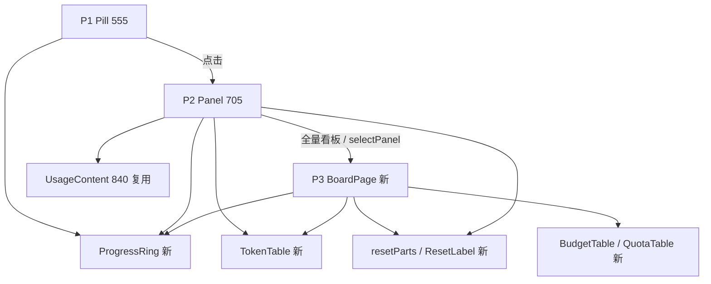

# Token 看板整页化与浮层收敛（前端）

> 状态：草案（已审阅，待批准施工）<br>
> 创建时间：2026-11-04<br>
> 更新时间：2026-11-04（第 2 版：代码 / 脚本二次复核，补齐 P3 取数、E2E 与截图脚本遗漏，重排执行顺序）<br>
> 关联逻辑根：`dsh-token-dash`（`client.js`）<br>
> 关联资料：[`ui-design.md`](../../../ui-design.md)（v3.1）、[`ui-reference-checklist.md`](../../../checklist/active/ui-reference-checklist.md)、[`backend-capability-checklist.md`](../../../checklist/active/backend-capability-checklist.md)

## 〇、前置依赖 / 代码探查事实

### 已明确

**入口与容器**

- 两个槽位在 `client.js` 的 `apply` 内注册：`conversation.hero.agentPreset`（1194）、`conversation.composer.dock`（1198）；`slots` 取自 `ctx.get('slots')`（1184）。（代码探查）
- P3 无现成入口，`grep slots.inject` 仅上述两处。（代码探查）
- 宿主全局面板可用：`ctx.get('layout')` 暴露 `panels / hasMainPanel / panelInfo / navigation / selectPanel`，`selectPanel('token-dash')` 实测可切页；`sidebar.panellist` 点击后中栏切整页。（2026-11-04 实测）
- 整页中栏 1280 视口下 1000px；P2 `fit-content` 实测 311.8px；中栏滚动容器 `overflow:hidden`（`scrollHeight 1389 / clientHeight 900`），`sticky bottom:12px` 生效（`bottom=888`）。（同上实测）

**现有组件与落点**

| 组件 / 函数 | 行 | 现状 |
|---|---|---|
| `MiniBar` | 506 | 48×4 条；`BudgetRow`(786) 用 stretch 满宽、`QuotaRow`(814) 用 48 宽 |
| `Pill` | 555 | P1；`getJson('/summary')`(576)、`/prefs`(588)、`POST /providers/refresh`(598) |
| `PanelHeader` | 682 | 带双 tab（`tab` / `onTab`） |
| `Panel` | 705 | 浮层；`getJson('/usage?range=')`(720) |
| `BudgetRow` | 772 | 预算行 + 满宽进度条 |
| `ResetLabel` | 790 | 共用重置块，内部走 `fmtReset` |
| `QuotaRow` | 797 | 订阅窗口 + `MiniBar`(814) |
| `DetailGroup` | 817 | 模型明细，行卡片 |
| `UsageContent` | 840 | 用量区（两格卡 + 明细） |
| `SettingsContent` | 910 | 设置五分区；`getJson('/prefs')`(923) |
| `fmtTokens` | 111 | `k/M/B`，1 位小数去 `.0` |
| `fmtReset` | 131 | 拼成 `3 小时后 · 11-03 20:15` 一整句 |
| `styles.panel` | 284 | `width: min(360px, 100vw-16px)` |
| `styles.budgetRow/Head` | 317/318 | 预算四列网格 |
| `styles.rangeCard/tile` | 322/323 | 两格卡容器（已有 tile 样式） |
| `styles.card` | 344 | 设置区卡片 |

**接口现状**

- `GET /summary`、`GET /usage?range=`、`GET /prefs`、`PUT /prefs`、`POST /providers/refresh`、`GET /logs/meta`、`POST /open-in-app/open`。（代码探查；设置写接口是 `PUT`，不是 `POST`）
- **无 `/repo`**：star chip 需新增路由（后端 B15），未上线前前端只渲染 `★`。（后端清单）
- **`/summary` 不读 `active`**：`index.js:281` 直接 `buildSummary`，`currentProviderId = state.currentProvider ?? providers[0]`（`src/core.js:609`）是账本值；投影 / 默认模型两层需前端接入，`?active=` 依赖后端 B14。（代码探查）
- `Esc` 仅 tooltip 的 `onKeyDown` 处理，浮层本体未监听；`×` 与点击外部已有。（代码探查）
- `visibilitychange` 与「打开浮层补刷新」均未实现（`grep` 计数 0）；P1 选 provider 只在 555 的 `Pill` 内按账本取。（代码探查）
- 宿主 `selectPanel` 对未注册的 key **直接抛错**（`layout.selectPanel: main panel "x" is not registered`）；「全量看板」必须先判 `hasMainPanel` 或 try/catch。（宿主 `LayoutController` 复核）
- `measurePanel`（610–617）用 `Math.min(360, innerWidth - 16)` 算 `panelShift` 与限高；`styles.panel` 改自适应后必须改用面板实测宽度，否则右缘溢出。（代码探查）

**后端与测试**

- 后端目标七家：现有五家 + OpenCode Go（三窗）+ Command Code（两窗 + credits），见 `backend-capability-checklist.md` B12/B13；P1 取值另需 B14（`active`），star chip 需 B15（`/repo`）。
- E2E 硬断言：面板宽 `≈360`（`scripts/e2e.mjs:227`）、预算条 `width ≥ 200`（316）、窄屏 `≤344`（490）；另有 `tab` 计数 6（282）、设置块 328–445、切回「用量」tab 447–450、暗色 tab 480–483 会随双 tab 取消失效。（代码探查）
- 截图脚本依赖设置 tab：`tools/mock/shots.mjs:142` 点「设置」、`:143` 等 `token-dash-settings`；取消 tab 后 `npm run shots` 必挂，`docs/pic/settings.png` 需换 P3。（代码探查）
- 单测不覆盖 UI：`test/unit/*` 只测 host 侧与 `locale/*.json` 键对等（`locale.test.mjs:8-23`），前端新增文案缺 EN 词条不会被测出，需人工核对。（代码探查）

### 待对齐

- `sidebar.panellist` 条目的语言切换重注册时机（现有 i18n 无 dispose）。
- 整页是否接管宿主 `Esc`（当前只在浮层用）。
- 七家后 P1 三窗在 12px 下的实际宽度，需实机量一次再定是否降两窗。
- P3 的 `dsh.client.inject` 是否需要新增 UI 包：临时插件实测已跑通，但 `package.json` 当前只 inject `conversation` / `settings`；施工时以实机为准，失败再补，不预改。

## 一、需求

| ID | 优先级 | 需求 / 边界 / 风险 | 成功信号 |
|---|---|---|---|
| REQ-01 | P0 | 抽 `ProgressRing`，P1 预算/订阅、P2 订阅、P3 已用共用 | 三处环几何与配色一致 |
| REQ-02 | P0 | 抽 `resetParts`，`resetLabel` / P2 / P3 共用两段式 | 「3 小时后」与「11-03 20:15」同源同值 |
| REQ-03 | P0 | 抽 `TokenTable`，列宽自适应、Tokens 按「单位 / `[` 交界」对齐 | 多行 `[` 同一竖线，切范围不抖动 |
| REQ-04 | P0 | 新增 P3 整页：`main` + `sidebar.panellist` 同 key | 侧栏出现入口，点击切整页 |
| REQ-05 | P1 | P1 百分比改「环 + 数字」；订阅 ≥90、API ≥100 转红 | 空环 / 满环 / `--` 三态正确 |
| REQ-06 | P1 | P2 收敛为「当前模型」：四列主区（`环+%` / `已用·预算` / `真实余额` / `本月已花`）+ 范围胶囊 + 用量表 + 全量看板 | 无进度条、无双 tab、无设置开关 |
| REQ-07 | P1 | P3 按量计价四列：月度预算 / 已用（环+%） / 计划余额 / 真实余额 | 无「计费」列、无「今日」列，两表按类型分流 |
| REQ-08 | P1 | P3 订阅表每窗两行：`环+已用%+剩余%` / `倒计时 · 绝对时间` | 与 P2 字段一致，缺窗两行都占位 |
| REQ-09 | P1 | P3 两格卡（总费用 / 真实 Tokens）用卡片容器，与明细表分行；总费用多币种**同行** | 两卡各有独立边框、gap 12，与表间距 16；`¥12.68  $19.00` 不折行 |
| REQ-10 | P1 | P3 底部「设置与数据管理」三行 + sticky + 96px 留白 | 滚到底不遮挡最后一行 |
| REQ-11 | P2 | P3 预算就地编辑（只改预算数字） | 保存后环、已用%、计划余额即时更新；超支时计划余额为负并转红 |
| REQ-12 | P2 | 三路关闭：`×` / 点外部 / `Esc` | 任一方式都能关，焦点回 P1 |
| REQ-13 | P2 | P3 头部 GitHub star chip（`★ 1.2k`，新标签打开） | `/repo` 未上线或失败时只渲染 `★`（可点、不报错） |
| REQ-14 | P1 | P1 取值三级兜底：投影 `next ?? lastUsed` → 默认模型 → 账本 | 切模型不发消息，Pill 立即跟随 |
| REQ-15 | P1 | 页面不可见不轮询、恢复可见立即刷新；打开浮层按陈旧度补一次 | 切后台 30s 回前台，1s 内更新 |
| REQ-16 | P2 | UI 容纳七家：两表各归其类；订阅最多 4 行；P1 最多三窗 | 七家 fixture 下不重叠、不截断 |
| REQ-17 | P0 | P3 自取数：`/summary` + `/usage` + `/prefs` 三路并发，按 `refreshMs` 轮询、不可见暂停、胶囊 `⟳` 立即刷新 | 进页 2s 内出数；刷新保留旧数据不闪空；失败有 strip + 重试 |
| REQ-18 | P1 | 脚本与文档同批：`shots.mjs` / `docs/pic` / `README` / `design.md` / `client.js` 头注释 / i18n 词条 | `npm run shots` 可跑；英文界面无中文漏出 |
| BND-01 | 边界 | 不改 `src/` 后端与 `/summary` 契约 | 前端只消费 VM |
| BND-02 | 边界 | 计费模式仍自动侦测，不提供切换 | 无下拉、无写接口 |
| BND-03 | 边界 | P2 不提供任何设置开关 | 设置只在 P3 胶囊 |
| BND-04 | 边界 | 不改 `MiniBar` 组件本身，仅停止在看板中使用 | 组件保留、无新调用 |
| RSK-01 | 风险 | `fit-content` 在 flex 容器内退化为 `max-content` | 触顶 480 截断模型名而非撑破 |
| RSK-02 | 风险 | 浮层与整页共用组件后 `Esc` 冲突 | 浮层打开时只关浮层 |
| RSK-03 | 风险 | `/repo` 未上线时 star chip 404 | 必须静默降级为 `★`，不报错 |
| RSK-04 | 风险 | `selectPanel` 对未注册 key 抛错，入口点击即崩 | 按钮先 `hasMainPanel` 判空，未注册时隐藏 |
| RSK-05 | 风险 | 删双 tab 连带 E2E 与截图脚本 8 处失效 | 断言迁移与功能同阶段完成，不集中到最后 |

## 二、设计方案

### 2.1 结构



| 节点 | 落点 | 职责 |
|---|---|---|
| P1 Pill | `Pill` 555 | 当前 provider 一眼扫；三级取值兜底 |
| P2 浮层 | `Panel` 705 / `PanelHeader` 682 | 当前模型：四列主区 + 窗口行 + 范围用量表 |
| P3 整页 | `apply` 1184 新增 `BoardPage` | 自取数（summary / usage / prefs）+ 七家全量 + 就地编辑 + 设置胶囊 |
| P3 按量计价 | `BudgetTable` 新 | 四列：月度预算 / 已用（环+%） / 计划余额 / 真实余额 |
| P3 订阅套餐 | `QuotaTable` 新（复用 `QuotaRow` 797 的重置逻辑） | 每窗两行 |
| 共用件 | `ProgressRing` / `resetParts` / `TokenTable` | 见 2.2 |

**流转表**

| 转移 | 求值位置 | 条件 | 动作 |
|---|---|---|---|
| T1 开浮层 | `Pill` onClick | 点击 / Enter / Space | 渲染 Panel，按陈旧度补刷新 |
| T2 关浮层 | Panel | `×` / 外部 / `Esc` | 120ms 淡出后卸载，焦点回 Pill |
| T3 进整页 | Panel 底部 | 点「全量看板」且 `hasMainPanel` | `layout.selectPanel(PAGE_ID)`；未注册时按钮不渲染 |
| T4 进整页 | 侧栏条目 | 点击 | 宿主切中栏，浮层不自动关 |
| T5 切 provider | Pill 576 | 投影 / 默认模型 / 账本变化 | 重取 summary，宽度 120ms 过渡 |
| T6 切范围 | Panel 720 / BoardPage | 胶囊点击 | 保留旧数据至新数据到达 |
| T7 存预算 | `BudgetTable`（原 `BudgetRow` 772） | Enter / 失焦保存；`Esc` 取消 | 本地即时更新环 / 已用% / 计划余额；失败回退原值 |

### 2.2 关键签名

| 层 | 名称 | 备注 |
|---|---|---|
| 组件 | `ProgressRing({ percent, state, size = 14, stroke = 2 })` | `state ∈ normal / critical / empty`；阈值调用方给；P1 14/2、P2 20/2.5、P3 14/2 |
| 函数 | `resetParts(ts, now?)` → `{ relative, absolute }` | 非法 `ts` 双 `null`；60min / 1440min 为分界 |
| 组件 | `ResetLabel({ ts, suffix = '重置' })` | P2 带「重置」；P3 传 `suffix=''` 只出两段 |
| 组件 | `TokenTable({ rows, maxRows = 5, empty })` | `minmax(0,1fr) auto auto auto`；无费用列；P3 明细另用 8 列变体 |
| 组件 | `BudgetTable({ providers, prefs, onSave })` | 四列；行内编辑；`prefs` 由 `BoardPage` 持有，保存后回写同源 |
| 组件 | `BoardPage({})` | P3 容器：`/summary` + `/usage` + `/prefs` 取数与轮询内置，子区块纯展示 |
| Hook | `useSummaryPolling({ active })` | `refreshMs` 轮询 + `visibilitychange` 暂停 + 打开浮层 `>5s` 补刷新 |
| 组件 | `RepoChip({ stars })` | `/repo` 失败只渲染 `★`；`<a target="_blank" rel="noopener">` |
| 常量 | `PAGE_ID = 'token-dash'` | `main.key` 与 `sidebar.panellist.id` 同值 |
| CSS 变量 | `--td-fs-pill` 12 / `--td-fs-body` 13 / `--td-fs-micro` 12；`--td-lh-*` | P1 用 pill 组，P2/P3 用 body 组 |
| 数据 | `providers[]`（只读） | 前端只遍历，不出现 provider id / URL |

### 2.3 数据约束

| 字段 | 约束 |
|---|---|
| `providers[].windows` | 0–3 个；`key ∈ 5h/week/month`；`usedPercent` 0–100 |
| `providers[].kind` | `api` / `subscription`，决定进哪张表 |
| 计划余额 | `预算 − 已用`，前端算，不读额外字段 |
| 真实余额 | 直接用 `balance`，与预算无关 |
| `probe.misses` | 空态原因唯一来源，缺失时退回单句 |

### 2.4 关键陷阱

| 项 | 约束 |
|---|---|
| `main` 与 `sidebar` 同 key | `sidebar.panellist.id` 必须等于 `main.key`，否则宿主校验失败 |
| `slots.inject` 顺序 | 先 `inject` 再 `register`，规避加载顺序 |
| `fit-content` 退化 | 外层 flex 下配 `min-width:280` + 内部 `minmax(0,1fr)` |
| `sticky` 前提 | 父级必须真的可滚动；宿主中栏 `overflow:hidden` 不影响 |
| 环与数字粘连 | 保留真实缺口、`gap:6px`，99% 仍可分辨 |
| `Esc` 冲突 | 浮层打开时优先关浮层，整页不响应 |
| 家数硬编码 | 不写「五家」循环或文案，一律遍历 `providers[]` |
| 订阅 4 行 | 行高与首屏按 4 行预留，不折叠 |
| `/repo` 404 | 捕获后只渲染 `★`，不弹错、不显示 `0` |
| 计划余额为负 | 超支时显示 `-¥2.68` 并转 `error` 色；**不夹到 0**，口径与「已用 > 预算」一致 |
| 整页 `Esc` | 整页不接管 `Esc`；只有浮层打开时响应，避免误退出 |
| 预算编辑 `Esc` | 编辑态 `Esc` 只取消编辑并回原值，不上抛成关浮层 |
| `selectPanel` 抛错 | 未注册 key 直接 throw；入口按钮先 `hasMainPanel` 判空 |
| 自适应定位 | `measurePanel` 改用面板实测宽度（观察面板自身），不再用常量 360 |
| 两格卡与表 | 两卡 gap 12；卡片与明细表分行，间距 16，不贴表头 |

## 三、实现要点

> 只写前端。后端能力（双 TTL、`probe`、源表、凭据两型、preflight、`/repo`、两家适配、`active`）见 `backend-capability-checklist.md` §1–§5。

### 3.0 执行顺序（施工阶段）

> 顺序原则：**公共件先定签名** → **先有 P3 骨架，再把设置搬走** → **再收敛 P2** → **再填 P3 数据区** → **P1 可并行** → **脚本与文档随阶段走**。每阶段结束必须 `npm test` 绿、`npm run e2e` 绿，不允许「设置暂时无处可去」这类中间态进主干。

| 阶段 | 目的 | 涉及 CHG | 完成判据 | 依赖 |
|---|---|---|---|---|
| S0 公共件 | 三个 P0 组件与字号 token 定稿，后三页只调用不改签名 | CHG-01 / 02 / 03 / 24 | `npm test` 绿；旧 UI 行为零变化 | 无 |
| S1 P3 骨架 | 整页可进、能取数、有状态行；区块内容先空着 | CHG-04 / 19 / 22 / 23 | 侧栏出入口，点开是中栏整页，`更新于` 与 `⟳` 可用 | S0 |
| S2 设置迁移 | 设置搬到 P3 胶囊，同批删 P2 双 tab（避免设置短暂消失） | CHG-10 / 20 / 06a / 17a | 三行设置可在 P3 操作；P2 头部只剩标题 + 三按钮 | S1 |
| S3 P2 收敛 | 四列主区、订阅窗口行、用量表、全量看板、自适应宽度、Esc | CHG-06b / 06c / 12 / 21 / 17b | 面板 280–480、无进度条、三路关闭 | S2 |
| S4 P3 数据区 | 两表 + 预算就地编辑 + 两格卡与明细 + star chip + 空态 | CHG-07 / 08 / 09 / 11 / 13 / 14 / 17c | 七家 fixture 下两表分流不重叠 | S2（不依赖 S3） |
| S5 P1 | 环、三窗、三级取值、轮询节律 | CHG-05 / 15 / 16 / 17d | P1 三态环正确、切模型即时跟随 | S0；B14 未上线时降级到账本 |
| S6 脚本与文档 | 截图脚本、fixture、README / design 同步 | CHG-18 / 25 / 26 | `npm run shots` 可跑，文档无「双 tab」残留 | S3 + S4 |

> S3 / S4 / S5 之间无文件级依赖：可按 S3 → S4 → S5 串行，也可在 S2 后并行推进；S6 必须最后。E2E 断言按阶段同步改（17a–17d），不留到最后一次性返工。
>
> 施工前先按 `docs/checklist/AGENTS.md` 建 `docs/checklist/active/dsh/` 施工稿（阶段与上表一一对应：S0–S6 各一节），经用户批准后再改代码。

### 3.0.1 改动总览（按阶段排序）

| ID | 阶段 | 类型 | 文件 · 落点 | 开发改动说明 | 优先级 |
|---|---|---|---|---|---|
| CHG-01 | S0 | 新增 | `client.js` · `styles` 之前 | `ProgressRing`：14/20 两档、`state` 驱动弧色、零 hex | P0 |
| CHG-02 | S0 | 修改 | `client.js` · `fmtReset` 131、`ResetLabel` 790 | 拆出 `resetParts`；`ResetLabel` 加 `suffix` 参数 | P0 |
| CHG-03 | S0 | 新增 | `client.js` · `DetailGroup` 817 附近 | `TokenTable`：列宽自适应、Tokens 两段对齐 | P0 |
| CHG-24 | S0 | 修改 | `client.js` · `styles` 269–348 | 落地 `--td-fs-*` / `--td-lh-*`，环尺寸与描边档位 | P1 |
| CHG-04 | S1 | 修改 | `client.js` · `apply` 1184 | 注册 `main` + `sidebar.panellist`（`PAGE_ID`），新增 `BoardPage` 空壳 | P0 |
| CHG-19 | S1 | 新增 | `client.js` · `BoardPage` 内 | 取数骨架：`/summary` + `/usage` + `/prefs` 并发、`refreshMs` 轮询、可见性暂停、`⟳` 刷新、`更新于`、失败保留旧数据 | P0 |
| CHG-22 | S1 | 修改 | `client.js` · `apply` 1184、P2 底部 | `hasMainPanel` 判空 + try/catch；未注册时按钮不渲染 | P0 |
| CHG-23 | S1 | 修改 | `client.js` · `EN` 23–80 | 补新文案 EN 词条；清理 `用量` / `设置` 旧键 | P1 |
| CHG-10 | S2 | 修改 | `client.js` · `SettingsContent` 910、`styles.card` 344 | 设置改三行 + 区块标题；sticky 与 96px 留白 | P1 |
| CHG-20 | S2 | 修改 | `client.js` · `BoardPage` / `SettingsContent` 910 | `prefs` 上提到 `BoardPage`，预算表与设置共用；保存后本地回写 + `onRefresh` | P0 |
| CHG-06a | S2 | 修改 | `client.js` · `PanelHeader` 682、`Panel` 705 | 删 `tab` / `onTab`，头部改「当前模型」+ 三按钮右对齐 | P1 |
| CHG-17a | S2 | 修改 | `scripts/e2e.mjs` · 328–445 | 设置断言迁 P3（先 `selectPanel` 再断言） | P0 |
| CHG-06b | S3 | 修改 | `client.js` · `UsageContent` 840、`styles.panel` 284 | 删进度条 / 今日-余额行；API 四列主区 + 范围胶囊 + 用量表 + 全量看板 | P1 |
| CHG-06c | S3 | 修改 | `client.js` · `UsageContent` 840 / `QuotaRow` 797 | P2 订阅主区改每窗四段行（环+% / 剩余 / 倒计时 / 绝对时间） | P1 |
| CHG-12 | S3 | 修改 | `client.js` · `Panel` 705 | 补 `document` 级 `Esc`；三路关闭 | P2 |
| CHG-21 | S3 | 修改 | `client.js` · `measurePanel` 610–617 | 按面板实测宽度重算 `panelShift` 与限高 | P0 |
| CHG-17b | S3 | 修改 | `scripts/e2e.mjs` · 227 / 282 / 302–325 / 365 / 368 / 487–493 | P2 相关断言改写（清单见 3.3） | P0 |
| CHG-07 | S4 | 新增 | `client.js` · `BoardPage` 内 | `BudgetTable` 四列（月度预算 / 已用环+% / 计划余额 / 真实余额） | P1 |
| CHG-08 | S4 | 新增 | `client.js` · 复用 `QuotaRow` 797 | `QuotaTable`：每窗两行，缺窗两行占位 | P1 |
| CHG-09 | S4 | 修改 | `client.js` · `DetailGroup` 817、`styles.rangeCard` 322 | 两格卡改卡片容器（gap 12）并与表分行（16）；明细 8 列含费用 | P1 |
| CHG-11 | S4 | 修改 | `client.js` · `BudgetTable`（原 `BudgetRow` 772）、`saveBudget` 954 | 行内编辑三态（✎ / Enter / 失焦 / `Esc` 取消 / 同时一行） | P2 |
| CHG-13 | S4 | 修改 | `client.js` · `BoardPage` | 空态按区块独立；只有一类时整块不渲染 | P2 |
| CHG-14 | S4 | 新增 | `client.js` · `BoardPage` 头部 | star chip：`getJson('/repo')`，`ok:false` / 404 / 抛错只渲染 `★` | P2 |
| CHG-17c | S4 | 修改 | `scripts/e2e.mjs` | 新增两表分流、两格卡间距、star chip 降级、超支负值断言 | P0 |
| CHG-05 | S5 | 修改 | `client.js` · `Pill` 555、`subscriptionNodes` 532 | P1 接环；去单窗「重置」；`slice(0,2)` → 三窗；阈值订阅 90 / API 100 | P1 |
| CHG-15 | S5 | 修改 | `client.js` · `Pill` 555 | 三级取值：投影 `next ?? lastUsed` → 默认模型 → 账本；`?active=` 透传（B14 未上线时静默降级） | P1 |
| CHG-16 | S5 | 修改 | `client.js` · `Pill` 576、`Panel` 720、`BoardPage` | `visibilitychange` 暂停/恢复；打开浮层按 >5s 补一次 | P1 |
| CHG-17d | S5 | 修改 | `scripts/e2e.mjs` | 新增 P1 三态环、可见性恢复、账本兜底断言 | P0 |
| CHG-18 | S6 | 修改 | `tools/mock/fixtures.mjs` | 七家 fixture（OpenCode 三窗 / Command Code 两窗）+ `本月已花` | P1 |
| CHG-25 | S6 | 修改 | `tools/mock/shots.mjs` 136–146、`docs/pic` | 设置截图改截 P3 整页；不再点 tab | P1 |
| CHG-26 | S6 | 修改 | `README.md` 33–83、`docs/design.md:143`、`client.js:3` | 文档与注释同步 v3.1（Panel 只 P2、BoardPage 为 P3） | P2 |

> `CHG-06` 拆成 a（删 tab）/ b（P2 布局）；`CHG-17` 拆成 a–d（分别对应 S2–S5 的断言改造）。施工时按拆分后的 ID 落 checklist。

### 3.1 改动清单（待实施）

> 小节顺序沿用原稿（按组件相邻性排列），**施工阶段以 3.0.1 的「阶段」列为准**；每个 CHG 都含「落点 / 做法 / 钩子（testid 或验收点）」三要素。

#### CHG-01 · `client.js` · ProgressRing

```diff
+ function ProgressRing({ percent, state = 'normal', size = 14, stroke = 2 }) {
+   const r = (size - stroke) / 2
+   const c = 2 * Math.PI * r
+   const arc = state === 'critical' ? 'var(--dsw-alias-state-error-primary)' : 'var(--dsw-alias-label-primary)'
+   return h('svg', { viewBox: `0 0 ${size} ${size}`, width: size, height: size, 'aria-hidden': true },
+     h('circle', { cx: size / 2, cy: size / 2, r, fill: 'none', stroke: 'var(--dsw-alias-border-l3)', strokeWidth: stroke }),
+     state === 'empty' ? null : h('circle', {
+       cx: size / 2, cy: size / 2, r, fill: 'none', stroke: arc, strokeWidth: stroke, strokeLinecap: 'round',
+       transform: `rotate(-90 ${size / 2} ${size / 2})`,
+       strokeDasharray: `${c * Math.min(100, Math.max(0, percent)) / 100} ${c}`,
+     }))
+ }
```

#### CHG-02 · `client.js` · resetParts

```diff
- const fmtReset = (ts) => { ... return `${relative} · ${absolute}` }
+ function resetParts(ts, now = Date.now()) {
+   if (!Number.isFinite(ts) || ts <= 0) return { relative: null, absolute: null }
+   ...
+   return { relative, absolute }
+ }
+ const fmtReset = (ts) => {
+   const { relative, absolute } = resetParts(ts)
+   return relative === null ? '—' : `${relative} · ${absolute}`
+ }
```

#### CHG-03 · `client.js` · TokenTable（S0）

```diff
+ function TokenTable({ rows, maxRows = 5, empty = tr('范围内暂无消耗') }) {
+   // 4 列：minmax(0,1fr) auto auto auto（模型 / Tokens / 请求 / 命中）
+ }
```

- Tokens 单元格拆两段：左段总量右对齐、右段 `[入/缓存/出]` 左对齐，两段同 baseline，`[` 落在固定竖线（对应 REQ-03）。
- 超过 `maxRows` 时容器内滚（`overflow:auto`），不截断、不加分页。
- `rows.length === 0` 时整块替换为 `empty`，不渲染表头。
- testid：`token-dash-token-table`、行 `token-dash-token-row-<providerId>-<modelId>`；P2 行仍保留 `token-dash-usage-line`（3.3 的保留断言依赖它）。
- P3 明细需 8 列，另写 `DetailTable`（CHG-09），不给本组件加列数分支。

#### CHG-24 · `client.js` · 字号与尺寸 token（S0）

```diff
+ const FS = { pill: 12, body: 13, micro: 12 }
+ const LH = { pill: 20, body: 24 }
```

- 落地方式：`styles` 内新增常量并替换现有散值（10.5 / 11 / 12 / 13）；仅「价格表来源行」保留 10px。
- 环不新增 token，尺寸/描边走 `ProgressRing` 入参（P1 14/2、P2 20/2.5、P3 14/2）。
- 只改本插件样式对象，不覆盖宿主 `--dsw-*` 变量，不新增 hex。

#### CHG-04 · `client.js` · 整页注册（`apply` 1184）

```diff
+ const PAGE_ID = 'token-dash'
+ const layout = ctx.get('layout')
+ const openBoard = () => {
+   if (layout?.hasMainPanel?.(PAGE_ID) !== true) return
+   try { layout.selectPanel(PAGE_ID) } catch { /* 宿主未注册时留在浮层 */ }
+ }
+ slots.inject('main', () => slots.register(
+   { name: 'main', key: PAGE_ID, label: tr('Token 看板') }, BoardPage))
+ slots.inject('sidebar.panellist', () => slots.register(
+   { name: 'sidebar.panellist', id: PAGE_ID, order: 6, label: tr('Token 看板') }, BoardEntry))
```

> `inject` 只用于宿主注入 props，不要写本插件不存在的标识（原稿的 `() => ({ call })` 会 `ReferenceError`）。

#### CHG-19 · `client.js` · BoardPage 取数骨架（S1 先落地）

```diff
+ function BoardPage() {
+   const [summary, setSummary] = useState(null)
+   const [usage, setUsage] = useState(null)
+   const [prefs, setPrefs] = useState(null)
+   const [range, setRange] = useState('all')
+   const [refreshing, setRefreshing] = useState(false)
+   const [error, setError] = useState(false)
+   const refresh = useCallback(async () => { /* summary + prefs 并发；usage 按 range */ }, [range])
+   // useSummaryPolling：refreshMs 轮询 + visibilitychange 暂停 + 失败保留旧数据
+ }
```

- 三路都要接：`/summary`、`/usage?range=`、`/prefs`；`/repo` 由 CHG-14 单独接，失败不影响页面。
- 状态行「更新于 HH:mm」取 `summary.updatedAt`；stale 判定沿用 `Panel` 现有口径（`refreshMs * 2`）。
- 失败时保留旧数据 + 顶部 strip + `重试`，不整页清空。

#### CHG-20 · `client.js` · prefs 归属与保存回写

- `prefs` / `savePrefs` 从 `SettingsContent`(910) 上提到 `BoardPage`，props 传给 `BudgetTable` 与 `SettingsContent`。
- 保存成功后：`setPrefs(saved)`，并就地把 `summary.providers[id].budget` 的 `amount / used / percent / state` 重算回写，不等下一轮轮询（REQ-11）。
- 保存失败：保留输入与错误提示，不改 `prefs`，避免「界面已改、后端未存」。

#### CHG-21 · `client.js` · 自适应宽度定位（与 CHG-06b 同批）

```diff
- const width = Math.min(360, window.innerWidth - 16)
+ const rect = panelRef.current?.getBoundingClientRect()
+ const width = Math.round(rect?.width ?? Math.min(360, window.innerWidth - 16))
```

- 面板宽度变化后由 `ResizeObserver` 观察**面板自身**触发重算，`panelShift` 仍按 `Math.min(0, innerWidth - 8 - rect.left - width)` 计算。

#### CHG-22 · `client.js` · 全量看板入口守卫

```diff
+ const canOpen = layout?.hasMainPanel?.(PAGE_ID) === true
+ canOpen ? h('button', { type: 'button', onClick: openBoard }, tr('全量看板')) : null
```

- 未注册时按钮直接不渲染（不置灰），避免给出无效入口。

#### CHG-23 · `client.js` · i18n 词条（S1）

- 新增键（`EN` 23–80 补对应英文，`ZH` 自动派生）：`全量看板`、`按量计价（按供应商）`、`订阅套餐（按供应商）`、`已用`、`计划余额`、`真实余额`、`剩余 {value}`、`设置与数据管理`、`更新于 {time}`、`未配置凭据`、`刷新中`、`退出编辑`。
- 停用键：`用量` / `设置`（双 tab 专用）、`订阅套餐（账户级）`、`本月预算`（P2 不再出现）。
- `locale/*.json` 与 `client.js` 内 `MESSAGES` 不是同一份（`index.js` 未引用 `locale/`）；本轮只改 `client.js`，并在 CHG-26 记录该结论，避免误改两份。
- 校验方式：切 EN 过 P1/P2/P3，搜中文残留（`npm test` 的 `locale.test.mjs` 只校验 `locale/*.json`，测不出漏词条）。

#### CHG-06b · `client.js` · P2 收敛

- `styles.panel`(284)：宽改自适应（与 CHG-21 必须同批，否则右缘溢出）。
- `PanelHeader`(682)：删 `tab` / `onTab`，按钮组右对齐（此段属 CHG-06a，S2 完成）。
- `UsageContent`(840)：删预算条（`MiniBar` 786 调用）与今日/余额组合行，改四列 grid。

```diff
- width: 'min(360px, calc(100vw - 16px))',
+ width: 'fit-content', minWidth: 280, maxWidth: 'min(480px, calc(100vw - 16px))',
```

- API 主区 `gridTemplateColumns: 'auto 1fr 1fr 1fr', columnGap: 8`：`环+%` / `已用 / 预算` / `真实余额` / `本月已花`；标签 400 + tertiary，数值 600。
- 用量表用 `TokenTable`，只喂当前 provider 的模型（D29：`providerId === currentProviderId`，未命中时回全量）。
- 底部左 `更新于 HH:mm`、右为 CHG-22 的「全量看板」按钮；两者共用同一右边界线。
- testid：`token-dash-summary-row`，列 `token-dash-summary-used` / `-balance` / `-month`。
- 删 `styles.budgetRow/Head`（317/318）与 `MiniBar` 调用（786）后，`MiniBar` 只剩组件定义（BND-04）。

#### CHG-06c · `client.js` · P2 订阅主区（S3）

- 结构：每窗一行 `grid-template-columns: auto 1fr 1fr 1fr`，四段分别是 `标签 + ProgressRing(20, 2.5) + 已用%` / `剩余 N%` / `倒计时` / `绝对时间`。
- 时间两段都取 `resetParts()`，**不带「重置」后缀**；缺窗三段 `—`、环 `state='empty'`。
- 可用宽 <320 时末列整体换行（沿用 2.4 陷阱），不截断金额与时间。
- 复用 `QuotaRow`(797) 的窗口遍历，但不复用它的 `MiniBar` 分支。
- testid：`token-dash-sub-window-<providerId>-<key>`，四段 `-used` / `-left` / `-rel` / `-abs`。

#### CHG-10 · `client.js` · 设置三行（S2）

```text
行 1  ⟳ 立即刷新   [30 秒 | 1 分钟 | 5 分钟]   账户余额 [switch]
行 2  打开日志文件夹  导出日志  导出数据  导入数据
行 3  价格表 <时间> · <来源> · 版本 <x.y.z>   ⤓ 检查更新
```

- 区块标题「设置与数据管理」；容器 testid `token-dash-settings` 保留，新增 `token-dash-settings-row-1/2/3`。
- 胶囊 sticky 由外壳承担：`position: sticky; bottom: 12px`，页面末尾 `padding-bottom: 96px`；视口高 <480 / 胶囊 >40vh / 宽 <760 时退化 `static`（ui-design §5.8）。
- 删除：`API 计费` / `订阅`（预算进按量表、窗口进订阅表）、`显示` 分区标题、价格外链整行。
- 保留 testid：`token-dash-refresh-segment`、`token-dash-log-open`、`token-dash-log-export`、`token-dash-data-export`、`token-dash-data-import`、`token-dash-update`、`token-dash-price-section`。
- 刷新按钮 `⟳` 直接调 CHG-19 的 `refresh()`，禁用态跟随 `refreshing`。

#### CHG-06a · `client.js` · 删双 tab（S2）

- `PanelHeader` 签名去掉 `tab` / `onTab`；左侧标题 `tr('当前模型')`（13px / 600），右侧 `ⓘ ⟳ ×`。
- 按钮组加 `marginInlineEnd: -5`，让图标视觉右缘与下方数据列对齐（ui-design §4.2）。
- 范围胶囊仍用 `Segmented` + `role=tablist`（4 项），删 tab 后 `getByRole('tab')` 计数应为 4。
- `Panel` 内 `tab` state 与 `SettingsContent` 分支一并删除；设置改由 `BoardPage` 渲染。

#### CHG-07 · `client.js` · BudgetTable

```diff
+ const COLS = '14ch 12ch 10ch 11ch 10ch'
+ h('div', { style: { display: 'grid', gridTemplateColumns: COLS, gap: 8 } },
+   h('span', null, tr('名称')), h('span', null, tr('月度预算')), h('span', null, tr('已用')),
+   h('span', null, tr('计划余额')), h('span', null, tr('真实余额')))
```

- 「已用」列 = `ProgressRing(14)` + `已用%`；计划余额 = `budget.amount − budget.used`（可为负，转 `error` 色），不读 `budget.remaining`（后端已夹到 0）。
- testid 按列给：`token-dash-budget-budget-<id>` / `-used-` / `-plan-` / `-balance-`，供 E2E 左缘对齐断言。

#### CHG-17 · `scripts/e2e.mjs` · 断言（拆 a–d，随阶段落）

```diff
- assert.ok(Math.abs(panelBox.width - 360) < 1, `panel width ... should be 360`)
+ assert.ok(panelBox.width >= 280 && panelBox.width <= 480, `panel width ... in 280..480`)
- assert.ok(barBox.width >= 200, 'budget bar should stretch')
+ assert.ok(summaryRow !== null, 'four-column summary row should exist')
- assert.equal(await panel.getByRole('tab').count(), 6) // 2 tabs + 4 range items
+ assert.equal(await panel.getByRole('tab').count(), 4) // 只剩 4 个范围项
```

> 完整清单见 3.3；a = 设置断言迁移，b = P2 布局断言，c = P3 新增断言，d = P1 新增断言。

#### CHG-08 · `client.js` · QuotaTable（S4）

- 每个订阅 provider 一块：首行 provider 名 + `[订阅]` chip，下面按 `windows[]` 顺序排窗口。
- 每窗两行：行 1 `ProgressRing(14) + 已用% + 剩余 N%`（环与数字同色，≥90 转红）；行 2 `倒计时 · 绝对时间`（`resetParts` 两段，无「重置」）。
- 缺窗分两种：provider 一个窗口都取不到 → 整行不进表（D7）；provider 有窗口但缺某窗（如缺 `month`）→ 按数组顺序占位，环 `state='empty'`、三段 `—`，保证多 provider 之间列对齐。
- 不复用 `QuotaRow` 的 `MiniBar` 分支；`QuotaRow` 在 P2 侧由 CHG-06c 接管，两处都不再调 `MiniBar`。
- testid：`token-dash-quota-table`、`token-dash-quota-row-<id>`、窗口 `token-dash-quota-cell-<id>-<key>`。

#### CHG-09 · `client.js` · 两格卡与明细表（S4）

- 卡片容器：圆角 8、`1px solid var(--dsw-alias-border-l3)`、padding 12、`bg-layer-1` 底；两卡 `grid-template-columns: 1fr 1fr; gap: 12`；与明细表 `marginTop: 16`。
- 总费用卡：多币种**同一行**（`gap: 8`，`¥12.68  $19.00`），不折行；单价种时单值。
- 真实 Tokens 卡：主值总量 + 副行 `输入 · 缓存 · 输出`；`ⓘ` 说明沿用 InfoTip inline 变体。
- 明细表 8 列：模型 / Tokens / 输入 / 缓存 / 输出 / 请求 / 命中 / 费用（API 计价估算）；订阅行费用列 `—`。
- 列宽 `minmax(0,1fr) auto × 7`；只列范围内有消耗的模型；行数不设上限（整页可滚动）。
- testid：`token-dash-range-cards`、`token-dash-detail-table`、行 `token-dash-detail-row-<providerId>-<modelId>`。

#### CHG-11 · `client.js` · 预算就地编辑（S4）

- 三态：`view`（数值 + `✎`）/ `editing`（input 自动聚焦）/ `error`（红框 + 提示，保持编辑态）。
- 进入：点数值或 `✎`；`editingId` 单值，切换行时先提交或取消上一行。
- 提交：Enter / 失焦；取消：`Esc` 回原值且不写接口（与 CHG-12 的浮层 `Esc` 隔离）。
- 校验与 CHG-20 一致（空串 = 未设置，写 0）；成功后由 `onSave` 走 CHG-20 回写环、已用%、计划余额。
- testid：保留 `token-dash-budget-input-<id>`（E2E 复用），新增 `token-dash-budget-edit-<id>` 触发按钮。

#### CHG-12 · `client.js` · 三路关闭（S3）

- `Panel` 挂 `document` 级 `keydown`，`Esc` 即关，不要求焦点在面板内；`×` 与点击外部沿用现有实现。
- 优先级：tooltip 展开时先由 `InfoTip` 自身 `onKeyDown` 关闭；预算编辑态 `Esc` 只取消编辑（CHG-11），不上抛。
- 关闭走 120ms 淡出（`opacity` + `translateY(4px)`）后卸载，焦点回 `pillRef`。
- 整页（P3）不监听 `Esc`（D20）；P3 离开靠侧栏切回会话。

#### CHG-13 · `client.js` · 空态与降级（S4）

- 按量表为空 → 整个区块（含标题）不渲染；订阅表为空同理（W8）。
- 两类都为空 → 一张空态卡：按 `probe.misses` 逐条列原因，字段缺失时退回单句「未检测到已配置供应商」。
- 范围无消耗 → 两格卡保留、明细表整块换 `范围内暂无消耗`，不渲染表头。
- 未配置凭据的 provider 不进表，原因只出现在空态卡（ui-design §5.9）。

#### CHG-14 · `client.js` · RepoChip（S4）

```diff
+ const stars = await getJson('/repo').then((data) => data?.stars ?? null).catch(() => null)
+ h('a', { href: REPO_URL, target: '_blank', rel: 'noopener', 'data-testid': 'token-dash-repo' },
+   stars === null ? '★' : `★ ${fmtTokens(stars)}`)
```

- 无论成功、404、`ok:false` 还是抛错，都渲染 `<a>`；取不到数字只显示 `★`（D16/D18）。
- 不轮询、不重试、不弹错；计数复用既有 `fmtTokens`（`1.2k` / `12k`），不新增格式化函数。

#### CHG-05 · `client.js` · P1 接环（S5）

- API 态：`[API] <预算标签> ◔ 12.3% 今日 ¥0.04 余额 ¥49.86`；订阅态：`[订阅] GLM 5h ◕ 42.5% 周 ◔ 18.2%`，最多三窗。
- 阈值：订阅 ≥90 → 环与数字同红；API ≥100 → 同红；80–100 只染数字、环保持中性（与 checklist §0.5.1 一致）。
- 删除：`subscriptionNodes` 的 `withReset` 分支（P1 不显示重置，checklist 第 12 轮）。
- 窗口数：`subscriptionNodes` / `subscriptionText` 的 `slice(0, 2)` → `slice(0, 3)`；仍超宽时按 D19 降两窗，不裁数字。
- 窄屏 ≤520：隐藏文字标签，只留环 + 数值。
- testid：`token-dash-pill-ring-budget`、`token-dash-pill-ring-<windowKey>`。

#### CHG-15 · `client.js` · P1 三级取值（S5）

- 会话内：slot props 的 `useProjection('modelSelection')`，取 `next ?? lastUsed`。
- 首页（hero 槽）：宿主默认模型 `agentDefaultModel.currentSelection()`。
- 兜底：账本 `summary.currentProviderId`。
- 三档都只把**原始字符串**透传给 `GET /summary?active=<raw>`，归一化在 host（B14）；不出现 provider id。
- 宿主服务缺失（无 projection / 无默认模型）时直接跳到下一档，不抛错。
- B14 未上线：后端忽略该参数，Pill 显示账本值，不报错、不空态（RSK-03 同类降级）。

#### CHG-16 · `client.js` · 轮询节律（S5）

```diff
+ function useSummaryPolling({ active = true, refreshMs, onTick }) {
+   // 可见：setInterval(refreshMs)；隐藏：clearInterval；恢复可见：立即 onTick() 并重排
+ }
```

- `document.addEventListener('visibilitychange')`；卸载时移除监听与定时器。
- 浮层打开时若 `Date.now() - summary.updatedAt > 5000` 立即补一次（F3）。
- P1 / P2 / P3 三处共用同一 hook，S1 的 `BoardPage` 先用内联实现占位，S5 收敛成 hook。

#### CHG-18 · `tools/mock/fixtures.mjs` · 七家 fixture（S6）

- 新增 `opencode-go`（`5h / week / month` 三窗）与 `command-code`（两窗 + `credits` 字段）。
- 每个 api provider 补 `usage.monthCost`（「本月已花」数据源）与 `budget.used`；窗口补 `resetAt`（用于倒计时/绝对时间）。
- `summary` / `summarySubOnly` 同步扩；`usageFor` 的 models 各加一条对应模型。
- 注意：`scripts/e2e.mjs` 内联 fixture 与 `tools/mock/fixtures.mjs` 是两份，本轮只改后者，e2e 侧改动归 CHG-17c。

#### CHG-25 · `tools/mock/shots.mjs` · 截图脚本（S6）

- 删除 `panel.getByRole('tab', { name: '设置' })`（142）与 `token-dash-settings` 等待（143）。
- 设置截图改为：`ctx.layout.selectPanel` 同款路径不可用时，点侧栏入口 → 等 `[data-testid=token-dash-board]` → 滚到顶截整页。
- 产物仍写 `docs/pic/settings.png`（文件名不变，README 图片链接无需改）。
- P2 截图在删 tab 后需重新裁切（`fit-content` 宽度变化），`panel-dashboard.png` 一并更新。

#### CHG-26 · 文档与注释同步（S6）

- `README.md:33-34`：删「用量 / 设置双 tab」，改「Pill → 浮层（当前模型）→ 侧栏入口 / 全量看板进入整页」。
- `README.md:79`：「P3 · 设置 tab」→「P3 · 整页看板」。
- `docs/design.md:143`：`client.js` 组成改为「Pill / Panel（P2）/ BoardPage（P3）/ 公共组件」。
- `docs/ui-design.md` §5.1 措辞与 D21 对齐（改为「当前接受重启后生效」），否则文档间自相矛盾。
- `client.js:3` 头注释 `docs/ui-design.md v2.21` → `v3.1`。
- `docs/design.md` 记录 `locale/*.json` 未被 `index.js` 引用的结论（CHG-23）。

### 3.2 与 checklist 改造点映射

| checklist | CHG | 阶段 | 说明 |
|---|---|---|---|
| F1 三路关闭 | CHG-12 | S3 | 只补 `Esc`；整页不接管 |
| F2 可见性轮询 / F3 打开补刷新 | CHG-16 | S5 | Pill / Panel / BoardPage 三处共用 `useSummaryPolling` |
| F4 取值三级兜底 | CHG-15 | S5 | 依赖 B14；未上线降级到账本 |
| F5 空态逐条原因 | CHG-13 | S4 | 依赖后端 `probe` |
| F6 进出动画 / F7 状态行 | CHG-06b / CHG-19 | S3 / S1 | 沿用现有淡出；「更新于」属 P3 取数骨架 |
| F8 窄屏断点 | CHG-13 / CHG-21 | S4 / S3 | P1 520 / P2 铺满 / P3 表格退化 |
| F9 状态聚合（可选） | — | — | 本轮不做，`aria` 与头部继续各写 |
| F10 P1 应用环 | CHG-05 | S5 | 预算与每窗 |
| F11 P3 整页 | CHG-04/19/07/08/09/10/20 | S1–S4 | 骨架取数 → 两表 → 卡与明细 → 胶囊 |
| F12 / F13 / F14 | CHG-01 / 02 / 03 | S0 | P0 前置 |
| 脚本与文档 | CHG-18 / 25 / 26 | S6 | 含 `shots.mjs` 与 README 截图 |

### 3.3 E2E 断言改造清单（CHG-17a–d 展开）

> 依据：逐行通读 `scripts/e2e.mjs`（176–500 行，已按现文件核对行号）。**新增组件必须沿用 `token-dash-*` testid 命名**，否则断言无从定位。断言改造与所属阶段同批提交，不留到最后。

#### 17a · 设置块迁移（S2）

| 行 | 现状 | 改为 |
|---|---|---|
| 328–331 | 点「设置」tab 后等 `token-dash-settings` | 先 `selectPanel('token-dash')`，等 `[data-testid=token-dash-board]` 与设置行 |
| 332 / 333 / 339 | 「API 计费」「订阅」「显示」标题 | 删除（设置改三行，预算与订阅已在两表；行 1 只留 `刷新间隔` + `账户余额`） |
| 335–338 | 「账户套餐」「5h」「周」「重置」负面断言 | 删除（P3 订阅表本就展示窗口；P2 已无设置区） |
| 340 / 341 | 「日志」「价格与版本」 | 保留（改断 `日志与数据` / `价格与版本`） |
| 344 / 345 | 「本月 Token」不存在、`select` 计数 0 | 保留，作用域换整页 |
| 348–352 | 刷新 segment `≤170` + 标签单行 | 迁 P3 行 1 后保留 |
| 357–364 | 日志区块在价格之上、`b` 单行、无 `<section>` | 改断三行顺序：行 1 → 行 2 → 行 3 |
| 367–368 | `price-links` 链接数 = 5 | 删除（价格外链整行去掉） |
| 371–375 | 价格表时间 / 社区链接 / 版本 | 保留（行 3） |
| 379–380 | 5 条链接同排 | 删除 |
| 401–428 | 预算输入 `token-dash-budget-input-*` | 改到 P3 按量表：点 `✎` 进入编辑后再输入；保留 `200.50` 保存、`-1` 报错、空值写 0 三条 |
| 431–445 | 日志 / 数据四按钮 | 迁 P3 行 2 后保留 testid |
| 447–450 | 点「用量」tab 切回、范围保留 | 删除（无 tab；改断 P2 关闭再开仍保留范围） |

#### 17b · P2 布局断言（S3）

| 行 | 现状 | 改为 |
|---|---|---|
| 227 | 面板宽 `≈360` | `280 ≤ width ≤ 480` |
| 228–231 | 「本月预算」「订阅套餐（账户级）」「¥12.34/¥100.00」「余额 ¥49.86」 | 前两条删除（迁 P3 为「按量计价（按供应商）」「订阅套餐（按供应商）」）；主区改断 `¥12.34 / ¥100.00` 与 `真实余额 ¥49.86`、`本月已花 ¥12.34` |
| 232–235 | 模型名 / `Tokens 320k [100k/200k/20k]` / `请求 12` / `命中` | 保留文案，容器换 `TokenTable`；`usage-line` testid 保留但结构变 grid |
| 236–238 | `usage-line` 单行不换行（`height < 24`） | 改断四列同一行、`TokenTable` 行高 ≤ 28 |
| 282 | `getByRole('tab').count() === 6` | 改 `4`（只剩范围胶囊） |
| 302–303 | `api-row-*` / `sub-row-*` 各 1 | 删除（P2 只留当前模型）；等价断言迁 P3 行 testid |
| 305–313 | 预算费用列 / 余额列左缘对齐 | 删除；改断 P3 四列左缘（`budget-budget-*` / `-used-` / `-plan-` / `-balance-`） |
| 316 | 预算条 `width ≥ 200` | 删除 |
| 317–318 | 重置文案 `(分钟后\|小时后\|天后) · MM-DD HH:mm 重置` | P2 订阅行拆两段：`3 小时后` 与 `11-03 20:15` 分列、同屏都有、无「重置」后缀 |
| 320–325 | 订阅窗口右端贴分区右缘 | 改四段均分、各段左缘对齐 |
| 365 | 支持图标 count = 0（设置 tab 下） | 删除（P2 恒显示 `ⓘ`） |
| 480–483 | 暗色下 `tab` 背景非白 | 改验环描边 / 胶囊背景取自宿主 token（非写死白） |
| 488–492 | 窄屏 `width ≤ 344` + 不越界 | 保留上限断言；删除「铺满 `≈344`」想法（`fit-content` 由内容决定，可能更窄）；493 无横向滚动保留 |

> 口径提醒：P2 主区四列是「环+% / 已用·预算 / 真实余额 / 本月已花」（`ui-design.md` §4.3），**不是** P3 的「月度预算 / 已用 / 计划余额 / 真实余额」；也不要按「已用 25%」断言——fixture 是 `12.34 / 100`，即 `12.3%`。
>
> 按 D29，P2 用量表只列 `currentProviderId` 的模型：mock 的 `currentProviderId = 'deepseek-official'`，所以表内只有 DeepSeek 那 1 行；若要断多行行为，需临时改 `currentProviderId` 或换 fixture。

#### 17c · P3 新增断言（S4）

| 场景 | 断言 |
|---|---|
| 进整页（侧栏） | 点侧栏条目后中栏出现 `[data-testid=token-dash-board]`；`PAGE_ID` 与侧栏项高亮一致 |
| 进整页（浮层） | 点「全量看板」后同上；`hasMainPanel` 为假时按钮不存在 |
| 两表分流 | 按量表行数 = API 家数、订阅表行数 = 订阅家数；两表 provider 名不重复 |
| 订阅每窗两行 | 第一行 `环 + 已用% + 剩余 N%`，第二行 `倒计时 · 绝对时间`；缺窗三段 `—` |
| 两格卡 | 两卡各自有边框、间距 12，卡片底边与明细表表头间距 ≥16 |
| 超支 | 预算调到小于已用后：计划余额为负、转 `error` 色、环满圈 |
| star chip 降级 | 拦截 `/repo` 返回 404 后 chip 只显示 `★` 且 `href` 存在 |
| 刷新与陈旧 | 点胶囊 `⟳` 触发一次 `/summary`；失败时旧数据保留 + strip + `重试` |

#### 17d · P1 新增断言（S5）

| 场景 | 断言 |
|---|---|
| 环三态 | 0%（空环）/ 25%（弧 1/4）/ 128%（满环转红）三组数据各断一次 |
| 切模型 | 改 `currentProviderId` 后不发消息，Pill 文本与环 1s 内跟随 |
| 账本兜底 | 去掉投影值时仍取 `currentProviderId`，不闪 `--` |
| 可见性 | 隐藏 30s 内 `/summary` 请求数不增长；恢复可见立即 +1 |

#### 不改（保留）

- `pill` 的 `[API]`（212）、`¥49.86`（213）、`--`（476）三处断言；
- header 三按钮 22×22（245–247）、tooltip 居中（258）、legend tooltip 宽度（278）；
- 范围胶囊切「近7天」（295–301）、两格卡「真实 Tokens」（297）；
- `select` 计数 0（345）、错误 strip（456）、空态与探测失败文案（468–473）；
- 窄屏无横向滚动（492–493）。

## 四、不改动 / 边界

- `BND-01`：不改 `src/`（providers / adapters / core）与 `/summary`；七家扩展由后端 B8–B13 承担。
- `BND-02`：不改计费侦测，不新增写接口。
- `BND-03`：P2 不出现任何设置开关。
- `BND-04`：`MiniBar` 组件保留，只是看板不再调用。
- `BND-05`：后端 `B14`（`active`）/ `B15`（`/repo`）由后端清单推进；未上线时前端降级（账本值 / 纯 `★`），不在前端造数。
- `BND-06`：不改 `test/unit/*`（现有单测均为 host 侧）；新增 UI 断言只进 `scripts/e2e.mjs`。
- 不改已定稿的设计文档结论；冲突先改文档再改代码。

## 五、验收要点

> **2026-11-04 施工结果**：S0–S6 全部落地（`1.2.0-local.1`）。`npm test` 76 项通过 75、跳过 1（local 版本跳过 Release notes 提取）；`npm run e2e` 全绿；`npm run shots` 可重生成三张截图。
>
> 自动测试已覆盖：P1 环与百分比、P2 四列主区与自适应宽度、P3 两表分流与四列数值、两卡间距 12 与表格间距 16、预算行内编辑（保存 / 非法值 / Esc 取消 / 清空为未设置 / 超支负数）、star chip 404 降级、Esc 三路关闭、窄屏 360 无横向滚动、暗色胶囊取宿主 token。
>
> 仍未自动覆盖（人工走查）：REQ-14 投影链路（宿主 projection / 默认模型服务与后端 B14 未在测试环境提供，代码走账本兜底）；REQ-15 的页面隐藏态（E2E 无法模拟 `document.hidden`，仅验证恢复可见立即刷新）；REQ-13 真实 `/repo`（B15 未上线，仅验证失败降级）。

| 项 | 来源 | 验证方式 | 结果 |
|---|---|---|---|
| 三处环几何与配色一致 | REQ-01 | 目检 P1 / P2 / P3，比对 `stroke` 与弧色 | 待验证 |
| 倒计时与绝对时间同源 | REQ-02 | 同一窗口在 P2 / P3 各看一次，值一致 | 待验证 |
| `[` 在多行落在同一竖线 | REQ-03 | 切 4 个范围各看一次 | 待验证 |
| 侧栏入口 + 浮层按钮都能进整页 | REQ-04 | 两条路径各点一次 | 待验证 |
| P1 环三态正确 | REQ-05 | 造 0% / 25% / 128% 三组数据 | 待验证 |
| P2 无进度条 / 无双 tab / 无开关 | REQ-06 | 目检 + DOM 断言 | 待验证 |
| P2 用量表只列当前 provider 的模型 | D29 | 切三个 provider 各看一次表内模型 | 待验证 |
| P3 按量表只有四列且无计费/今日 | REQ-07 | 表头断言 + 截图 | 待验证 |
| 订阅表每窗两行、缺窗占位 | REQ-08 | 三窗 / 缺窗两组数据 | 待验证 |
| 两格卡有边框且与表分行 | REQ-09 | 截图量：两卡 gap 12、与表 ≥16 | 待验证 |
| P3 取数、轮询、刷新、失败保旧 | REQ-17 | 进页 / 点 `⟳` / 断 `/summary` 三次 | 待验证 |
| 未注册 `main` 时不出现「全量看板」 | RSK-04 | 移除注册后目检 + 点击不报错 | 待验证 |
| 面板自适应后宽度 280–480、右缘不溢出 | CHG-21 / RSK-01 | 1280 / 760 / 360 三档量 `width` 与 `right` | 待验证 |
| 预算编辑 `Esc` 只取消编辑 | CHG-11 | 编辑态按 `Esc`，浮层不关、值回退 | 待验证 |
| `npm run shots` 可跑且截图更新 | REQ-18 | 跑脚本，检查 `docs/pic` 三张 | 待验证 |
| 英文界面无中文漏出 | REQ-18 / CHG-23 | 切 EN 过三页，搜中文残留 | 待验证 |
| 滚到底不遮挡最后一行 | REQ-10 | 滚到底截图，间距 ≥24 | 待验证 |
| 改预算后环与计划余额即时变 | REQ-11 | 50 → 100，环与计划余额同步 | 待验证 |
| 三种关闭方式均生效 | REQ-12 | `×` / 外部 / `Esc` 各一次 | 待验证 |
| star chip 取不到时只显示 `★` | REQ-13 / RSK-03 | 断开 `/repo` 路由访问 | 待验证 |
| 切模型不发消息，P1 立即跟随 | REQ-14 | 下拉换 provider 后不发消息 | 待验证 |
| 后台 30s 回前台 1s 内更新 | REQ-15 | 切标签页再切回 | 待验证 |
| 七家数据两表不重叠、订阅 4 行完整 | REQ-16 | 用 CHG-18 fixture 跑一遍 | 待验证 |
| 浮层打开时 `Esc` 只关浮层 | RSK-02 | 整页已打开的前提下再开浮层，按 `Esc` | 待验证 |
| 看板不再调用 `MiniBar` | BND-04 | 全局搜 `MiniBar(` 只剩组件定义 | 待验证 |

### 5.1 前端走查表

| # | 场景 | 期望 |
|---|---|---|
| W1 | 首页无会话 | P1 用账本兜底，不闪 `--` |
| W2 | 切模型不发消息 | P1 立即跟随投影 |
| W3 | 三窗订阅 | P1 三窗全显；≤520 只留首窗 |
| W4 | 预算 99% | 环缺 1% 缺口，红环红字不粘连 |
| W5 | 整页 760px | 按量表退化两行卡片，订阅表横向滚动 |
| W6 | 整页滚到底 | 胶囊贴底，最后一行留 ≥24 |
| W7 | 七家（订阅 4 行） | 两表各归其类，不折叠 |
| W8 | 只有订阅 | 按量计价整块（含标题）不渲染 |
| W9 | 超支（已用 > 预算） | 计划余额显示负数并转红，环满圈 |
| W10 | `/repo` 不可达 | star chip 只显示 `★`，点击仍能打开仓库 |

## 六、决策记录

| # | 决策 | 结论 |
|---|---|---|
| D1 | P2 宽度 | `fit-content` 280–480 |
| D2 | P2 进度条 | 删除 |
| D3 | 计费模式 | 只读，`hide` 两张表都不显示 |
| D4 | 底部胶囊 | sticky + 96px 留白 |
| D5 | 时间范围 | P2 / P3 各自独立 |
| D6 | 计划余额 | `月度预算 − 已用` |
| D7 | 订阅表范围 | 只列能取到窗口的 provider |
| D8 | 浮层首屏 | 空环 + 四列 `—`，不用骨架屏 |
| D9 | 浮层跳整页 | `hasMainPanel` 判定后再 `selectPanel(PAGE_ID)`；未注册不渲染入口 |
| D10 | 整页宽度基准 | 中栏 1000px |
| D11 | 家数假设 | 前端不写死，遍历 `providers[]` |
| D12 | 凭据形态 | 前端不感知；Cookie / 本机登录态不接入 |
| D13 | P3 按量表列 | 四列，去「计费」「今日」 |
| D14 | P3 两格卡 | 卡片容器 + 与表分行 |
| D15 | P3 订阅单元格 | 两行：`环+%+剩余` / `倒计时 · 绝对时间` |
| D16 | star chip | 沿用 armory 形态；`/repo` 未上线时静默降级 |
| D17 | 两格卡多币种 | 总费用按币种**同行**排（`¥12.68  $19.00`），不折行 |
| D18 | `/repo` 未上线 | 先渲染 `★`（无数字、可点），后端上线后自动出数 |
| D19 | P1 三窗 | 先按三窗实现；实机超宽时降为「5h + 周」两窗，不裁切数字 |
| D20 | 整页 `Esc` | 不接管；`Esc` 只关浮层 |
| D21 | 侧栏语言切换 | 接受重启后生效，不为入口引入 dispose / 重注册 |
| D22 | 计划余额为负 | 显示 `-¥2.68` + `error` 色，不夹到 0 |
| D23 | 施工顺序 | S0 公共件 → S1 P3 骨架 → S2 设置迁移 + 删双 tab → S3 P2 收敛 → S4 P3 数据区 → S5 P1 → S6 脚本与文档 |
| D24 | 设置迁移时机 | 与「删 P2 双 tab」同阶段，避免设置短暂无处可去；E2E 设置断言同批迁 P3 |
| D25 | 测试节奏 | E2E 断言按阶段同步改（17a–d），不留到最后一次性返工；每阶段 `npm test` + `npm run e2e` 绿 |
| D26 | P3 数据归属 | `BoardPage` 持有 `summary / usage / prefs`，预算表与设置区共用同一份 `prefs`，保存后本地回写 |
| D27 | 未注册入口 | `hasMainPanel` 为假时不渲染「全量看板」；不置灰、不靠 try 静默吞错 |
| D28 | 自适应定位 | 面板宽度改由实测值驱动，`measurePanel` 不再用常量 360 |
| D29 | P2 用量表范围 | 只列当前 provider 的模型；`currentProviderId` 未命中时回全量，避免空表 |
| D30 | `locale/*.json` | 与 `client.js` 内词典不是同一份（`index.js` 未引用），本轮不改；只在 design.md 记录结论 |

## 七、自测反馈台

（暂无）
