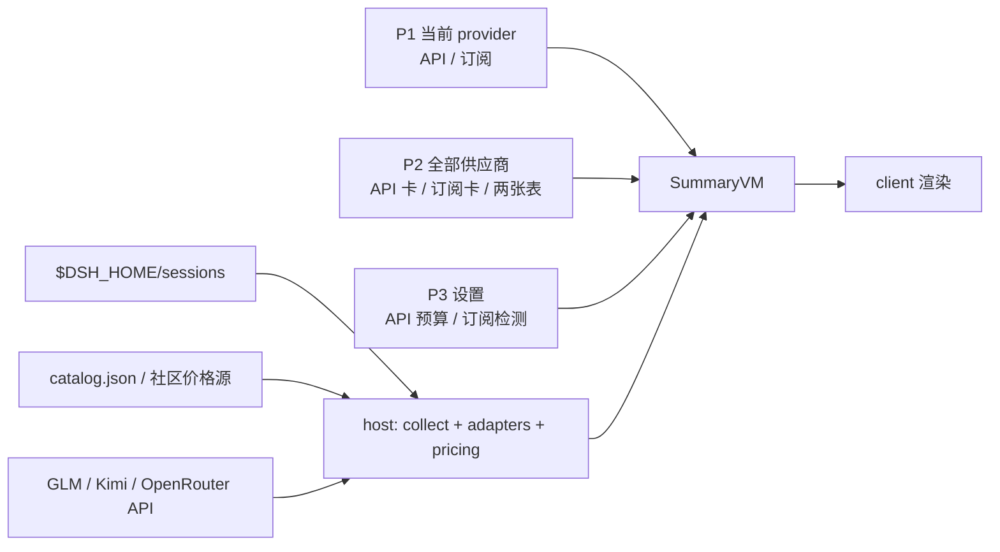

# DSH Token 看板：多供应商预算、订阅配额与本地计价

> 状态：待归档（v1.0.0 已发布 GitHub：#24-#47 全部闭环，L1 37/37 + E2E pass + 用户桌面验收；npm 发布与市场收录待办见 §十）<br>
> 创建：2026-10-31；更新：2026-11-01（v0.2 施工 → #24-#47 五轮迭代 → v1.0.0 发布 + 治理体系；终态精修）<br>
> 工程：`dsh-tokenDash`（包名 `dsh-token-dash`）<br>
> 关联资料：[UI 施工 checklist（已归档）](../../../checklist/archived/dsh/token-dash-ui-build-checklist.md)、[治理体系 checklist（已归档）](../../../checklist/archived/dsh/github-governance-build-checklist.md)

## 〇、前置依赖 / 代码探查事实

### 已明确

- DSH 基线 `0.2.1-rc.5`；desktop 由 Electron 独占，自动化使用临时 `web` profile；Key 经 `ctx.credentials.resolve()` 读取（不读 `.credentials.yaml`）。
- P1 槽位（宿主渲染 DOM，非手动挂载）：首页 `conversation.hero.agentPreset`；会话 `conversation.composer.dock`（`order:-1`）。
- provider 默认形状（实际以 DSH `providers` / `apiKeyEnv` 为准）：

| provider | 默认 host / baseURL | 默认 Key 环境 | 说明 |
|---|---|---|---|
| DeepSeek | `api.deepseek.com` | `DEEPSEEK_API_KEY` | 官方账号优先 |
| GLM | `open.bigmodel.cn` / `api.z.ai` | `ZHIPU_API_KEY` | Coding Plan 用同一账号 Key |
| Kimi Coding | `api.kimi.com` | `KIMI_API_KEY` | `/coding/v1/usages` |
| Kimi 普通 | `api.moonshot.cn` | `MOONSHOT_API_KEY` | 仅余额，不查套餐 |
| OpenRouter | `openrouter.ai/api/v1` | `OPENROUTER_API_KEY` | credits + `/models` |
| Qwen | `dashscope.aliyuncs.com` / `dashscope-intl.aliyuncs.com` | `DASHSCOPE_API_KEY` | 仅 API；国内 CNY、国际 USD；无 quota |

- 五家配额/余额/价格端点与解析参考的映射见 §2.3 订阅适配表（唯一来源）。
- 打开日志目录走宿主 `POST /open-in-app/open`（非通用 shell API），失败降级复制路径 + 导出。
- 社区价格表 `LaoYueHanNi/model-price-table`（默认 Gitee，GitHub 兜底）；**L5 真实订阅 Key 不覆盖**（无账号不购买），验收以 L1-L4 + fixture 契约为准。

## 一、需求

| ID | P | 需求 | 成功信号 |
|---|---|---|---|
| REQ-01 | P0 | P1 跟随当前 provider；API 样式显示预算%、今日、余额 | DeepSeek / OpenRouter 切换时 P1 正确变化 |
| REQ-02 | P0 | 订阅 provider 显示账户级 5h / 周百分比 | GLM / Kimi 订阅卡可见；不显示预算% |
| REQ-03 | P0 | 判定不了时默认 API 样式；P1 不显示对话 Token | 未知 provider 显示 `[API] --`（#38 词条统一）；DSH 原生 Token 不重复 |
| REQ-04 | P0 | P2 每个 API provider 独立预算 + 独立进度条 | DeepSeek / OpenRouter 各一条；无预算满格且不显示百分比 |
| REQ-05 | P0 | P2 订阅区每个 provider 一张卡；标题行统一"重新检测" | 5h/周/月窗口、重置时间、单卡无重复按钮 |
| REQ-06 | P0 | API 费用表只统计 API，按 CNY/USD 分组；订阅只进用量表 | 无跨币种合计；订阅行无金额 |
| REQ-07 | P0 | P3 只做设置：API 行 = provider + 月度预算 + 币种（#39 删除计费模式下拉）；订阅行 = 模式 + 状态 | 无单价输入、无模型展开、无价格编辑 |
| REQ-08 | P0 | ViewModel 拆 `providers / balances / plans / apiTotals` | P1/P2/P3 共用一份 summary，无单 `balance` |
| REQ-09 | P0 | 自动侦测五家：DeepSeek / Kimi / GLM / OpenRouter / Qwen | 其他 provider 不显示；Qwen 只判 API；订阅/API 不误判 |
| REQ-10 | P0 | GLM 配额 adapter 严格参考社区实现 | 5h/周百分比正确；401/无窗口降级 |
| REQ-11 | P0 | Kimi 配额 adapter 严格参考社区实现 | 5h/周/月窗口正确；普通 Key 只查余额 |
| REQ-12 | P0 | OpenRouter credits + `/models` 价格 | USD credits 显示；不请求套餐接口 |
| REQ-13 | P0 | `catalog.json` + 社区价格源 + family-latest 回退 | 新模型同系列显示近似价；跨代际未定价 |
| REQ-14 | P0 | 只读本地数据；不抓网页、不读凭证文件、不上传 | 停用后原生 UI 恢复 |
| REQ-15 | P0 | Qwen 仅 API：识别百炼/DashScope host，社区价格 + `catalog.json`，国内 CNY / 国际 USD，无 quota | Qwen API 卡/预算/价格正常；不显示订阅百分比 |
| REQ-16 | P0 | P2/P3 动态渲染：只显示 `summary.providers` 中已配置/已检测 provider；不预置固定卡片数量或固定供应商行 | 填 1 个只显示 1 个；未检测到 API/订阅时隐藏对应区 |
| REQ-17 | P0 | P3 只保留"查看日志"行：打开固定目录 + 导出单个日志；不再有诊断区块；用户自行上传分析，插件不自动上传 | desktop 可打开固定目录；web 可复制路径/导出；无日志级别/清空 UI |
| BND-01 | 边界 | 只支持五家；Qwen 仅 API，其他 provider 不显示计费卡 | 不出现未知中转/Qwen 订阅入口 |
| BND-02 | 边界 | 订阅百分比是账户级，不拆单对话 | 文案带"账户套餐" |
| BND-03 | 边界 | 不做价格编辑、汇率换算、自定义币种 | P3 无单价输入 |
| BND-04 | 边界 | 不做 OS 悬浮窗、多用户、云同步 | 仅 DSH 窗口内 |
| BND-05 | 边界 | 日志不含 Key、prompt、完整响应；不自动上传 | 脱敏审计通过；用户手动导出 |
| RSK-01 | 风险 | 社区价格表滞后/失真 | 显示 `updatedAt`；失败回退 bundled；近似价标识 |
| RSK-02 | 风险 | 订阅接口字段漂移 | fixture 契约测试；失败显示"套餐查询失败" |
| RSK-03 | 风险 | 槽位/DOM 变化导致 P1 不显示 | 失败不白屏；设置入口保留 |
| RSK-04 | 风险 | 多币种被错误合并 | 按币种分组；禁止跨币种合计 |
| RSK-05 | 风险 | 日志泄露敏感信息或过大 | 脱敏 + 轮转 + 限制大小 |

## 二、设计方案

### 2.1 结构：UI → VM → 数据



| 层 | 职责 |
|---|---|
| client | 只消费 `SummaryVM`；不重算价格、不猜 provider；P1/P2/P3 共用 |
| index | 装配、路由、credentials、quota/balance 调用 |
| collect | `message.source`、usage、session 回填、水位线 |
| core | provider/model 分桶、VM 组装、预算、费用、百分比 |
| pricing | `catalog.json` / 社区源 / OpenRouter `/models`；匹配与 family 回退 |
| adapters | GLM、Kimi、OpenRouter 的 balance/quota 解析 |

### 2.2 ViewModel 与关键字段

```ts
SummaryVM {
  providers: ProviderVM[]
  apiTotals: Record<'CNY' | 'USD', { today: number; month: number; budget: number; remaining: number }>
  updatedAt: number
  stale: boolean
}

ProviderVM {
  id: string
  name: string
  kind: 'api' | 'subscription'
  currency: 'CNY' | 'USD'
  usage: { todayTokens; monthTokens; todayCost; monthCost; requests }
  budget?: { amount; used; remaining; percent; state: 'ok' | 'warn' | 'over' | 'unset' }
  balance?: { amount: number | null; status: 'ok' | 'unconfigured' | 'error' }
  plans?: QuotaWindow[]
}

QuotaWindow {
  key: '5h' | 'week' | 'month'
  usedPercent: number | null   // 仅官方 ratio / used+limit
  resetAt?: number
  source: 'official'
}
```

规则：

- P1 只取当前 provider 的 `ProviderVM`；未知 provider 用 API 空态。
- P2 的 API 卡按 `providerId` 一条一条渲染；订阅卡同。
- API 费用/用量表只按 `kind='api'` 过滤；订阅 token 保留在用量表。
- 预算只在 `api` 上存在；订阅 provider 无 `budget`。
- 百分比必须带来源/窗口；没有显式分母则为 `null`，UI 显示 `—`。

### 2.3 数据：provider 侦测、价格目录、订阅适配

**provider 侦测**

| 条件 | 结果 |
|---|---|
| `providerProfiles.billingMode` 显式 | 直接使用 |
| `deepseek-*` / `api.deepseek.com` | `api` |
| GLM 路由 + quota 成功 | `subscription` |
| GLM 路由 + quota 失败 | `api` + 余额 |
| Kimi `api.kimi.com` / `kimi-coding` | `subscription` |
| Kimi `api.moonshot.cn` | `api` + 余额 |
| `openrouter.ai` | `api` + credits |
| Qwen `qwen/dashscope/aliyun/tongyi` 或 `dashscope*.aliyuncs.com` | `api`；不查 quota |
| 其他 | 不显示计费卡 |

- P2 提示行固定为：`自动侦测 API Key 类型：DeepSeek / Kimi / GLM / OpenRouter / Qwen`。

**价格目录**

- 内置 `catalog.json`：DeepSeek / GLM / Kimi / Qwen；OpenRouter 走 `/models`。
- 社区表已收录 18 个 Qwen 模型（含 `qwen3.8-max`、`qwen3.8-flash`、`qwen3-coder-*`），可直接作为 Qwen 价格来源；`catalog.json` 只内置兜底条目。
- 社区源：`LaoYueHanNi/model-price-table/model_pricing.json`；默认 Gitee，GitHub 兜底，`pricing.source` 可切 bundled。
  - Gitee：`https://gitee.com/oyw125/model-price-table/raw/master/model_pricing.json`
  - GitHub：`https://raw.githubusercontent.com/LaoYueHanNi/model-price-table/master/model_pricing.json`
- 启动拉取，24h 缓存，last-known-good；失败回退 bundled；再失败"未定价"。
- 匹配顺序：`providerId:modelId` 精确 → aliases/aliasPatterns → 同 provider + 同 family 最新已知 → 未定价。
- family-latest 标 `≈` / "近似价"；不跨 provider、不跨代际。
- 社区 JSON 只消费数据，校验 schema、数值范围、大小；不执行代码、不发 Key。
- Qwen 国内站按 CNY；国际站按 USD。社区表为 CNY 时，国际站未单独收录则显示"未定价"，不做汇率换算。
- Qwen 官方价格页：`https://help.aliyun.com/zh/model-studio/billing-for-alibaba-cloud-model-studio`，与 P3"查看价格明细"一致。

**订阅适配（严格参考社区代码）**

参考基线（本地已验证 commit）：

| 仓库 | URL | commit |
|---|---|---|
| dsh-token-usage-lao | `https://github.com/LaoYueHanNi/dsh-token-usage.git` | `d1c22b1` |
| dsh-spend | `https://github.com/nonewind/dsh-spend.git` | `d621227` |
| dsh-ui-usage-billing | `https://github.com/kenz1117/dsh-ui-usage-billing.git` | `12c11a7` |

| Provider | 端点 | 参考仓库 / 文件 |
|---|---|---|
| DeepSeek 余额 | `GET https://api.deepseek.com/user/balance` | `dsh-token-usage-lao/src/quota/adapters/deepseek-balance.ts`；`deepseek-account.ts` |
| GLM Coding | `GET https://bigmodel.cn/api/monitor/usage/quota/limit` | `dsh-token-usage-lao/src/quota/adapters/zhipu.ts`；`dsh-spend/lib/providers/quota-zhipu.js`；`dsh-ui-usage-billing/src/subscriptions.ts` |
| Kimi Coding | `GET https://api.kimi.com/coding/v1/usages` | `dsh-token-usage-lao/src/quota/adapters/kimi.ts`；`dsh-ui-usage-billing/src/subscriptions.ts` |
| Kimi 余额 | `GET https://api.moonshot.cn/v1/users/me/balance` | `dsh-spend/lib/providers/balance-moonshot.js` |
| OpenRouter credits | `GET https://openrouter.ai/api/v1/credits` | `dsh-token-usage-lao/src/quota/adapters/openrouter.ts`；`dsh-ui-usage-billing/src/subscriptions.ts` |
| OpenRouter 价格 | `GET https://openrouter.ai/api/v1/models` | `dsh-ui-usage-billing/src/pricing-fetch.ts` |
| Qwen | 无 quota；仅价格估算 | `dsh-spend/lib/knowledge.js`（qwen 价）、`dsh-ui-usage-billing/src/pricing-fetch.ts`（models.dev/OpenRouter 参考） |
| 社区价格表 | `model_pricing.json` | `LaoYueHanNi/model-price-table`；加载参考 `dsh-token-usage-lao/src/pricing.ts` |

- `reference/third-party/` 只作本地研究，不入库。
- 五家都无 OAuth；API Key 由宿主 credentials 解析；Qwen 不做订阅百分比。

**原样参考约束**

- endpoint、path、method、auth header、query、响应字段名、窗口映射必须与参考文件 1:1。
- 只允许改：provider id 映射、超时/重试、日志、错误封装；不得自创字段或百分比算法。
- 参考实现没有的字段，返回 `null` / `parse error`，不补猜、不默认 0%。
- 每个 adapter 的 fixture 从参考代码的响应形状复制；不访问真实账号，不编造响应。
- 参考仓库升级时先 diff 上述文件与 commit，再改适配层。
- 未购买订阅，L5 真实 API 验证不覆盖；自动测试只使用参考代码的 fixture，不购买测试 Key。

### 2.4 关键陷阱

- 订阅百分比是账户级，不能拆成"本对话已用"。
- 不能把余额换算成套餐百分比。
- 不能把 OpenRouter credits 当订阅窗口。
- 不能跨 provider/family 套价；不能拿 GLM-5 价套 GLM-6。
- 社区价格表可能滞后/失真；必须保留 bundled 回退和 `updatedAt`。
- 不能在 relay/未知 host 上请求官方 quota。
- Qwen 没有订阅 quota：不显示套餐百分比，不把 `qwen-token-plan` 当 API 预算。
- Qwen 国际站 USD 不能用 CNY 社区价直接套；未收录就"未定价"。
- P1 的 DOM/槽位失败时不能白屏。

### 2.5 日志与导出

目标：用户只需要在 P3 导出一个 `.log` 文件，上传后就能定位 adapter、解析、路由和槽位问题；插件不自动上传。

**文件与格式**

- 文件：`$DSH_HOME/logs/dsh-token-dash/dsh-token-dash-YYYYMMDD.log`（宿主日志目录实施前核实）。
- 格式：JSONL，一行一个事件；首行 `type: "header"`。
- 轮转：单文件 5MB，保留 3 份，7 天；导出上限 10MB。
- 级别：固定 `info`；`debug` 只保留给开发配置，不暴露 P3 控件，仍不记录 payload。
- 导出文件包含：header + 最近日志 + 错误摘要；无日志时也生成 header。

事件为 JSONL（字段含 `ts/level/module/event/providerId/modelId/traceId/sessionHash/status/errorCode/durationMs/meta`；`meta` 仅状态计数不含内容；`sessionHash` 为 12 位 hash 不落原始 id）。**模块前缀（运行契约，新增模块先改本表）**：

统一格式 `[TD:<module>]`；JSONL 的 `module` 字段使用 `<module>`，文本前缀是同值镜像。

| 前缀 | module | 负责内容 | 示例事件 | 默认级别 | 禁止记录 |
|---|---|---|---|---|---|
| `[TD:boot]` | `boot` | 启动、停止、版本、prefs 迁移、路由注册 | `start` / `stop` / `migrate` | info | Key、完整配置 |
| `[TD:provider]` | `provider` | provider id、host、billingMode、currency、手动覆盖 | `detect` / `override` / `unsupported` | info | Key、完整 baseURL query |
| `[TD:adapter.deepseek]` | `adapter.deepseek` | DeepSeek 余额请求、状态、错误码 | `balance.ok` / `balance.auth` | info | Authorization、响应 body |
| `[TD:adapter.glm]` | `adapter.glm` | GLM quota、窗口解析、401/parse | `quota.ok windows=2` / `quota.parse` | info | 原始 Key、完整响应 |
| `[TD:adapter.kimi]` | `adapter.kimi` | Kimi coding usages、legacy/current、余额 | `quota.ok` / `quota.legacy` | info | Key、usage 原始 body |
| `[TD:adapter.openrouter]` | `adapter.openrouter` | credits、`/models` 拉取 | `credits.ok` / `models.stale` | info | Authorization、全量模型响应 |
| `[TD:adapter.qwen]` | `adapter.qwen` | Qwen 价格/币种提示；无 quota | `price.missing` / `currency.usd` | info | 伪造 quota 请求 |
| `[TD:pricing]` | `pricing` | catalog/社区表/匹配/family 回退 | `match exact` / `family-latest` / `unpriced` | info | 用户输入内容 |
| `[TD:collect]` | `collect` | backfill、session、水位线、模型归因 | `backfill.done` / `event.drop` | info | prompt、消息正文 |
| `[TD:vm]` | `vm` | provider 数量、预算、币种、stale | `build providers=3 api=2` | info | 完整 VM 快照 |
| `[TD:slot]` | `slot` | P1 挂载、DOM/槽位失败、降级 | `mount.ok` / `mount.fail` | warn | DOM 全文、节点树 |
| `[TD:ui]` | `ui` | P1/P2/P3 操作、导出、清空、失败提示 | `export.start surface=p3` | info | 点击全文、输入值 |
| `[TD:route]` | `route` | path、status、duration；不记 query/body | `GET /summary 200 12ms` | info | query、body、Cookie |
| `[TD:diag]` | `diag` | 日志导出、轮转、脱敏命中、清空 | `export lines=420 redacted=3` | info | 日志正文 |
| `[TD:update]` | `update` | 检查更新、安装结果、失败 | `check.latest` / `install.fail` | info | 命令中的凭证 |
| `[TD:core]` | `core` | 未归类事件兜底 | `unexpected` | warn | 任意敏感内容 |

职责边界：`adapter.*` 只记外部请求/解析；`pricing` 只记价格来源/匹配；`ui` 只记动作与错误（同类错误限频 1 分钟 3 条）；模块前缀与 JSONL `module` 一致，缺失回退 `core`。错误事件带 `errorKind`（http/timeout/network/parse）+ `httpStatus`（#47 落地）。

**脱敏红线**

- 永不记录：API Key、`Authorization`、Cookie、prompt/消息内容、完整响应 body、完整 URL query。
- `apiKey` / `token` / `secret` / `sk-` / `Bearer` 统一替换为 `[REDACTED]`。
- 只记录 host，不记录完整 URL；只记录错误码/状态，不记录响应正文。
- sessionId 只存 hash；provider/model 是公开标识，可保留。
- 导出前再跑一次脱敏扫描；命中敏感模式则阻止导出并提示。

**P3 入口**：仅"查看日志"一行（打开固定目录 + 导出 `.log`）；无诊断块/级别/清空。打开目录走宿主 `/open-in-app/open`，失败或 web profile 降级复制路径 + 导出（Blob 下载）。不自动上传。

## 三、实现要点

### 3.0 开发改动总览（全部已实施，实际形态见各文件与 §九闭环卡）

| ID | 类型 | 文件 | 开发改动说明 |
|---|---|---|---|
| CHG-01 | 新增 | `catalog.json` | DeepSeek / GLM / Kimi 模型、family、alias、四类价格；带 version/updatedAt/source |
| CHG-02 | 新增 | `src/pricing.js` | 社区源加载/校验/缓存、exact/alias/family 匹配、近似价标记 |
| CHG-03 | 新增 | `src/providers.js` | 五家 provider 侦测、adapter 路由、currency；Qwen 仅 API |
| CHG-04 | 修改 | `src/collect.js` | `message.source` provider/model、session 维度、usage 分桶 |
| CHG-05 | 修改 | `src/core.js` | `SummaryVM`、provider/model 分桶、API/订阅预算、币种分组 |
| CHG-06 | 修改 | `src/store.js` | `budgets[providerId]`、catalog 版本/缓存；旧 prefs 迁移 |
| CHG-07 | 修改 | `index.js` | 装配 pricing/providers、quota/credits、summary 路由 |
| CHG-08 | 修改 | `client.js` | P1 两种样式；P2 API 卡/订阅卡/币种表；P3 简化设置 |
| CHG-09 | 修改 | `scripts/e2e.mjs` | fixture server、P1/P2/P3 断言、五家 provider mock（Qwen 无 quota） |
| CHG-10 | 新增 | `test/unit/*.test.mjs` | pricing、VM、adapter parser、currency、预算 |
| CHG-11 | 新增 | `src/diagnostics.js` | JSONL 日志、轮转、脱敏、导出 header/错误摘要 |
| CHG-12 | 修改 | `client.js` | P3 仅"查看日志"：`/open-in-app/open` 打开固定目录 + 导出；无诊断块/级别/清空 |

## 四、不改动 / 边界

- 不修改 DSH 本体、原生 composer、ContextMeter。
- 不读取 `.credentials.yaml`，不把 Key 发给非官方 host。
- 不做价格编辑、模型展开、汇率换算、自定义币种。
- 不做 OS 悬浮窗、账号登录、多用户/云同步。
- 不支持五家之外 provider 的计费卡；Qwen 不显示订阅套餐。
- 日志不自动上传、不含 Key/prompt/完整响应；导出前必须脱敏。

## 五、验收

| 项 | 来源 | 验证方式 | 结果 |
|---|---|---|---|
| **总口径（2026-11-01）** | 全部 | L1 37/37 + E2E 全矩阵 pass + 用户桌面走查；L5 不覆盖（D-09） | 下表结果列统一为"已验证" |
| P1 API / 订阅两态 | REQ-01/02 | L3 mock；真实桌面走查 | 已验证 |
| P1 未知默认 API | REQ-03 | L3 mock | 已验证 |
| P2 多 API 独立进度条 | REQ-04 | L3 mock；无预算满格 | 已验证 |
| P2 订阅卡 / 重新检测 | REQ-05 | L3 mock | 已验证 |
| API 费用按币种分组 | REQ-06 | L2 VM + L3 | 已验证 |
| P3 无价格输入 | REQ-07 | L3 DOM 断言 | 已验证 |
| P2/P3 动态 provider 数量 | REQ-16 | L3：配置 1/2/3 家分别渲染 | 已验证 |
| 日志导出 / 脱敏 | REQ-17/BND-05 | L1 脱敏单测 + L3 导出 | 已验证 |
| 打开日志文件夹 | REQ-17/BND-05 | desktop 打开固定目录；web 复制路径 | 已验证 |
| 日志模块/轮转 | REQ-17/RSK-05 | 模块枚举、轮转、导出上限 | 已验证 |
| prefs 迁移 | REQ-04/08 | 单 budget → budgets 映射，幂等 | 已验证 |
| 空 provider / 槽位失败 | REQ-16/RSK-03 | 空态正确；不白屏 | 已验证 |
| VM 字段完整 | REQ-08 | L1/L2 | 已验证 |
| 五家侦测 | REQ-09/15 | L1 + L4 fixture | 已验证 |
| Qwen API / 价格 / 币种 | REQ-15 | L1 + L3 | 已验证 |
| GLM / Kimi / OpenRouter adapter | REQ-10/11/12 | L4 contract fixture | 已验证 |
| 社区价格回退 / 近似价 | REQ-13 | L1 + L2 | 已验证 |
| 只读/停用恢复 | REQ-14 | L2 + 人工 | 已验证 |

### 5.1 E2E 分层与自主执行守则

| 层 | 内容 | 方式 | 资源 | 无人值守 |
|---|---|---|---|---|
| L1 | pricing、VM、预算、currency、adapter parser | `node --test` | 无 | 是 |
| L2 | host 路由 + summary/prefs + provider mock | 临时 `DSH_HOME` + web profile | 无 | 是 |
| L3 | P1/P2/P3 + 多币种 + 空态 | Playwright + `/summary` mock | 无 | 是 |
| L4 | 订阅 adapter 契约 | 参考仓库 fixture，无真实请求 | 无 | 是 |
| L5 | 真实 GLM/Kimi/OpenRouter Key；Qwen API 可选 | 不覆盖 | 真实额度 | 否，`[不覆盖]` |

用户已确认：**L4 fixture 是当前验收门槛**；没有订阅 Key，且不购买付费 API Key 做测试，L5 不执行、不阻塞交付。

**守则五要素**

1. 执行范围：L1 → L2 → L3 → L4 依序；L5 不执行。
2. 修复边界：只改 adapter/pricing/断言/fixture；不得改 §四 BND。
3. 停机条件：同类失败连续 3 轮、需改 BND → 停止并留报告。
4. 记录去向：每轮写 §九；L4 未通过转 `[待用户验证]`，不得写"真实账号已验证"。
5. 授权：commit/push 必须用户显式拍板；不购买 Key、不跑真实订阅。

### 5.2 L1 纯函数测试

| ID | 场景 | 断言 | 来源 |
|---|---|---|---|
| L1-01 | provider 侦测 | DeepSeek/GLM/Kimi/OpenRouter/Qwen/unknown 映射正确；Qwen 固定 api；不靠 Key 前缀 | REQ-09/15 |
| L1-02 | VM 组装 | 每 provider 预算/余额/plans；订阅无 budget；无单 balance | REQ-08 |
| L1-03 | 币种分组 | CNY/USD 独立 totals；禁止跨币种合计 | REQ-06 |
| L1-04 | 价格匹配 | exact → alias → 同 family 最新；跨代 null；近似标记 | REQ-13 |
| L1-05 | GLM parser | unit 3/6 百分比；TIME_LIMIT 不参与；401/空窗口 | REQ-10 |
| L1-06 | Kimi parser | legacy/current 两代；多 5h 取最新 reset；字符串数值 | REQ-11 |
| L1-07 | OpenRouter parser | credits 余额与 USD；`/models` 价格 | REQ-12 |
| L1-08 | 社区源校验 | schema/数值/大小；失败回退 bundled | REQ-13/RSK-01 |
| L1-09 | 日志格式 | `[TD:<module>]` 枚举；未知模块回退 core；JSONL module 一致 | REQ-17 |
| L1-10 | 日志脱敏 | Key/Bearer/Cookie/prompt/body 替换；导出前二次扫描 | REQ-17/BND-05 |
| L1-11 | prefs 迁移 | 单 budget → `budgets[providerId]`；旧字段保留兼容 | REQ-04/08 |

### 5.3 E2E 测试矩阵

| ID | 层 | 场景 | 断言 | 来源 |
|---|---|---|---|---|
| E2E-01 | L3 | P1 API CNY | `[API]` + 预算% + 今日 + 余额；无 Token | REQ-01/03 |
| E2E-02 | L3 | P1 API USD | OpenRouter 金额为 `$`，不与 CNY 合并 | REQ-01/06 |
| E2E-03 | L3 | P1 API 无预算/无余额 | `预算 未设置`；余额 `0.00`；不出现"可用" | REQ-01/04 |
| E2E-04 | L3 | P1 订阅 GLM | 5h/周百分比；`账户套餐` 语义 | REQ-02 |
| E2E-05 | L3 | P1 订阅 Kimi | 5h/周/月窗口；单窗口重置时间 | REQ-02/11 |
| E2E-06 | L3 | 未知 provider | 默认 API 样式 `[API] --`；不显示空白卡 | REQ-03/09 |
| E2E-07 | L3 | P2 多 API | DeepSeek + OpenRouter 各一条进度条 | REQ-04/08 |
| E2E-08 | L3 | P2 无预算 | 满格、中性色、无百分比、无"可用" | REQ-04 |
| E2E-09 | L3 | P2 订阅区 | GLM/Kimi 两张卡；标题行一个"重新检测" | REQ-05 |
| E2E-10 | L3 | API 费用表 | 仅 API；CNY/USD 分组；无跨币种合计 | REQ-06 |
| E2E-11 | L3 | 订阅用量 | 订阅 token 出现在用量表，费用表无订阅行 | REQ-06 |
| E2E-12 | L3 | P3 设置 | 无单价输入、无模型展开；预算在 API 行 | REQ-07 |
| E2E-13 | L2 | summary VM | `providers/apiTotals` 完整；无单 `balance` | REQ-08 |
| E2E-14 | L2 | 预算保存 | PUT prefs 后 summary 立即刷新；不等待轮询 | REQ-04/08 |
| E2E-15 | L2 | 只读/无外联 | 未匹配 provider 不发起 quota；断网仍能渲染 bundled | REQ-14/BND-01 |
| E2E-16 | L3 | P1 位置 | 首页工作区行、会话活动行可见；右侧栏展开不跑位 | REQ-01/03 |
| E2E-17 | L3 | P1 切 provider | 当前 provider 从 API 切到订阅，P1 样式随之变化 | REQ-01/02 |
| E2E-18 | L3 | P2 混合 | API 卡 + 订阅卡 + 两张表；无统一百分比 | REQ-04/05/06 |
| E2E-35 | L3 | 动态 provider | 配置 1/2/3 家时只渲染对应数量；空区隐藏；P3 不出现未配置行 | REQ-16 |
| E2E-36 | L3 | 导出日志 | P3 点击导出生成 `.log`；含 header；无自动网络请求 | REQ-17 |
| E2E-37 | L1 | 日志脱敏 | Key/Bearer/Cookie/prompt/完整 body 被替换或剔除 | REQ-17/BND-05 |
| E2E-38 | L3 | 打开日志目录 | desktop 调用 `/open-in-app/open` 打开固定目录；web/失败复制路径；不接受任意路径 | REQ-17/BND-05 |
| E2E-39 | L3 | 槽位失败 | 模拟 P1 槽位缺失：不白屏，设置入口可达 | RSK-03 |
| E2E-40 | L2 | prefs 迁移 | 单 budget 迁移到 budgets 映射；重复迁移幂等 | REQ-04/08 |
| E2E-41 | L2 | 社区镜像回退 | Gitee 失败切 GitHub；都失败用 bundled | REQ-13/RSK-01 |
| E2E-42 | L3 | 日志级别固定 | P3 无级别/清空控件；导出为 info；仍无 Key/prompt/body | REQ-17/BND-05 |
| E2E-43 | L3 | 空 provider | 无任何 provider：隐藏 API/订阅区，显示空态 | REQ-16 |
| E2E-44 | L2 | 日志轮转 | 达到大小上限轮转；导出不超过 10MB | REQ-17/RSK-05 |
| E2E-19 | L3 | P3 重新检测 | 按钮在订阅区标题右侧；点击只触发订阅配额 | REQ-05 |
| E2E-20 | L3 | 窄屏 | 表格横向滚动；P1 不撑开输入框 | BND-04/RSK-03 |
| E2E-21 | L4 | GLM success | 5h/周 42.5/18.2；TIME_LIMIT 不进百分比 | REQ-10 |
| E2E-22 | L4 | GLM 401/missing | 不认定订阅；回退 API；不显示假 0% | REQ-09/10 |
| E2E-23 | L4 | Kimi legacy | `limits[].detail` 取最新 reset 的 5h；usage 为周 | REQ-11 |
| E2E-24 | L4 | Kimi current | `usages.limit_5h` / `limit_month_code` 优先；字符串数值可解析 | REQ-11 |
| E2E-25 | L4 | Kimi 401/no windows | `套餐查询失败` 或未配置；不伪造窗口 | REQ-11/RSK-02 |
| E2E-26 | L4 | OpenRouter credits | `total_credits - total_usage`；USD；不足补 0 | REQ-12 |
| E2E-27 | L4 | OpenRouter models | `/models` 取输入/输出价；不请求订阅接口 | REQ-12 |
| E2E-28 | L4 | 价格 exact/alias | `provider:model` 与 aliases 均命中 | REQ-13 |
| E2E-29 | L4 | family-latest | 同 family 新版本显示近似；跨代际 `未定价` | REQ-13 |
| E2E-30 | L4 | 社区源失败 | 回退 bundled；last-known-good；不阻塞 UI | REQ-13/RSK-01 |
| E2E-33 | L3 | Qwen API 卡 | 国内 CNY / 国际 USD；有预算进度条；无订阅卡 | REQ-15 |
| E2E-34 | L4 | Qwen 价格 | 社区/catalog 精确与 family 回退；无 quota 请求 | REQ-15/13 |
| E2E-31 | L5 | 真实 GLM/Kimi/OpenRouter | 不覆盖；无订阅 Key，不购买测试 Key | REQ-10/11/12 |
| E2E-32 | L5 | 真实平台账单对照 | 不覆盖；只做本地估算口径说明 | REQ-14 |

### 5.4 订阅 adapter 契约（严格参考）

所有 L4 fixture 只复用参考仓库的响应形状，不访问真实账号；字段缺失按错误处理，不补猜。

| Fixture | 输入形状 | 期望 | 参考 |
|---|---|---|---|
| GLM-OK | `data.limits[]`：`TOKENS_LIMIT unit=3/6 + percentage + nextResetTime`；`TIME_LIMIT` | 5h/周窗口；`TIME_LIMIT` 忽略 | `dsh-token-usage-lao/src/quota/adapters/zhipu.ts` |
| GLM-AUTH | HTTP 401/403 或 `success:false, code:401` | `unauthorized`；不认定订阅 | 同上；`dsh-spend/lib/providers/quota-zhipu.js` |
| GLM-EMPTY | 成功但无 `TOKENS_LIMIT` | 无窗口；不伪造百分比 | 同上 |
| KIMI-LEGACY | `limits[].detail {limit, remaining/used, resetTime}` + `usage` | 多个 5h 取 reset 最新；周窗口 | `dsh-token-usage-lao/src/quota/adapters/kimi.ts` |
| KIMI-CURRENT | `usages.limit_5h {used_ratio, reset_time}` + `limit_month_code/total` | 5h/月 ratio 优先；数字/字符串兼容 | 同上；`dsh-ui-usage-billing/src/subscriptions.ts` |
| KIMI-AUTH | 401/403 | `unauthorized`；普通 host 只余额 | 同上 |
| OR-CREDITS | `data.total_credits/total_usage` | 余额 = max(0, 差)；USD | `dsh-token-usage-lao/src/quota/adapters/openrouter.ts` |
| OR-MODELS | `data[] {id,pricing.prompt,pricing.completion}` | USD / 1M；无价格跳过 | `dsh-ui-usage-billing/src/pricing-fetch.ts` |
| PRICE-EXACT | `providerId:modelId` | 精确价 | `catalog.json` |
| PRICE-ALIAS | `aliases/aliasPatterns` | 归一命中 | `model_pricing.json` |
| PRICE-FAMILY | 同 `family` 新版本 | 最新已知价 + `≈`；跨代 `null` | `dsh-token-usage-lao/src/pricing.ts` |
| PRICE-BAD | schema/数值非法 | 回退 bundled；不崩溃 | 本项目校验器 |
| QWEN-PRICE | `qwen` 社区/catalog 价格 | CNY/USD 按 host；无 quota 请求 | `dsh-spend/lib/knowledge.js`；社区表 |

参考本地 commit：`dsh-token-usage-lao d1c22b1`、`dsh-spend d621227`、`dsh-ui-usage-billing 12c11a7`。升级参考仓库时先对比这些路径与 commit。

## 六、运行与安全

- 兼容基线 `0.2.1-rc.5`；desktop / web 同包，自动化走 web profile。
- 只读本地 sessions；外联仅五家官方 host（含 DashScope 国内/国际）+ 社区价格源 + OpenRouter `/models`。
- 社区源默认 HTTPS、限大小、schema 校验；失败不阻塞 UI。
- 单实例写 `daily.json`；停用即停订阅/定时器，数据保留。
- 文案标明"DSH 本机估算"，不宣称平台真实账单。

## 七、日志速查

- LogCategory：`TokenDash`；文本前缀 `[TD:<module>]`，模块表见 §2.5。
- 固定 `info`，不暴露 P3 级别切换；文件、字段、事件、脱敏、轮转、导出统一见 §2.5。
- 只记状态翻转与错误；不按 token 打点；不记录 prompt/Key/body。

## 八、决策记录

| # | 问题 | 定案 |
|---|---|---|
| D-01 | P1 形态 | API / 订阅两种；未知默认 API；不显示对话 Token |
| D-02 | 订阅百分比 | 账户级 5h/周；不拆单对话 |
| D-03 | 多 API | 每个 provider 独立预算/进度条；无预算满格不显示百分比 |
| D-04 | 多币种 | CNY / USD 分组；不换算、不合并 |
| D-05 | 价格源 | `catalog.json` + 社区价格表；24h 缓存 + bundled 回退 |
| D-06 | 新模型 | exact → alias → 同 family 最新，标近似；跨代未定价 |
| D-07 | 订阅适配 | 严格参考 Lao / dsh-spend / usage-billing 的现有实现 |
| D-08 | P3 | 只做 provider 模式 + 预算；不做价格编辑 |
| D-09 | 真实 Key | 无订阅 Key，L5 不覆盖；不购买测试 Key，自动测试只用 fixture |
| D-10 | Qwen | 仅 API/价格估算；国内 CNY、国际 USD；无 quota、无订阅百分比 |
| D-11 | 动态渲染 | P2/P3 只渲染已配置/已检测 provider；不固定三张 API 卡或两家订阅卡；空区隐藏 |
| D-12 | 日志 | P3 只保留"查看日志"：打开固定目录 + 导出 `.log`；固定 info；脱敏；不自动上传 |
| D-13 | 检查更新 | 完整流程：发现新版本弹一次确认（P3 内确认 UI）；确认后由 host 执行 `dsh plugin --profile <p> update <pkg>`，完成提示重启；失败展示错误与可复制的命令（2026-11-01 定案） |
| D-14 | "本月 Token"开关 | 删除开关与 `showMonthTokens` UI；prefs 字段保留兼容但不再暴露控件（2026-11-01 定案） |
| D-15 | P3 输入框 Esc | ~~两层语义~~ 修订（2026-11-01 施工中）：**不处理 Esc 按键输入**——浮层内按 Esc 不做任何事，关闭浮层走右上"关闭"按钮；原"取消编辑/关闭浮层"两层语义放弃（与宿主焦点/事件系统交互调试成本过高，用户拍板简化） |
| D-16 | 订阅卡标题 | 套餐名口径：GLM Coding / Kimi Coding（侦测不到套餐名时用"厂商名 + Coding"合成）（2026-11-01 定案） |

## 九、自测反馈台（活跃期）

> 旧 Issue #1-#18 随 v0.2 重写废弃；#19-#29 施工后清除（活跃遗留保全至文末"遗留"小节）；#30-#47 已修复并验证通过，按 skill 闭环卡压缩。

### Issue #30 [已修复] 2026-11-01 浮层锚定 pillWrap
- 触发：浮层位置三次反馈不对（贴 pill 漂左上 / 右对齐后与 pill 水平脱节）
- 根因：Panel 渲染在 Fragment 中、是 pillWrap 的兄弟节点——`position:absolute` 的定位基准一直是宿主槽位容器，"贴 pill"从未生效（v1 起所有怪位置的共同根因）
- 落点：`client.js` · Pill render——Panel 移入 pillWrap 内部；`styles.panel`——absolute + left:0 + bottom:calc(100%+8px)，清理 fixed/right 动态计算
- 边界：允许遮挡输入框（三次定案）；maxHeight 按 pill 上方空间钳制（下限 200px、内部滚动）
- 验证：L3 位置断言（panel 左缘对齐 pill 左缘 ±4px、底边 = pill 顶 - 8px ±4px）+ 桌面走查
- 遗留：关闭后焦点归还 setTimeout 尽力而为（E2E 受宿主焦点管理干扰未断言），真实浏览器人工走查


### Issue #31 [已修复] 2026-11-01 showBalance 开关只控制 P1
- 触发：开关关闭后 P2 余额列也被隐藏，且余额接口停发导致 P2 无数据
- 根因：开关同时作用于 UI 隐藏与 adapters 的 skipBalance 请求跳过（#28 引入）
- 落点：`src/adapters.js` · readProviders——删除 skipBalance（余额/credits 恢复常请求）；`client.js` · ApiCard——余额列恒显示（删 cols1 单列分支）
- 边界：P1 pill 余额段仍受开关控制；订阅 quota 不受影响
- 验证：L3 断言"showBalance=false 时 pill 无余额 + panel 有 ¥49.86"；checklist 三处口径同步


### Issue #32 [已修复] 2026-11-01 用量明细空态保留表格结构
- 触发：`models` 为空时渲染 colSpan 文案行"本月暂无消耗"，表头下无内容观感差
- 根因：空态分支返回单行文案而非表格占位结构
- 落点：`client.js` · UsageTable——空态改占位行（`—` / `0` / `0.00M` ×3 / `—`），空态行提取为 emptyRow 变量
- 边界：合计 `0.00M` 保留；P5 文案表"本月暂无消耗"废止
- 验证：L3 断言不含"本月暂无消耗"且含 0.00M
- 遗留（施工坑）：嵌套 h() 链替换丢闭括号被 node --check 拦截——大改动优先提取子表达式变量


### Issue #33 [已修复] 2026-11-01 API 卡显示总预算额度
- 触发：P2 API 卡只有百分比，预算总额不可见，与 P3 设置卡不一致
- 根因：#25-2 按 checklist 框线图实现，框线图只有百分比（规划盲区）
- 落点：`client.js` · ApiCard——预算段含已用/总额金额（后经 #37 并入单行式）
- 验证：L3 断言 `¥12.34 / ¥500.50`
- 遗留（E2E 坑，可复用）：includes(2.5%) 被 GLM 卡 42.5% 子串命中成永真断言；"保存后 P2 更新"依赖 60s tick 随机时机——根修为主动点刷新 + 精确金额断言；Playwright glob `*` 不跨 `/`（`update*` 匹配不到 `update/install` 会穿透 mock 到真实 host）


### Issue #34 [已修复] 2026-11-01 "已保存"提示不再引起弹窗抖动
- 触发：status 独立行出现/消失改变浮层内容高度，弹窗整体 resize
- 根因：状态提示渲染在 header 下的独立行，参与内容流布局
- 落点：`client.js` · Settings——status 移入标题栏"关闭"按钮左侧，minWidth 88 固定宽占位（空态保留位置）
- 边界：`aria-live=polite` 保留；P2 error 行不在范围
- 验证：L3 getByText 通过 + 桌面走查


### Issue #35 [已修复] 2026-11-01 点击浮层外部自动关闭
- 触发：只有"关闭"按钮能收起浮层（Esc 按 D-15 修订不做）
- 落点：`client.js` · Panel——document mousedown 监听：target 不在 panel 且不在 pillWrap（含 pill/hint）→ onClose；命中 pill 时交给 toggle，无双触发
- 边界：关闭途径收敛为关闭按钮 / 点击外部；Esc 维持不做
- 验证：L3 断言 body 派发 mousedown → panel 消失 → 重开正常 + 桌面走查


### Issue #36 [已修复] 2026-11-01 P1 pill 精简
- 触发：徽标与厂商名占位过大；输入框右下角已有模型指示，名称冗余
- 落点：`client.js` · Pill——不显示 provider 名（hover `title` 含 provider、aria-label 完整兜底）；chevron marginLeft 2 / padding 0 1px、pill gap 6 / padding 0 8px；数值段保留
- 边界：P2/P3 卡片显示名不受影响；数据口径"最近消息 provider"下陈旧数据靠 hover 确认（用户接受）
- 验证：L3 pill 无名称断言 + aria-label 含 OpenRouter 断言 + 桌面走查
- 备注：徽标文案经 #38 修订为 `[API]`


### Issue #37 [已修复] 2026-11-01 P2 API 卡回归框线图单行式
- 触发：四层结构（标题行/金额大字/进度条/两列网格）偏离 checklist 框线图两层紧凑结构
- 落点：`client.js` · ApiCard——单行：provider 名（左）+ 预算段（¥已用 / ¥总额 · 百分比，状态着色）+ 今日 + 余额（内联文本）+ 第二行进度条
- 边界：无预算时预算段 `未设置预算`（不再 fallback 月消费金额）；#33 总额度并入预算段
- 验证：L3 断言 `¥12.34 / ¥500.50`、`2.5%`、`¥49.86` + 桌面走查


### Issue #38 [已修复] 2026-11-01 模式词条统一 API / 订阅
- 触发：pill 徽标 `[非订阅]`（#36 引入）与设置页/文档术语（API/订阅）不一致，否定式表述别扭
- 落点：`client.js` · Pill——徽标 `[非订阅]` → `[API]`（未知默认 `[API]`）
- 验证：L3 两处 `[API]` 断言；REQ-03、E2E-01/06、checklist P1 口径同步


### Issue #39 [已修复] 2026-11-01 P3 API 卡删除计费模式下拉
- 触发：大多数 provider 下拉仅一个选项、无作用
- 落点：`client.js` · Settings——API 卡改单行 `provider 名 + 月度预算 + 输入框 + 币种`，删除 modeSelect 调用
- 边界：手动覆盖入口下线（已知取舍：计费模式完全依赖自动侦测）；`billingModes` 数据层保留兼容；订阅行下拉保留
- 验证：L3 select/hide option 计数 4→2 + 桌面走查


### Issue #40 [已修复] 2026-11-01 API 费用明细空态整体隐藏
- 触发：本月无 API 消耗（月初/新装）时，用量明细显示空表结构（#32），但"API 费用明细"表完全消失——空态策略不一致
- 根因：`groups.size === 0` 直接 return null（沿用 Q13"空区隐藏"），未随 #32 的空态口径更新
- 落点：`client.js` · ApiCostTable——空态分支渲染表头 + `CNY 合计 ¥0.00` + 占位行（模型 `—`、占比 `0.0%`、费用 `¥0.00`）
- 边界：订阅 provider 不进费用表；有数据时币种分组逻辑不变
- 验证：L3 空态场景断言（`API 费用明细` 标题 + `CNY 合计 ¥0.00`）；L1 30/30、E2E pass


### Issue #41 [已修复] 2026-11-01 升级后旧数据（unknown 行）不出现在看板
- 触发：用户升级插件后打开 P2，模型用量/费用明细为空，以为旧数据丢失（"目前选择的基础模型显示不出来"）
- 取证：本地 `daily.json` 有 `2026-10-31` 数据（`deepseek-flash`），但挂在 `providers.unknown` 下；日志多次 `backfill.done`（归因机制正常运行）；DSH 会话事件锁文件无法直读，实时与回填两条路径均未拿到 `message.source.provider`——DSH 侧未标注 provider，`ingest` 按设计记为 `unknown`
- 根因（三层叠加）：① collect 依赖 `message.source.provider`，DSH 不提供 → 全部记 `unknown`；② `buildSummary` 跳过 unknown（`providerId === 'unknown' continue`）；③ 跨月过滤（`dayKey.startsWith(month)`）——月初旧月数据即使归因也不可见
- 落点：`src/providers.js` · 新增 `providerFromModel(modelId)`——模型名前缀归因（`deepseek-*`→deepseek-official、`glm-*`→zhipu、`kimi-*`/`moonshot-*`→moonshot、`qwen-*`→qwen，无匹配 null）；`src/core.js` · buildSummary——视图层归因 unknown 行（**不改 daily.json**，随时可逆），`breakdown.models` 改跨月累计（费用/用量明细 = 历史累计估算），`provider.usage`（today/month、预算口径）保持当月
- 兼容（正式发布老数据）：纯视图层计算，`daily.json` 不迁移不动；v0.1 老结构（day 下直接 models）`loadState` 已兼容；unknown 归因不出时不伪造归属
- 边界：P1 pill 与 API 卡预算仍当月口径；OpenRouter 中转的 deepseek 模型会被归到 deepseek-official（误归风险已知，单用户场景影响小）
- 验证：L1 31/31（新增归因/跨月用例：unknown + `deepseek-flash` → deepseek-official 跨月累计一条、provider.usage 当月口径、无前缀模型保持不可见）；E2E 回归 pass

### Issue #42 [已修复] 2026-11-01 P2 明细区文案与口径精简（用户 5 点）
- 触发：P2 区块标题与表标题冗长，信息重复
- 落点：`client.js` · Panel（区标题去括号：`API 按量` + 右侧 `已检测 N · 刚刚`；`订阅套餐` 同理）+ ApiCostTable/UsageTable（表标题 `API 费用明细 / 本月`、`模型用量明细 / 本月`，删括号后缀）+ `src/core.js` · buildSummary（models 回当月口径，回退 #41 跨月累计；unknown 归因保留）
- 边界：本月 unknown 数据仍归到 provider 名下显示；上月数据不再出现在本月看板（用户定案"简易显示本月信息"）
- 验证：L1 31/31（#41 用例改回本月断言）+ E2E 标题断言同步 pass；2026-11-01 二问确认（用户拍板）：**明细口径维持严格本月**——取证 daily.json 10-31 数据在（unknown+deepseek-flash）、11-01 零新数据（会话文件 mtime 停在 10-31，当日无对话），月初空表为预期，模型将于 11 月产生消耗后自然显示（#43 三层归因就位）

### Issue #43 [已修复] 2026-11-01 provider 归属三层链（参考库调研定案）
- 背景：用户提出"providers 有必要保持"；#41 取证显示本机 DSH 会话事件无 `message.source.provider`，数据全进 unknown
- 参考库结论（dsh-cost-dashboard `scan.mjs`、dsh-ui-usage-billing `aggregate` 双重印证）：
  - **两层归属链是社区标准做法**：`assistant/message` 的 `message.source.provider/model` 为权威归属；**无 source 时回退（fallback）最近一条 `request/header` 事件的 `header.config.provider/model`**（每请求写入的请求头配置）
  - dsh-ui-usage-billing issue #14 教训：仅靠 header 会串账（header 稀疏，380 请求仅 22 条），修复为 message.source 优先；legacy 日志（无 source）保留 header 回退
  - dsh-cost-dashboard 同构：bare usage chunk（失败请求）归属最近 `request/header`
- 定案（用户确认施工）：三层归属链 `message.source`（权威）→ `request/header` 会话状态（回退）→ 模型名前缀（#41 兜底）
- 落点：`src/collect.js` · 新增 `headerFromEvent`（解析 `request/header` 的 `data.header.config.provider/model`）+ `ingest` 维护 `state.headers[sessionId]` 并在 usage 无 source 时回退填充；`src/core.js` · emptyState 加 `headers: {}`；`src/store.js` · loadState 兼容 `state.headers ??= {}`
- 边界：与 REQ-14"只读本地数据"一致；backfill 顺序遍历天然重建 header 状态；正式发布后老数据（无 source 无 header 追溯）由第三层兜底
- 验证：L1 34/34（新增三用例：request/header 解析、usage 无 source 回退 header 归属、message.source 优先）；E2E 回归 pass

### Issue #44 [已修复] 2026-11-01 模型行应跟随供应商配置而非消耗数据
- 触发：用户澄清需求——"只要用户在 DSH 填写了供应商（Key/DS 账号），就应该显示出模型名称，除非没填没登录"；当前明细表只显示有消耗的模型，本月无消耗时表空，用户以为识别失败（参考插件因昨日有会话数据能显示模型）
- 根因：`breakdown.models` 仅由 `state.days` 消耗数据聚合，与"已配置 provider"（providerInfo）无关联
- 落点：`src/providers.js` · 新增 `DEFAULT_MODELS`（deepseek-official→`deepseek-v4.1-flash`、zhipu→`glm-5.3`、moonshot→`kimi-k3`、qwen→`qwen3.8-max`；openrouter 中转无默认不补）；`src/core.js` · buildSummary——已配置 provider 本月无真实模型行时补默认模型行（数值 0，kind 跟随 provider，真实行优先不重复）
- 边界：与 #42 严格本月口径兼容（配置可见性兜底，不引入跨月数据）；hidden/usage-only provider 不补；预算/API 卡不受影响
- 验证：L1 35/35（新增三场景：已配置无消耗补行、有真实行不重复、未配置无行）；E2E 回归 pass ×2

### Issue #45 [已修复] 2026-11-01 OpenRouter 无默认模型时的占位行
- 触发：用户确认 #44 机制后提出——OpenRouter 配置了但明细表无模型行（#44 设计为中转不补默认），期望显示 `OpenRouter / -` 占位；并指出"不可能不选模型"（DSH 输入框右下角必选模型），`-` 仅是"配了 Key 但本月未用"的短暂状态
- 落点：`src/providers.js` · DEFAULT_MODELS 增加 `'openrouter': '-'`；`src/core.js` · 补行循环——`-` 占位在该 provider 出现任何真实模型行后不再补（前缀查 `modelsMap`），避免重复
- 验证：L1 35/35 + 运行时双场景（无消耗 → `openrouter:-` 补位；有真实行 → 占位消失仅显示真实模型）+ E2E 回归 pass

### Issue #46 [已修复] 2026-11-01 日志前缀完善：adapter.* 与 slot 落地
- 触发：用户要求审查日志前缀工作。对照 §2.5：现有 12 处调用（boot/pricing/collect/vm/provider/update/diag/route）全部合规；设计中的 `adapter.*` 五家事件表与 `slot` 完全未实现——缺口
- 落点：`src/adapters.js` · 新增 `logAdapterEvents(logger, providers)` 纯函数（状态映射：`balance.ok/auth/error`、`quota.ok windows=N/fail/miss`、`credits.ok/error`、`currency.usd`；只记状态与计数，脱敏）；`index.js` · providerCache 两处刷新点接线 + 新增 `POST /log` 路由（模块白名单仅 slot，防日志注入）；`client.js` · slot inject 回调 fire-and-forget 上报 `mount.ok`
- 边界：`mount.fail` 无捕获点（inject 回调不触发时无执行位置）；文件存储为 JSONL，`[TD:xxx]` 前缀为导出格式（§2.5 口径不变）
- 验证：L1 36/36（logAdapterEvents 九事件映射断言）+ E2E 日志文件断言（`"module":"slot","event":"mount.ok"` + hero 槽位 meta）pass

### Issue #47 [已修复] 2026-11-01 错误链路日志完善（网友报障排查支撑）
- 触发：用户指出——反馈 issue 时只有错误情况，日志必须能还原错误原因。逐层审查发现错误路径日志缺口
- 缺口清单：
  1. **adapters 错误原因全丢**（最严重）：deepseek/kimi/openrouter 的 catch 只留 `status:'error'`（HTTP 码/网络/超时分类丢弃）；glm/kimi quota 失败降级 api 条目无痕迹（§2.5 设计的 `quota.parse` 事件未用）
  2. **pricing 加载失败静默**：`loadCommunityPricing/loadRouterPricing` 的 `.catch(() => {})` 吞错——费用全"未定价"时无从排查
  3. **store 损坏文件静默改名**：readJson 非 ENOENT → rename `.corrupt-*` + fallback，无日志——"数据丢失"报障无痕；flusher 写盘失败 `.catch(() => {})` 静默
  4. **install.fail 无 spawn 输出**：runPluginUpdate 收集了 output tail 但日志只记 reason
- 方案：① adapters `errorDetail(error)` 分类（http+status / timeout / network / parse）挂条目 `_error`/`_quotaError`（VM 透传无害），logAdapterEvents 记入错误事件 meta，parse 空窗口发 `quota.parse`；② pricing catch 记 `catalog.fail`/`router.fail`（warn）；③ store `loadState/loadPrefs/createFlusher` 接受可选 logger——corrupt 记 `state.corrupt`、写失败记 `state.write-fail`（warn）；④ install.fail meta 带 output 截断
- 边界：deepseekAccount 非 ready（signed-out）是正常态不记错；readProviders allSettled rejected 理论不可达（adapter 全 catch），标注不处理
- 验证：L1 37/37（错误分类六事件映射：balance.error 带 errorKind/httpStatus、balance.auth 带 timeout、quota.parse、quota.fail 带 401、quota.miss + balance.error network）+ E2E 回归 pass

### 遗留（未编号，2026-11-01 保全）

- 双 Pill 实例共享数据：首页 hero / 会话 dock 两实例各自 fetch，低优
- i18n zh/en：单独排期，不阻塞
- `/update` 真实检查：依赖 npm 发布后才有效（当前 registry 404 → "未发布"）；install 的 CLI 定位 = `DSH_CLI` env 或 exe 旁 app.asar 内 cli.js，profile 取 `DSH_PROFILE` 默认 desktop
- Qwen 国际站 USD：仅 `DASHSCOPE_INTL_API_KEY` Key 名判定（DSH_HOME 无 provider 配置可读、reference 无先例）；DSH 暴露 provider 配置后再升级
- currentProvider 口径：维持"最近消息 provider"（宿主无可读会话上下文，E2E-17 语义 = 发消息后跟随）
- 浮层关闭后焦点归还：setTimeout 尽力而为（E2E 受宿主焦点管理干扰未断言），真实浏览器人工走查

## 十、发布方式调研与 1.0.0 定案（2026-11-01）

**参考库调研**（dsh-token-usage-lao）：

- 发布体系 = **tag 触发 npm 发布**：`.github/workflows/publish.yml` 监听 `v*` tag push → 校验 tag 与 package.json 版本一致 → pnpm install → `npm publish --provenance --access public`（Trusted Publishing OIDC 认证，无需 Secrets 存 NPM_TOKEN；rc 版自动挂 next 标签）
- **GitHub 版本安装**：`dsh plugin add github:<user>/<repo>`——宿主直接拉 GitHub 仓库安装，不依赖 npm；参考插件 README 双语 + `screenshots.json` 截图清单

**本项目 1.0.0 定案**：

- 版本号 `1.0.0`（用户定案；0.2.0 → 1.0.0，覆盖 #30-#47 全部 18 个 issue 的功能与修复）
- **GitHub 版本发布**：`git tag v1.0.0` + push tag；安装命令 `dsh plugin --profile desktop add github:spartawhy117/dsh-token-dash`
- **npm 发布后续再做**：届时复用 dsh-token-usage-lao 的 publish.yml 模板（tag 校验 + Trusted Publishing），README 安装段的 npm 命令同步解注
- 展示素材入库：`doc/pic/` 四张截图（pill-home / pill-session / panel-dashboard / settings），README 界面预览引用
- README 参考第三方结构多轮迭代（badge / 安装双方式 / 界面草图与截图 / 日志排查 / 隐私 / 开发 / 致谢）
- **`github:` 安装语义**：宿主拉 GitHub 仓库作安装源；本项目纯 JS 无构建，源码即产物，长期可用（lao 为 TS 需构建产物已转 npm-only）
- **npm 迁移坑（lao 教训，npm 发布时必办）**：`github:` 名与 npm 包名无法原地 `update`——需 `remove` 旧名再 `add` 新名，数据目录不受影响；README 已加迁移预告
- **Release 产物**：`dsh plugin add <tgz路径>` 实测可用；Release v1.0.0 已建并附 tarball；`.github/workflows/release.yml`（tag push → npm pack → 自动 Release）；`npm run pack` 产物入 `build/`（gitignore）
- **插件市场收录（PR 已提）**：[awesome-dsh-plugin#11130](https://github.com/awesome-dsh-plugin/awesome-dsh-plugin/pull/11130)（manifest + 双 README 重新生成，仓库创建 2026-10-31 满足 1 天条件——此前误记 11-01）；合并后 plugins.json 更新、dshmarket/Cockpit 市场自动收录，届时 README 加 awesome badge
- **Issue 治理体系（已落地，施工稿见 checklist archived/github-governance-build-checklist.md）**：标签 11 个（英文小写、双语描述）；模板三件套双语（Bug 强制日志附件）；`issue-template-compliance`（必填校验 + 附件链接校验仅 Bug + 模块关键词→英文标签 + 2h 期限）与 `issue-template-close`（cron 超时自动关闭）；`README.en.md` 英文版；验收通过
- **发布流程文档化**：`doc/release.md` 一页 checklist + `CHANGELOG.md`（新增/修改两段式）
- **npm 通道上线（同日）**：`dsh-token-dash@1.0.1` 已发布（staged publishing：CI `npm stage publish` → npmjs.com Staged Packages 2FA 审批 → `dist-tag add` 移 latest）；三条安装通道齐备（npm / github: / Release tgz）；检查更新链路真实生效（registry latest=1.0.1）；`publish.yml` + 双语 README npm 命令解注；`CHANGELOG` 1.0.1 段。**终态（同日 v1.0.2）**：Trusted Publishing（OIDC）配置并验证通过（2 天窗口内首发 1.0.2 成功）——`publish.yml` 改直发模式（`npm publish --provenance`、零 token），**推 `v*` tag = GitHub Release + npm 全自动上线**（无审批、无 dist-tag 手工步骤）；发版手册 `doc/release.md` 已对齐该形态。发布全程实录见 `docs/checklist/archived/dsh/token-dash-release-checklist.md`（四踩坑：granular token 无法预授权新包 / staged 审批后 latest 不自动移 / action-gh-release 名字与 dispatch tag_name / granular 直发权限 2027 废弃）。**待办**：删除对话明文暴露的 stage-only token（npm 侧）；awesome-dsh-plugin PR #11130 等评审
