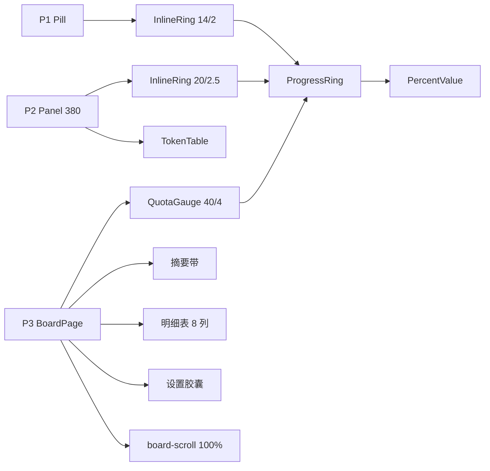

# Token 看板卡片化与三色环（前端重构）

> 状态：已实施（2.0.0 候选，未正式发布）<br>
> 完成时间：2026-11-05（基线 `1.3.0`；2.0.0 仅打包/安装，未 tag）<br>
> 关联逻辑根：`dsh-token-dash`（`client.js`）<br>
> 关联资料：[`ui-design.md`](../../../ui-design.md)（v3.5）、施工稿（已归档）[`board-redesign-build-checklist.md`](../../../checklist/archived/board-redesign-build-checklist.md)、设计决策（已归档）[`board-visual-review-checklist.md`](../../../checklist/archived/board-visual-review-checklist.md)、原型 [`tools/preview/templates/`](../../../../tools/preview/templates/)、历史方案 [`feature_fullpage_board.md`](feature_fullpage_board.md)

## 一、最终需求与范围

| ID | 最终处置 | 需求 / 边界 / 风险 | 最终结论 |
|---|---|---|---|
| REQ-01 | 完成 | 组件拆分：`ProgressRing` / `PercentValue` / `InlineRing` / `QuotaGauge` | 环只画几何，数字与文案归组合层 |
| REQ-02 | 完成 | 三色语义：normal 绿 / warn 黄 / critical 红，环与数字同色 | `stateOf` / `percentText` 唯一实现 |
| REQ-03 | 完成 | 金额去绿，负数 / 超支红 | 金额用前景色 + 600 |
| REQ-04 | 完成 | P1：`InlineRing` 14/2，最多 3 窗，箭头 SVG，空态 `--` | 与 `page-p1.html` 一致 |
| REQ-05 | 完成 | P2：固定 380；单行摘要；范围条满宽；订阅三槽位；表格右对齐 | 三组摘要（环 / 已用预算 / 余额），尾部空槽 |
| REQ-06 | 完成 | P3 按量区：每 provider 一卡，卡宽 ≤260、末行居中 | 3 家一行 3 张、520 两行 2+1 |
| REQ-07 | 完成 | P3 订阅区：窗口一排、缺窗不出列 | 1000/760/520 = 4/3/2 列 |
| REQ-08 | 完成 | 范围 + 摘要带 + 8 列明细合并底框 | 模型列 240、数值列 1fr、字号 13 |
| REQ-09 | 完成 | 设置胶囊三行；第一行刷新间隔 / 账户余额 | 去掉「立即刷新」，按钮蓝色 |
| REQ-10 | 完成 | 内容宽 1000 / 内容 952；P3 自持纵向滚动 | `board-scroll` 100% + `overflow-y:auto` |
| REQ-11 | 完成 | E2E：环同色、P2 固定宽、右对齐、滚动、胶囊两组 | 79 单测 + e2e 通过 |
| REQ-12 | 完成 | 文档与截图：README、CHANGELOG、`npm run shots` | 截图与实现一致 |
| REQ-13 | 完成 | P2 移除「本月已花」，前三槽不变 | 4 列网格；第 4 列空；VM 不动 |
| BND-01 | 保持 | 不改数据接口、provider 清单与预算持久化 | 前端只消费现有 VM |
| BND-02 | 保持 | 不改宿主入口 `main` / `sidebar.panellist` | 但 `conversation.hero.agentPreset` 需在后续 Issue 移除 |
| BND-03 | 保持 | 不引入组件库 / CSS 框架 / 构建链 | 内联样式 + token |
| BND-04 | 保持 | 不做主题切换与自定义配色 | 只消费宿主 token |
| RSK-01 | 已验证 | 环色断言随主题变化 | e2e 只断言环与数字同色 |
| RSK-02 | 已验证 | P2 长 provider 名撑宽 | 固定 380；模型列 150 + 省略号 |
| RSK-03 | 已验证 | 卡片化改动面大 | S0→S4 串行 |
| RSK-04 | 已验证 | 窄屏摘要带过高 | ≤560 单列；明细内部滚动 |
| RSK-05 | 已验证 | P2 删第四组后余额被推右 | 4 列网格 + 尾部空槽；e2e 断言余额不贴右 |

## 二、最终实现

### 改动总览

| ID | 文件 | 开发改动说明 |
|---|---|---|
| CHG-01 | `client.js` · `ProgressRing` / `stateOf` / `percentText` | 环收窄为几何；统一三态与格式化 |
| CHG-02 | `client.js` · `PercentValue` / `InlineRing` / `QuotaGauge` | P1/P2 内联、P3 堆叠三种组合 |
| CHG-03 | `client.js` · `Pill` | `InlineRing`；最多 3 窗；SVG 箭头；空态 |
| CHG-04 | `client.js` · `Panel` / `PanelHeader` | 固定 380；头部 space-between；满宽范围条 |
| CHG-05 | `client.js` · `P2Summary` / `P2Windows` | P2 三组摘要；订阅三槽位，两窗占前两槽 |
| CHG-06 | `client.js` · `TokenTable` / `DetailTable` | 行高 28、6% 分隔、aria；数值右对齐，列距 8 |
| CHG-07 | `client.js` · `BudgetTable` | 卡片布局；竖排 Gauge + 预算 + 三行 |
| CHG-08 | `client.js` · `QuotaTable` / `QuotaCell` | 订阅卡；窗口一排；缺窗不出列 |
| CHG-09 | `client.js` · `RangeCards` / `DetailTable` | 摘要带 + 明细底框；模型 240、数值 1fr/13px |
| CHG-10 | `client.js` · `SettingsRows` | 三行；第一行只剩刷新间隔 / 余额；按钮蓝 |
| CHG-11 | `client.js` · `BoardPage` / `boardScroll` | 自持滚动；内层 1000；页头两按钮 44×26 |
| CHG-12 | `client.js` · `styles` / `EN` / `ZH` | 4px 六档、蓝色按钮、状态 caption |
| CHG-13 | `scripts/e2e.mjs` | 卡片结构、环同色、P2 固定宽、右缘、胶囊、滚动、列宽 |
| CHG-14 | `tools/mock/fixtures.mjs` / `shots.mjs` | 7 家 provider；新布局截图 |
| CHG-15 | `README.md` / `README.en.md` / `ui-design.md` / `design.md` | 卡片、摘要带、三色环、间距、滚动 |
| CHG-16 | `CHANGELOG.md` | 1.3.0-local.1~7；后续 1.3.0 / 2.0.0 |
| CHG-17 | `client.js` · `P2Summary` / `summaryRow` | 删除「本月已花」；4 列网格保留尾部空槽 |

### 2.1 最终结构



### 2.2 关键决策与陷阱

| 项 | 最终结论 |
|---|---|
| P2 宽度 | 固定 380（`max-width: calc(100vw - 16px)`），避免切 provider 跳宽 |
| P2 摘要 | 4 列网格 `auto minmax(120px,1.2fr) minmax(80px,1fr) minmax(0,1fr)`；只放三组，尾部空 |
| P2 订阅 | 三槽位：第 1 窗左、第 2 窗中、第 3 窗右；两窗占前两槽 |
| P2 表格 | 模型 150 + 省略号；Tokens 括号 11px；列距 8 |
| P3 明细 | 模型 ≤240；7 个数值列 `minmax(56px,1fr)`；数值 13 / 表头 11 |
| P3 滚动 | `board-scroll` 自持滚动，滚动条贴窗口右缘；不改宿主 `main` |
| 胶囊 | 第一行刷新间隔（左）/ 账户余额（右）；按钮蓝；底部 32 |
| 间距 | 4 / 8 / 12 / 16 / 24 / 32；1px 只给描边与分隔线 |
| 环 | `percent=0` / `empty` 不画弧；warn 环与数字同黄 |
| 缺窗 | 按实际窗口数出列，不渲染占位 |

### 2.3 反馈收口

| Issue | 结论 |
|---|---|
| #1 4px 间距 | 六档落地；表格列距归 #2、胶囊底部归 #3 |
| #2 表格右对齐 | P3 12→8；P2 6→8 + Tokens 右对齐 |
| #3 P3 页头/胶囊 | 两按钮 44×26；胶囊三行、按钮蓝、底部 32 |
| #4 P3 滚动/列宽 | 去立即刷新；自持滚动；模型 240 + 数值 1fr/13 |
| #5 P2 本月已花 | 删除第四组；三组 + 尾部空槽；VM 不动 |

## 三、不改动 / 边界

- 不改数据接口、provider 清单与预算持久化格式。
- 不改宿主入口 `main` / `sidebar.panellist`；`conversation.hero.agentPreset` 的冲突留给后续 Issue #1（GitHub）。
- 不引入组件库 / CSS 框架 / 构建链；`client.js` 仍是唯一产物。
- 不做主题切换与自定义配色。

## 四、最终验收

| 项 | 方式 | 结果 |
|---|---|---|
| 组件拆分与环同色 | 代码走查 + e2e | 通过 |
| P1 14/2、三窗、空态 | e2e + 截图 | 通过 |
| P2 固定 380、三组摘要、满宽范围条 | e2e 量宽 + 截图 | 通过 |
| P3 卡片 4/3/2、缺窗不出列 | 三档截图 | 通过 |
| 摘要带 / 明细右对齐 | e2e 右缘断言 | 通过 |
| 胶囊两组、蓝色按钮、底部 32 | e2e 坐标 + 截图 | 通过 |
| P3 自持滚动 | `scrollHeight > clientHeight` | 通过 |
| P2 删除本月已花 | e2e 三组 + 截图 | 通过 |
| 单测 / e2e | `npm test` / `npm run e2e` | 79 通过 / e2e 通过 |
| 安装验证 | desktop profile | `2.0.0` 候选已安装 |

## 五、计划—实际偏差

```text
计划 P2 fit-content 280–480 → 固定 380
计划 胶囊三组含「立即刷新」→ 两组（间隔 / 余额）
计划 明细模型列 1.6fr → ≤240 + 数值 1fr
计划 宿主中栏滚动 → BoardPage 自持滚动
计划 P2 四组摘要 → 三组 + 尾部空槽（2.0.0）
```

## 六、关联资料

- 设计契约：[`ui-design.md`](../../../ui-design.md) v3.5
- 视觉决策：[`board-visual-review-checklist.md`](../../../checklist/archived/board-visual-review-checklist.md)
- 施工记录：[`board-redesign-build-checklist.md`](../../../checklist/archived/board-redesign-build-checklist.md)
- 原型：[`tools/preview/templates/`](../../../../tools/preview/templates/)
- 历史方案：[`feature_fullpage_board.md`](feature_fullpage_board.md)
